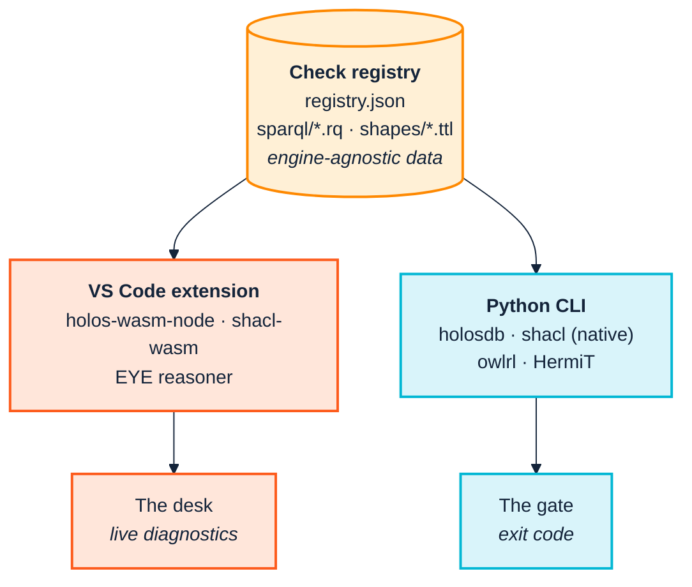

<p align="center">
  
</p>

# 7. The toolchain

> *Part II — The SemOps frame*

When I wrote the first edition of this manual there were two tools: one for the
author's desk and one for the build. There are six now. The count is the least
interesting thing about it, though. What changed is who wrote the engines.

Why would anyone write their own SPARQL engine in 2026? Not for speed. Fast
ones exist, and racing them is a race already lost. The reason is the one this
chapter keeps coming back to. **A lenient engine let a check pass in the
suite's own tests and fail in the field**, and the only way to stop that
happening again was to evaluate the rules on engines that do what the
specification says, and that someone in the room can fix.

| | Role | What it is | Where |
|---|---|---|---|
| **Ontology Development Suite** | The desk | VS Code extension: live diagnostics, outline, graph view, query workbench, and a TypeScript DSL for writing ontologies as code | [`.vsix` from the release](https://github.com/pwin/consolidated-ontology-quality-suite-webapp/releases/tag/v0.15.0) · DSL on npm as [`ontology-suite`](https://www.npmjs.com/package/ontology-suite) · [GitHub](https://github.com/pwin/consolidated-ontology-quality-suite-webapp) |
| **Ontology Quality Suite** | The gate | Python CLI and library: the 61-check registry, OWL2 reasoning, version diffing, change impact and repair, live-store checks, reference docs | PyPI [`ontology-quality-suite`](https://pypi.org/project/ontology-quality-suite/) · [GitHub](https://github.com/pwin/consolidated-ontology-quality-suite-python) |
| **SHACL Engine** | The validator | SHACL in Rust: Python bindings, WebAssembly and a CLI; SHACL-AF rules; 425 of the 426 W3C tests, the exception named | PyPI [`shacl`](https://pypi.org/project/shacl/) · npm [`shacl-wasm`](https://www.npmjs.com/package/shacl-wasm), [`shacl-wasm-node`](https://www.npmjs.com/package/shacl-wasm-node) · CLI from the [releases](https://github.com/pwin/SHACL_Engine/releases) |
| **HOLOS** | The store | An RDF 1.2 store with SPARQL 1.2 and access policy enforced at the index scan | PyPI [`holosdb`](https://pypi.org/project/holosdb/) · npm [`holos-wasm`](https://www.npmjs.com/package/holos-wasm), [`holos-wasm-node`](https://www.npmjs.com/package/holos-wasm-node) · CLI from the [releases](https://github.com/pwin/triplestore/releases) |
| **tarka** | The triplifier | CSV, Parquet and Polars data frames to RDF, through TARQL queries or OTTR templates | PyPI [`tarka-rdf`](https://pypi.org/project/tarka-rdf/) · CLI from the [releases](https://github.com/pwin/tarka/releases) |
| **The testing repository** | The evidence | Deliberately broken ontologies, and a 38-question competency board, asserting what the suite must and must not report | [GitHub](https://github.com/pwin/consolidated-ontology-quality-suite-python-testing) |

Two of these you install on every machine (the extension and the suite). Two
you mostly meet *inside* the others, because the suite and the extension
evaluate on them (the SHACL engine and HOLOS). One replaces a step you already
have (tarka, for triplification). And one you never install at all, but should
read, because it is how the rest are kept honest.

> **Versions this edition was measured against.** Every number in Part III
> comes from running these, on 13 October 2026:
>
> | | Version | From |
> |---|---|---|
> | Ontology Quality Suite | **0.22.0** | PyPI `ontology-quality-suite` |
> | Ontology Development Suite | **0.15.0** | `ontology-dev-suite-0.15.0.vsix` from the v0.15.0 release; DSL as npm `ontology-suite` 0.15.0 |
> | SHACL Engine | **0.3.2** | PyPI `shacl`; npm `shacl-wasm`, `shacl-wasm-node`; the `shacl` command from the v0.3.2 release |
> | HOLOS | **0.21.0** | PyPI `holosdb`; npm `holos-wasm`, `holos-wasm-node`; the `holos` command from the v0.21.0 release |
> | tarka | **0.1.1** | PyPI `tarka-rdf`; the `tarka` command from the v0.1.1 release |
> | Testing repository | `6d078a1` | `main`, 8 October 2026 |
>
> These move quickly. The suite went from 0.14.2 to 0.22.0 between this
> edition and the last, and the engine underneath every check changed. Yet
> every figure in [Chapter 9](09-continuous-integration.md) came out the
> same. That's no accident, and §7.1 says why. Pin your own versions anyway,
> for the reasons in [Chapter 9](09-continuous-integration.md) §9.2.

---

## 7.1 The idea: one registry, two runtimes, one set of engines

The suite's quality rules are not code. They are **data**: a `registry.json`
plus a directory of SPARQL `.rq` files and SHACL `.ttl` shape files. The Python
CLI reads that data. The VS Code extension reads *the same data*, copied into
its own `resources/checks-registry/`. And since the end of September both of
them evaluate it on the same two engines.



The consequence is still the thing to hold on to:

> **The rule that fails your build is the same rule that underlined the problem
> in your editor twenty minutes earlier.**

In the first edition, that sentence meant "the same *data*". By the last
edition the SHACL half also ran on one engine, the Rust validator, compiled
natively for the CLI and to WebAssembly for the editor. Now the SPARQL half
does too: the 44 portable checks run on **holosdb** in Python and on
**holos-wasm-node** in the editor, both at 0.21.0. The rule, the engine and the
version are the same on both sides.

Why does that matter so much? Because a team whose local linting disagrees with
its CI learns to distrust both. Green locally, red in CI, and the gate becomes
something to work around rather than something that helps. Sharing the rules
as data is what stops the disagreement starting. Sharing the engines is what
stops it creeping back in.

### Why own the engines

Here is the story that decided it, because it is the clearest case I know of a
dependency being *too kind*.

`STY-003` reports a label with no language tag. Its message was built with
`STR(?e)`. SPARQL 1.1 (§17.4.2.5) defines `STR()` for literals and IRIs only,
so `STR()` of a blank node is a type error. And on a real ontology most
labelled things *are* blank nodes: anonymous restrictions and axioms carrying
an `rdfs:label`.

What happened next depended on the engine:

- **rdflib**, which the suite used, does not raise. It returns the blank
  node's internal identifier, so the message was present and named something
  meaningless that changed on every run.
- **Oxigraph**, which the extension used, raises as the specification says.
  The `CONCAT` errors, the `BIND` leaves the variable unbound, and the message
  vanishes. On the suite's stress fixture, 60 of 65 findings had no message at
  all.

Every test in the suite passed throughout. The check fired at the right count,
the right severity and the right focus node. It shipped like that in the
extension. What found it was a new test that ran every check under *two* SPARQL
engines and failed on any disagreement.

The lesson the suite drew is worth borrowing whole. Its own engines now do the
evaluating, and the third-party engines it used to depend on stay in the
development group, as dissenting witnesses:

| Engine that does the work | Checked against | Why keep the witness |
|---|---|---|
| holosdb (SPARQL) | rdflib, pyoxigraph | pyoxigraph is what the extension used to ship, so it speaks for those users |
| `shacl` (SHACL) | pyshacl | pyshacl caught a real regression in the native engine, `isIRI($this)` on blank nodes, in 0.1.5 |

> **A dependency's leniency is a defect waiting for a stricter reader.** If
> your checks will ever run somewhere else (a partner's validator, a browser, a
> store), test them under a conformant engine too, and keep the lenient one as
> a witness rather than a judge.

The move had costs, and the suite is candid about them. Blank-node labels are
document-scoped, and different engines rename them, so two arms of one check
stopped agreeing about which anonymous node they meant. The dedup now pairs
anonymous findings by position within *(check, path, value)* instead. A message
must never be built out of a label, so both repositories now render an
anonymous focus node as the literal text `[a blank node]`, identically, so the
two arms still merge. And `--inference owlrl` left the checks path, because
pyshacl was what served it (§7.4).

### Shared does not mean identical

The extension carries an exact copy of the 61-check registry, with the same
ids and the same ten categories. Then it adds three of its own with no CLI
equivalent: `MDL-001`/`002`/`003`, modelling-guidance checks informed by gist.
So the editor can flag something CI never will. That is the right way round.
Advice belongs where the author is, and a build gate should not fail on a
matter of modelling taste. Still, it's worth knowing before someone asks why a
warning they saw while typing never appears in the pipeline.

### Being in the registry is not the same as being runnable

I got this wrong in an earlier edition, so let me be exact about it. `VOC-001`,
the closed-world vocabulary check in [Chapter 8](08-model-and-validate.md),
moved out of the extension's private extras *into the shared registry*, and I
reported that as "so CI runs it too". It does not. Nothing in the Python
package implements it; only `registry.json` mentions the id.

What the registry is, really, is a **shared vocabulary of findings**: id,
title, severity, category, remediation. Being declared makes a finding
*nameable by both sides*. Being implemented makes it *producible by one*. The
suite's own docs now put it in five words: **the registry declares; the
directories decide.** A query with no registry entry still runs and reports as
`UNMAPPED`. An entry with no file never fires.

Neither side runs all sixty-one. Three are the extension's alone (`VOC-001`,
`REA-005`, `REA-006`), on top of the three `MDL` checks outside the registry.
Eleven are the CLI's alone: `REA-020`/`021`/`022` need a full DL reasoner;
`REA-010`/`011`/`012` are OWL2 profile membership, which the extension computes
but does not report as findings; `CNF-001`/`002`/`005` need a two-graph split
the editor does not have; and `TQL-004`/`005` read a graph only the CLI builds.

**Both repositories pin their own exception list, and each names the
other's.** That is the part to copy. A shared registry with no such list is a
promise the UI does not keep, because a check that cannot fire is
indistinguishable from a check that found nothing. Publishing the rules is the
easy half. Publishing **what your implementation actually does with them** is
the half that makes the rules trustworthy across an organisational boundary
([Chapter 3](03-across-the-boundary.md)).

### Shared data is not shared behaviour

The registry travels as data, so a test can compare the two copies character
for character, and one does. But a handful of algorithms are written twice,
once in Python and once in TypeScript, and a test that compares files cannot
see them.

The one that proved it decides which text a tool may rewrite: `strip_comments`
in the CLI, behind `--apply-repairs`, and `stripComments` in the extension,
behind rename and find-references. Both shipped the same defect for the same
reason. A scan skipped a line *beginning* with `#` but read a trailing comment
in full, so this line

```turtle
ex:Dog a owl:Class .  # was ex:Dgo, renamed 2026-09-04
```

recorded an occurrence of `ex:Dgo` **inside the remark**. Rename it and the note
explaining the rename was rewritten too, turning a true comment into a false
one. Both sides were fixed in the same week, independently, in two languages,
and nothing noticed they had been wrong together.

The fix is a fixture of sixteen cases that **both repositories carry**, written
by hand from the intent rather than generated from either implementation. That
detail is what makes it work. **A fixture derived from the code only restates
what the code already does, and would have agreed with both ports on the day
they were both wrong.** You will meet the same principle again in
[Chapter 10](10-ingest-and-transform.md), where a tool generates SHACL shapes
from a mapping: useful, and for exactly the same reason unable to tell you the
mapping is wrong.

The same discipline now runs in the other direction too. The blank-node
message fix and the positional dedup landed in both repositories within hours
of each other, each written against its own stack and each tested end to end
through both real engines. Neither was copied across on trust.

> **Wherever one rule has two runtimes, sort what you share into data and
> behaviour.** Publish the data and compare copies. Guard the behaviour with a
> fixture written from the intent. A conformance suite a vendor generates from
> their own product tells you nothing about whether they agree with anyone
> else.

---

## 7.2 Installing them

### The Python suite

[PyPI](https://pypi.org/project/ontology-quality-suite/) ·
[source](https://github.com/pwin/consolidated-ontology-quality-suite-python) ·
requires Python 3.11+

```bash
pip install ontology-quality-suite
```

or, working from a checkout:

```bash
uv sync
```

That one line now brings both engines: `holosdb` and `shacl` are runtime
dependencies, not options. (`uv sync --extra native-shacl` still parses but
installs nothing; plain `uv sync` used to *uninstall* the native engine and
quietly move the default back to pyshacl, which is why it was promoted.) It
also brings `owlready2`, the bridge to HermiT. What is genuinely optional is a
**Java runtime** for HermiT to run in. Without one you still get the always-on
`owlrl` closure and pattern checks, which catch the fixture's deliberate
contradiction on their own, and an explicit `REA-022` finding telling you the
DL reasoner did not run ([Chapter 4](04-from-research-to-industry.md)).

> **Upgrading a checkout.** `uv pip install --upgrade` does not move a locked
> dependency, because `uv run` re-syncs from `uv.lock`. `uv lock
> --upgrade-package holosdb` is the step. The suite learned this the hard way.
> Its own lock went stale at 0.14.3 for a while without anyone noticing, and
> the 0.22.0 release locked holosdb at 0.15.0 while a fresh install resolved
> 0.16.0, so its tests ran against a version no new user would get.

Two invocation styles appear in this manual:

```bash
ontology-quality-suite <command> ...        # installed entry point
python -m ontology_suite <command> ...      # module form, from a checkout
```

They are equivalent. The module form is used in Part III because that is how
the commands were actually run while writing it.

### The VS Code extension

[Source](https://github.com/pwin/consolidated-ontology-quality-suite-webapp) ·
[latest release](https://github.com/pwin/consolidated-ontology-quality-suite-webapp/releases/latest)

It is not on the Marketplace, so download the `.vsix` from the release and
install it with *Extensions: Install from VSIX…*, or:

```bash
code --install-extension ontology-dev-suite-<version>.vsix
```

Core functionality has **no external runtime dependency at all**:
`holos-wasm-node`, `shacl-wasm-node` and `eyereasoner` are WebAssembly. Oxigraph
went in 0.13.11, and the `.vsix` dropped from 20.2 MB to 17.5 MB with it.

> One small packaging lesson rode along. `vsce package --no-dependencies`
> produces an archive that packages and installs without error and **contains
> none of the engines**, because they are loaded from `node_modules` at run
> time. The extension then quietly offers fewer checks. The build now reads its
> own archive back and fails if an engine is missing. The size was the only
> clue the first time.

The Python CLI is detected via `ontologySuite.pythonCliPath` or on `PATH`, and
is used only for the commands that genuinely need it: *Run Deep Validation*
(full OWL2 DL reasoning), *Run Full Triplify* (the `oxi-gen` binary) and
*Generate Documentation*. All three degrade gracefully when it is absent.

### The DSL, outside the editor

```bash
npm install --save-dev ontology-suite
```

That makes `import … from 'ontology-suite/dsl'` resolve in CI, in another
editor, or under Node, where `build()` returns the ontology as RDF/JS quads.
Keep it at the same version as the extension. [Chapter 8](08-model-and-validate.md)
§8.2 shows what it is for.

### The engine, the store and the triplifier

Each comes two ways: as a library from PyPI (and, for two of them, npm), and as
a command from its GitHub release.

```bash
pip install shacl          # the SHACL engine, as a Python library
pip install holosdb        # HOLOS, as a Python library
pip install tarka-rdf      # tarka, as a Python library (imported as tarka_rdf)

npm install shacl-wasm     # or shacl-wasm-node, for require()
npm install holos-wasm     # or holos-wasm-node, for require()
```

**The wheels are libraries only.** Of the four PyPI packages in this manual,
only `ontology-quality-suite` installs a command. The `shacl`, `holos` and
`tarka` commands used in Part III come from the release archives on GitHub
([SHACL Engine](https://github.com/pwin/SHACL_Engine/releases),
[HOLOS](https://github.com/pwin/triplestore/releases),
[tarka](https://github.com/pwin/tarka/releases)), built for Linux, macOS and
Windows, each release with a `SHA256SUMS` file. Check it. An earlier edition
said `pip install shacl` brought the command line too; it does not.

Watch the names. `shacl` on crates.io is a different project, and so is `tarka`
on PyPI and npm, which is why the Python package is `tarka-rdf`.

That zero-dependency property of the extension is still a governance fact, not
just a convenience. As [Chapter 3](03-across-the-boundary.md) argues, a
validation step that requires a JVM excludes a class of supply-chain partners
from self-service compliance. The same goes for the single-binary engine and
triplifier: a partner can run them without procuring anything.

---

## 7.3 Decision table: question → command

| You want to… | Run | Chapter |
|---|---|---|
| Know if the ontology itself is sound — no data | `ontology` | [8](08-model-and-validate.md) |
| Run the full registry against ontology and/or data | `checks` | [8](08-model-and-validate.md), [9](09-continuous-integration.md) |
| See only findings in terms **you** own | `checks --own-namespace <IRI prefix>` | [9](09-continuous-integration.md) |
| Group findings under questions in your own words | `--themes <file>` | [9](09-continuous-integration.md) |
| Write only the two reports a person and a script read | `--reports minimal` | [9](09-continuous-integration.md) |
| Run your house rules *alongside* the built-in ones | `--sparql my-checks/ --sparql @builtin` | [8](08-model-and-validate.md) |
| Check CSV→RDF queries against the ontology, no CSV needed | `sketch` | [10](10-ingest-and-transform.md) |
| Actually produce RDF from CSV or Parquet | `tarka run` (or `triplify`, which drives oxi-gen) | [10](10-ingest-and-transform.md) |
| Load the output straight into a store | `tarka run … --post <GSP endpoint>` | [10](10-ingest-and-transform.md) |
| Assess real triplified data | `data` | [10](10-ingest-and-transform.md) |
| Derive triples with SHACL-AF rules | `shacl … --advanced` | [11](11-rules-and-inference.md) |
| Compare two versions, get MAJOR/MINOR/PATCH | `version-diff` | [12](12-release-and-change.md) |
| Find and auto-repair ontology↔query drift | `consistency` | [12](12-release-and-change.md) |
| Check a controlled-vocabulary layer too | `pattern-consistency` | [12](12-release-and-change.md) |
| Run the checks against a **live** store | `consistency-remote` | [13](13-operate-and-consume.md) |
| Answer a query as a particular person | `holosdb`: `Store.query(…, principal=, policy=)` | [13](13-operate-and-consume.md) |
| Produce something a stakeholder can read | `docgen` | [13](13-operate-and-consume.md) |
| Run everything applicable, one report | `run` | [9](09-continuous-integration.md) |

And the editor-side equivalents, by VS Code command:

| You want to… | Command |
|---|---|
| Start a new ontology with imports wired up | *New Ontology* |
| Add a class in the right place in the hierarchy | *Add Class or Category* / *Add Subclass* / *Add Sibling Class* |
| Write the ontology as a TypeScript script | *Run Ontology Script (.ontology.ts)* |
| Run the registry locally, in-process | *Run Local Checks* |
| See the model as a picture | *Visualize Subject Graph* |
| Draft an ontology and query from a raw CSV | *Infer Ontology + Query from CSV* |
| Preview a transformation against sample rows | *Open Query Workbench* |
| See DL expressivity and OWL2 profile membership | *Show Metrics & DL Expressivity* |
| Escalate to full OWL2 DL reasoning | *Run Deep Validation* |

---

## 7.4 Two flags worth knowing before you start

### `--engine`

`checks`, `data` and `run` accept `--engine`. Since 0.22.0 the choice is
simpler than it was, because there are no longer two SHACL engines to choose
between: `shacl` and `native` are the same thing now, and so are `both` and
`native+sparql`. Both spellings survive because scripts pass them.

All modes, against this manual's fixture with `--own-namespace`, same ontology,
same registry:

| `--engine` | Findings | Severity split | What it runs |
|---|---|---|---|
| `native` / `shacl` | **22** | 1 V / 21 W | The SHACL shapes only. **Misses `QUA-004`**, which exists only as a SPARQL check |
| `sparql` | **23** | 1 V / 22 W | The `.rq` checks only, on holosdb. The numbers used throughout this manual |
| `native+sparql` / `both` | **23** | 1 V / 22 W | Both, deduplicated. The default |

**Neither formulation is complete alone.** The registry is implemented as 44
SPARQL `.rq` files and 6 SHACL shape files, and they do not cover the same
checks. If you want a single-formulation mode, `sparql` is the one with the
broader registry behind it.

On the unscoped run the three take about 1.7 s (`native`), 2.0 s (`sparql`) and
2.2 s (`native+sparql`), whole process, on the laptop this edition was measured
on. So the choice is not about speed at this size.

**The severity lesson is about shape authoring, not engines.** Until 0.6.0
`--engine both` reported 5 Violations where `native+sparql` reported 2 on
identical findings. The shapes declared `sh:severity` *inside* each nested
`sh:sparql [ … ]` block, where SHACL defines it as a property of the
**enclosing shape**. The native engine read it there anyway; pyshacl fell back
to the spec default of `sh:Violation`. With `--fail-on Violation`, a class named
`person_record` failed CI exactly as hard as a logical contradiction. Moving
the declaration onto the shape fixed it.

I tripped over the same thing myself while testing the engine for this
edition, one level over. I put `sh:severity sh:Warning` on a node shape, and the
result came from its nested property shape, which still defaulted to
Violation. **Severity belongs to the shape that produces the result.** If your
gate is failing on something you declared `Warning`, look at where the
declaration sits before you blame the engine.

> **`--inference owlrl` and `both` are gone from the checks path.** pyshacl
> served them, and the native engine has no OWL2-RL reasoner. Downgrading
> silently to RDFS would have dropped findings that depend on OWL2-RL rules, so
> the suite refuses and points you at the reasoning stage, which still builds
> an `owlrl` closure. Two small rough edges remain: `--help` still offers
> `owlrl` and `both` as choices, and asking for one produces a Python
> traceback rather than a one-line diagnostic. Loud is right; a stack trace is
> not quite the way to be loud ([Chapter 14](14-coverage-and-gaps.md) §14.4).
>
> **And under `--engine sparql` it is not loud at all.** Only the SHACL arm
> applies `--inference`, so with no SHACL arm the flag is accepted and ignored.
> `--inference owlrl`, `--inference rdfs` and no flag all return the same 479
> findings. A pipeline that asks for `sparql` with `owlrl` passes, having
> inferred nothing. Even under the default engine, `rdfs` reaches only the
> shapes; the `.rq` checks never see the inferred triples. If a check depends on
> inference, run the reasoning stage.

### `--verbose`

Every subcommand takes `-v`/`--verbose`, which prints what each input option
actually resolved to *before* running: which files matched a glob, which
`owl:imports` resolved and from where, which engine ran.

Reach for it whenever a result looks surprising, before assuming a bug. Most
"the tool is wrong" reports turn out to be an `owl:imports` that quietly did
not resolve, and `--verbose` shows that in one line. There is a worked instance
of exactly this kind of mistake in [Chapter 9](09-continuous-integration.md),
where an IRI prefix off by one character produced a confidently empty report.

---

## 7.5 The fixture used throughout Part III

Every command in Part III runs against
[`examples/acme_robotics/`](https://github.com/pwin/consolidated-ontology-quality-suite-python/tree/develop/examples/acme_robotics)
in the Python suite: a small org chart built on two real, standards-track
vocabularies rather than an invented domain.

| Vocabulary | Used for |
|---|---|
| W3C Organization Ontology (`org:`) | `org:OrganizationalUnit` as the base class for departments |
| FOAF (`foaf:`) | `foaf:Person` as the base for employees; `foaf:name`, `foaf:mbox` |

The fixture is **deliberately imperfect**, with each flaw commented with the
check it demonstrates:

| Term | Flaw | Check it triggers |
|---|---|---|
| `acme:Contractor` | `rdfs:subClassOf acme:Employee` **and** `owl:disjointWith acme:Employee` | `LOG-001`, logically unsatisfiable |
| `acme:hasSkill` | no `rdfs:label`, and no `skos:prefLabel` either | `QUA-001`, `QUA-004` |
| `acme:reports_to` | local name is not lowerCamelCase; no domain or range | `STY-002`, `STR-003` |

Each deliberate flaw produces **exactly one finding**, which is what makes the
fixture usable for teaching: every finding traces to a line someone wrote on
purpose.

The scoped run in [Chapter 9](09-continuous-integration.md) reports **23**, and
the gap is instructive rather than a discrepancy. Eighteen of those 23 are
`QUA-009` and `QUA-010`, nine each: a documentation policy the registry asks
for (a `skos:prefLabel` per language, a `skos:definition`) that this fixture
does not follow. **That is one decision you have not taken, reported nine
times, not nine mistakes.** Telling those two apart is the subject of
[Chapter 9](09-continuous-integration.md) §9.4.

`acme-org-v2.ttl` is a plausible next release. It renames `acme:Engineer` to
`acme:SoftwareEngineer` (a breaking change, *with* a migration annotation) and
adds one genuinely additive class and property. It deliberately leaves the
flaws above untouched, because real releases do not fix everything at once.

Using real external vocabularies rather than toy ones is what makes Chapters 9
and 10 possible. The most valuable lessons in this manual come from the
collision between a general-purpose checker and the conventions real
vocabularies actually use.

---

## 7.6 Where the deeper documentation lives

This manual is the SemOps layer. For tool-level depth:

| Document | Covers |
|---|---|
| Suite [`PRIMER.md`](https://github.com/pwin/consolidated-ontology-quality-suite-python/blob/develop/docs/PRIMER.md) | Task-oriented guide, worked examples, CI wiring |
| Suite [`CHECKS.md`](https://github.com/pwin/consolidated-ontology-quality-suite-python/blob/develop/docs/CHECKS.md) | All 61 checks, by category |
| Suite [`ARCHITECTURE.md`](https://github.com/pwin/consolidated-ontology-quality-suite-python/blob/develop/docs/ARCHITECTURE.md) | Which engine does the work, and why; file loading; benchmarks |
| Suite [`REPORTS.md`](https://github.com/pwin/consolidated-ontology-quality-suite-python/blob/develop/docs/REPORTS.md) | What each report is for, where finding positions come from, `--themes` |
| Suite [`EXTENDING.md`](https://github.com/pwin/consolidated-ontology-quality-suite-python/blob/develop/docs/EXTENDING.md) | Authoring your own checks; "the registry declares, the directories decide" |
| Suite [`REASONING.md`](https://github.com/pwin/consolidated-ontology-quality-suite-python/blob/develop/docs/REASONING.md) | Reasoner backends and their real limitations |
| Suite [`CONSISTENCY_AND_REPAIR.md`](https://github.com/pwin/consolidated-ontology-quality-suite-python/blob/develop/docs/CONSISTENCY_AND_REPAIR.md) | Finding-kind → fix-kind → confidence table |
| Suite [`FUSEKI.md`](https://github.com/pwin/consolidated-ontology-quality-suite-python/blob/develop/docs/FUSEKI.md) | Live-store manifest spec and Python API (any SPARQL endpoint) |
| Suite [`VERSIONING.md`](https://github.com/pwin/consolidated-ontology-quality-suite-python/blob/develop/docs/VERSIONING.md) · [`UPDATING.md`](https://github.com/pwin/consolidated-ontology-quality-suite-python/blob/develop/docs/UPDATING.md) | Semver for ontologies; sequencing and rollback |
| Extension [`README.md`](https://github.com/pwin/consolidated-ontology-quality-suite-webapp/blob/main/README.md) · [`TUTORIAL.md`](https://github.com/pwin/consolidated-ontology-quality-suite-webapp/blob/main/TUTORIAL.md) | The extension; Part 11 is the DSL |
| HOLOS [`ACCESS-CONTROL.md`](https://github.com/pwin/triplestore/blob/develop/ACCESS-CONTROL.md) · [`holosdb` README](https://github.com/pwin/triplestore/blob/HEAD/crates/holos-python/README.md) | Policy at the scan: the guarantee, and the Python API |
| tarka [`README.md`](https://github.com/pwin/tarka/blob/main/README.md) | TARQL, OTTR, data frames, shapes from mappings |
| SHACL Engine [`README.md`](https://github.com/pwin/SHACL_Engine) | Conformance, the `sh:conforms` default, rules, performance |

The testing repository deserves a sentence of its own, because you never install
it and it is the most useful of the lot to *read*.
[`consolidated-ontology-quality-suite-python-testing`](https://github.com/pwin/consolidated-ontology-quality-suite-python-testing)
holds seventeen deliberately broken ontologies, a 38-question competency board
with one folder per question, and a harness asserting which checks each one
must and must not trigger. Its
[`COMMANDS.md`](https://github.com/pwin/consolidated-ontology-quality-suite-python-testing/blob/main/COMMANDS.md)
gives every fixture as both a harness invocation and the equivalent bare CLI
command. [Chapter 9](09-continuous-integration.md) §9.8 is about the practice
it demonstrates.

---

| ← [6. Stages and stories](06-stages-and-stories.md) | [8. Model and validate →](08-model-and-validate.md) |
|---|---|
