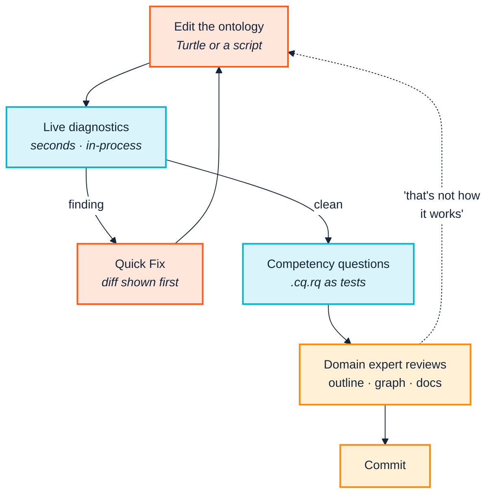

<p align="center">
  
</p>

# 8. Model and validate

> *Part III — The practice · SemOps stage 2 · Operating-model layer 2*

> **Stories answered here**
> *As an ontology engineer, I want to know whether the change I just typed broke
> anything, without leaving the editor.*
> *As a domain expert who does not read Turtle, I want to check the model matches
> how the business actually works.*
> *As a knowledge engineer, I want our own house rules enforced, not just generic
> ones.*

Think about how a child learns to spell. Nobody hands them a word list on
Monday and a red-pen verdict on Friday. Someone sits beside them, and the
correction arrives while the pencil is still on the page. That's the whole
argument of this chapter, and it applies to grown engineers with ontologies
just as well.

Stage 2 is where the artefact is written, and it gives the most leverage per
pound spent. A problem caught here costs a keystroke. The same problem caught
in CI costs a context switch; caught in production, it costs an incident and a
meeting.

---

## 8.1 The inner loop belongs in the editor

The SemOps pipeline blueprint lists "modelling and local validation" as a stage
in its own right, before CI, and that is not a formality. If the only way to
find out whether a model is sound is to commit and wait, the feedback loop is
minutes long. A minutes-long loop changes how people work: they batch changes,
commit less often, and stop experimenting.

The Ontology Development Suite exists to make that loop seconds long.
Everything below runs **in-process**, in WebAssembly, with no Python or Java
involved.

### Structure you can see

The Ontology Outline renders classes and properties as a nested, Protégé-style
hierarchy in the Explorer sidebar, with object and datatype properties kept as
separate subtrees rather than one flat list:

```
▾ Classes (4)
  ▾ Employee
      Contractor
      Engineer
    OrganizationalUnit
▾ Object Properties (2)
    works in
    reports to
▾ Datatype Properties (3)
    has skill
    has employee ID
```

This is the artefact from [Chapter 2](02-people-and-cognition.md) that a domain
expert can actually validate. Nobody needs to read an axiom to say *"Contractor
should not be under Employee — contractors are not on our payroll."* The
priesthood is defeated by rendering, not by training.

Authoring happens in the same tree: right-click any class or property for *Add
Subclass*, *Add Sibling Class* (which inherits the sibling's own parents) or
*Add Sub-property*. Dragging one class onto another adds an **additional**
parent. That is deliberately never a destructive move, and the confirmation
says so.

> Since 0.14.0 a restriction typed into those prompts resolves its names
> properly. Before that, a bare name such as `hasChild some Person`, the
> prompt's own example, was written as a relative IRI, `<hasChild>`. The
> extension's CHANGELOG gives a regular expression for finding any relative IRIs
> an earlier version left in your files. Run it once if you used the prompt.

### Live diagnostics, including one SHACL cannot give you

*Run Local Checks* evaluates the 44 SPARQL and 6 SHACL check files from the
same 61-check registry the CLI reads, plus OWL2-RL-style inference and
contradiction detection, into the standard Problems panel. The SPARQL checks
run on **holos-wasm-node** and the shapes on **shacl-wasm-node**: the same two
engines, at the same versions, as the CLI ([Chapter 7](07-the-toolchain.md)
§7.1).

It also runs **three checks the CLI does not have**, `MDL-001`/`002`/`003`,
modelling-guidance checks informed by gist. Advice belongs where the author is,
so seeing something here that never appears in CI is the design rather than a
discrepancy.

`VOC-001` below is a fourth of a different kind, and a correction I owe from
an earlier edition, where I said it had moved into the shared registry "so CI
runs it too". It is in the registry; the CLI still cannot produce it. Only the
extension implements it, along with `REA-005` and `REA-006`.
[Chapter 7](07-the-toolchain.md) §7.1 has the distinction between a check being
*declared* and being *runnable*, which is the one to hold on to when reading
`registry.json`.

**Eleven go the other way.** The editor cannot produce `REA-020`/`021`/`022`
(they need a full DL reasoner), `REA-010`/`011`/`012` (OWL2 profile membership,
which it computes for the status bar but does not report as findings),
`CNF-001`/`002`/`005` (a graph assessed against a *separate* ontology, where
*Run Local Checks* merges the document with its imports so there is no
"separate" left), or `TQL-004`/`TQL-005`
([Chapter 10](10-ingest-and-transform.md) §10.2), which query a graph the CLI
builds from a TARQL query and the editor does not.

Those last two are held back *explicitly*, and the reason is a good one. The
extension's coverage test treats the presence of a `.rq` file as proof the
check runs, which is true of every other directory. Left alone, they would have
counted as implemented while being unable to fire, so the exception list would
assert something false **and still pass**. A check that cannot fire and a check
that found nothing look the same from outside.

One check is worth calling out, because it covers a genuine blind spot in SHACL
itself. **`VOC-001`, the closed-world vocabulary check**, catches the typo:

```turtle
:bob a acme:Empolyee .     # note the transposition
```

SHACL's open-world semantics will never flag this. Nothing *contradicts* the
existence of an undeclared class; it is simply never asserted to exist. The
graph is valid. It is just about something that is not there.

`VOC-001` walks every triple's predicate and, for a fixed set of
term-referencing predicates (`rdf:type`, `rdfs:subClassOf`, `rdfs:domain`,
`rdfs:range`, `owl:equivalentClass`, `sh:targetClass` and others), its object
too, flagging any IRI not declared in the document or its resolved imports.

Critically, it is **scoped to namespaces the graph has some closed-world
knowledge of**: at least one term must already be declared there. An external
vocabulary that was never imported is left alone rather than flooded with false
positives. That is the same instinct as [Chapter 9](09-continuous-integration.md)'s
central lesson: **a check is only useful if its findings are about things you
control.**

**If you want this in CI, ask for `STR-001` instead.** Since the CLI cannot
produce `VOC-001`, the practical question is what does gate on the typo, and the
answer is the one-graph structural form of the same question. Run against that
file, the CLI reports `STR-001`; `VOC-001` is not among its findings. So the typo
*is* caught at the gate, under a different id and with narrower reach, since
`VOC-001` also covers the axiom positions. Know that before you write a CI rule
naming the id you saw in the editor.

### Quick Fix, with the diff shown first

Sixteen checks offer a one-click lightbulb repair, each computed from a real
SPARQL Update and completed where relevant by the project's own
`.ontology-suite/standards.json`. Nothing is ever written without an explicit
confirmation showing the exact triples that will change.

That confirmation is not timidity. An auto-fix that silently rewrites an
ontology teaches the team not to trust the tool, and one bad silent rewrite
costs more confidence than fifty good ones earn.

Two things the repair engine learned this autumn are worth knowing, because both
are the same shape: information lost on the way back into somebody's file.

- **It nearly renamed every blank node in the file.** Moving the engine to
  holosdb meant the store and the document labelled blank nodes differently, so
  a naive before-and-after diff gave one anonymous restriction two labels and
  counted its triples as added. Blank nodes now cross the boundary as
  `urn:x-holos-skolem:` IRIs and come back as blank nodes, so labels round-trip
  exactly, untouched triples keep their order, and a repair's diff shows only
  the repair.
- **It dropped a literal's base direction.** Applying an insert-kind fix
  rewrote `"x"@ar--rtl` as `"x"@ar`, silently changing the datatype from
  `rdf:dirLangString` to `rdf:langString`. Fixed in 0.13.12. An Arabic or
  Hebrew ontology is where you would have noticed, because `QUA-001` inserts a
  label in the project language.

Neither had a test until it was found. Both have one now.

### Refactoring that knows what is a comment

Rename, find-references and go-to-definition work on CURIEs across the
document, which turns renaming a term into a thirty-second job rather than a
careful grep.

All three depend on one decision, *which text counts as code*, and until 0.13.5
they got it subtly wrong. The scan skipped a line whose *first* non-space
character was `#` but read a **trailing** comment in full, so

```turtle
ex:Dog a owl:Class .  # was ex:Dgo, renamed 2026-09-04
```

recorded a use of `ex:Dgo` inside the remark. Renaming rewrote the note that
explained the rename. All three now mask comments first, with a scanner that
preserves offsets and knows that `#` is also the fragment separator in almost
every RDF namespace, so `<http://example.org/ns#Term>` survives intact.

**CURIEs inside string literals are still scanned, deliberately.** A term named
in an `sh:message` or an embedded query is a real reference, and dropping those
would make find-references quietly incomplete. The CLI reaches the same
behaviour from the opposite direction, because a TARQL IRI template is built out
of string literals ([Chapter 12](12-release-and-change.md) §12.4). One
behaviour, two reasons. It is also the same defect the CLI carried, found
independently in both, which is the story [Chapter 7](07-the-toolchain.md) §7.1
tells.

### A warning that says where it actually looked

The unresolved-import warning used to read *"no workspace file declares this
identity or `owl:versionIRI`"*. Only the first three words were wrong, and they
were the ones a reader acts on: resolution walks the **document's own directory
tree**, never the workspace. It now names the directory it searched and how
many ontology files it found there, which separates the two causes an IRI alone
cannot: **none found**, so check the location; or **candidates, none
matching**, where the real cause is usually a file with no `a owl:Ontology`
header. **A diagnostic should assert only what it checked.** That is an easy
mistake to make in your own SHACL messages too.

### Metrics and expressivity, live

*Show Metrics & DL Expressivity* reports OntoQA-style schema metrics (class and
property counts, inheritance and relationship richness, hierarchy depth), a
DL-expressivity label such as `ALCHIQ(D)`, and OWL2 EL/QL/RL profile badges.
The label also sits in the status bar.

The ontology is never *restricted* to a profile. The display just shows where it
sits, which lets you develop deliberately in a lighter profile when a consumer
needs one, and notice the moment a casual edit pushes you out of it.

### Seeing what the reasoner adds

*Visualize Subject Graph* renders a subject's neighbourhood as SVG through
Graphviz compiled to WASM. Its most instructive toggle is **Show inferred
(reasoner closure)**, which runs the EYE reasoner over the neighbourhood and
overlays the derived triples as dashed edges beside the asserted graph's solid
ones.

For anyone learning what an ontology actually *does*, this is the single most
valuable view in either tool: what you wrote, and what follows from what you
wrote, drawn on one picture. It is also the quickest way to discover that a
subclass chain you thought was harmless entails something you did not intend.

### Competency questions as tests

`.cq.rq` files, SPARQL `ASK`/`SELECT` with expected-result directives, appear
in the VS Code Test Explorer and run like unit tests.

This is worth more than it first appears. A competency question is the closest
thing ontology work has to a requirement: *"can this model answer 'which
contractors report to someone in Engineering?'"* Making it executable turns a
modelling discussion into a regression suite, which is the move
[Chapter 2](02-people-and-cognition.md) recommends for surviving maintenance
fatigue: the expert's requirement, captured once, checked for ever.

---

## 8.2 Ontologies as code, literally

For years "treat ontologies like code" has been a metaphor. Since 0.13.x it has
been possible to take it literally. *Run Ontology Script* runs a `.ontology.ts`
file, a small TypeScript program written against a DSL, and writes its triples
into the document. The DSL owes a good deal to Phil Lord's Tawny-OWL and to
Owlready2. Since 0.15.0 it is also on npm as `ontology-suite`, so the same
script type-checks in CI and runs under Node.

Why would anyone want that, when Turtle is right there? I can think of three
reasons, and the third is the one that surprised me.

1. **Repetition becomes a function.** Twenty properties that differ only in
   their range are a loop, not twenty paragraphs of Turtle.
2. **The editor knows what kind of thing each name is.** A class, an object
   property and a datatype property have different TypeScript types. Give an
   object property a literal, or put a datatype property in a property chain,
   and the editor underlines it before anything runs. Manchester Syntax inside
   `` mx`…` `` is parsed as you type, and an error is marked at its column.
3. **It moves the modelling conversation from labels to verbs.** A script makes
   you declare what a property *does*: its domain and range, whether it is
   functional or transitive, what it is the inverse of, which chain it
   completes. Those are the verbs and adjectives of the model, and a DSL that
   puts them in the signature of `defobjectproperty` nudges people past the
   labels-only stage that so many enterprises get stuck in
   ([Chapter 2](02-people-and-cognition.md) §2.3).

Here is the Acme fixture's core, deliberate contradiction included, as a script:

```typescript
import { ontology, defontology, defclass, defobjectproperty,
         defdatatypeproperty, datatype, build } from 'ontology-suite/dsl';

ontology('https://acme.example.org/ns/', 'acme');
defontology('https://acme.example.org/ns/1.0.0', { label: 'Acme Robotics org chart' });

const Department = defclass('Department', { label: [{ value: 'Department', language: 'en' }] });
const Employee   = defclass('Employee',   { label: [{ value: 'Employee',   language: 'en' }] });
defclass('Engineer', { subClassOf: [Employee] });

// The fixture's contradiction, written as code.
defclass('Contractor', { subClassOf: [Employee], disjointWith: [Employee] });

defobjectproperty('worksIn', { domain: Employee, range: Department });
defdatatypeproperty('hasEmployeeId', { domain: Employee, range: datatype('xsd:string') });
```

Verified against the published 0.15.0 package. The interesting part is what
catches which mistake.

**The type checker catches a mistake of kind.** My first draft wrote
`range: 'xsd:string'`, a bare string. Since 0.15.0 a datatype property's range
is a datatype, not a class, so `tsc` refused it before anything ran:

```
acme.ontology.ts(16,58): error TS2322: Type 'string' is not assignable to type 'DatatypeRef'.
```

**The gate catches a mistake of logic.** The types have no opinion about a class
that is a subclass of something it is also disjoint from. That is perfectly
well-typed. So the script builds, writes Turtle, and the gate does what it
always did:

```
      19  LOG-001   Violation Class https://acme.example.org/ns/Contractor is asserted
                              disjoint with its own (transitive) superclass ...
```

and exits 1. The two kinds of check are complementary rather than competing,
and the division is a tidy one to teach: **the compiler knows what kind of
thing each name is; the gate knows what follows from what you said.**

Three things to know before you adopt it:

- **Keep the npm package and the extension at the same version.** When a script
  runs in VS Code, the extension runs it with its own copy of the DSL, whatever
  `node_modules` holds.
- **Code the checker did not see gets a blunter error.** Run the same bad range
  with `tsx` (no type check) and it fails inside the DSL with
  `TypeError: Cannot convert undefined or null to object`, which names nothing
  you wrote. Type-check first.
- **One type-level rough edge.** The package's README suggests handing
  `build().quads` to n3's `Writer`. That runs, but under strict TypeScript with
  `@types/n3` installed the package's bundled `Quad` type is not assignable to
  n3's (it lacks `termType` and `value`). A cast is the workaround for now
  ([Chapter 14](14-coverage-and-gaps.md) §14.4).

The script is the source; the Turtle is a build product. Commit the script,
regenerate the Turtle in CI, and gate on the Turtle. That way the review
happens on the thing people wrote, and the checks run on the thing machines
read.

---

## 8.3 The tightest CLI loop: `ontology`

When you want the same judgement from a terminal, or from a script, the
narrowest command is `ontology`: no data, just *"is the schema itself sound?"*

```bash
python -m ontology_suite ontology \
  --ontology examples/acme_robotics/acme-org-v1.ttl \
  --import-dir examples/acme_robotics \
  --out-dir out/ontology
```

Real output against the fixture:

```
Findings: 2 total (1 Violation, 0 Warning, 1 Info)
Reports written to: out/ontology
  - out/ontology/findings.txt (start here -- what, where, and the source line)
  - out/ontology/report.html
  - out/ontology/full_results.csv
```

That first report is new since the last edition, and it is the one I now read
first. It says where the finding is, and quotes the line:

```
2 finding(s): 1 Violation, 1 Info

-- located: 1 finding(s) at 1 place(s) -------------------------------------

examples\acme_robotics\acme-org-v1.ttl

  > 47 | acme:Contractor a owl:Class ;
    48 |     rdfs:subClassOf acme:Employee ;
    49 |     owl:disjointWith acme:Employee ;

      47  LOG-001   Violation Class https://acme.example.org/ns/Contractor is asserted
                              disjoint with its own (transitive) superclass ...

-- not located: 1 finding(s) -----------------------------------------------

  REA-022  Info  External DL reasoner unavailable -- only owlrl-based checks ran
```

| ID | Severity | What it found |
|---|---|---|
| `LOG-001` | **Violation** | `acme:Contractor` is disjoint with its own transitive superclass `acme:Employee`, making it unsatisfiable |
| `REA-022` | Info | The external DL reasoner could not run; only the always-on `owlrl` closure and pattern checks executed |

`LOG-001` is the deliberate contradiction, caught without any external
reasoner. Its message is worth reading in full, because it is a model of what a
check message should be:

> Class `https://acme.example.org/ns/Contractor` is asserted disjoint with its
> own (transitive) superclass `https://acme.example.org/ns/Employee`, which makes
> `https://acme.example.org/ns/Contractor` logically unsatisfiable.
>
> **Remediation:** Remove either the subclass axiom or the disjointness axiom;
> the two together are contradictory.

No description-logic background is needed to act on that.

`REA-022` is [Chapter 4](04-from-research-to-industry.md)'s worked example of
consuming research-grade components responsibly. The DL reasoner failed, and
rather than crashing, or (far worse) quietly reporting success, the suite
emitted a first-class finding naming which checks did not run and what that
costs you in completeness.

Notice that it lands under **not located**, and the report says why: no line in
your file declares it, because it is a finding about the run, not about a term.
The locator declines rather than guessing. Hold on to that; it matters again in
[Chapter 10](10-ingest-and-transform.md) §10.4.

> **You may see a different second finding.** When HermiT runs, `REA-022` is
> replaced by `REA-021` (`acme:Contractor` is unsatisfiable), a second and
> independent confirmation of the deliberate contradiction. Up to 0.22.0 a third
> finding came with it, `REA-020`, saying the whole ontology is inconsistent.
> That one was wrong. Nothing is asserted to be a Contractor, so the ontology is
> consistent, and HermiT says so when asked directly. 0.23.0 stops reporting it
> ([Chapter 14](14-coverage-and-gaps.md) §14.4); earlier editions counted it as a
> third confirmation. Which you get depends, of all things, on Python's hash
> seed. On this fixture `PYTHONHASHSEED=5` ran HermiT in every run I made, and
> seed 0 failed in nine runs out of ten, because owlready2 fails to load one
> FOAF property in some orders ([Chapter 14](14-coverage-and-gaps.md) §14.4 has
> the mechanism, and what is known about the tenth). Unpinned, each run draws a seed,
> which is why it looked random for so long.

**Want a specific OWL2 profile checked?** `--profile EL` (repeatable). It is off
by default; ask for it explicitly when a downstream consumer needs a lighter
profile.

---

## 8.4 The full registry: `checks`

`ontology` is the schema-soundness subset. `checks` runs the whole 61-check
catalogue across ten categories (structural integrity, logical cogency, naming
style, documentation, efficiency, data quality and more) against an ontology,
a data graph, or both.

```bash
python -m ontology_suite checks \
  --ontology examples/acme_robotics/acme-org-v1.ttl \
  --import-dir examples/acme_robotics \
  --engine sparql \
  --out-dir out/checks --fail-on never
```

Run exactly like that, against the fixture with its real `org:` and FOAF imports
resolved, this reports **479 findings** (55 Violations, 340 Warnings, 84 Infos),
the same on every run.

Twenty-three of those are Acme's. The rest are the registry doing its job
thoroughly against the internals of the W3C Organization Ontology and FOAF.

**That number is the subject of [Chapter 9](09-continuous-integration.md)**, and
it is the most important practical lesson in this manual. Please don't wire this
command into CI as written.

---

## 8.5 Your own rules, without forking anything

SemOps layer 2 calls for SHACL constraint modelling as an ongoing
knowledge-engineering activity, and layer 1 lists "modelling standards" as a
core artefact. Both are hollow unless a project's own rules can be enforced as
easily as the built-in ones.

The registry is data, so this needs no code. The fixture ships exactly one house
rule, `ACM-001`, which encodes an Acme HR requirement no general-purpose
registry could know about: every employee must carry a traceable employee ID.

```sparql
CONSTRUCT {
  _:r a sh:ValidationResult ;
    sh:resultSeverity sh:Violation ;
    sh:focusNode ?this ;
    sh:resultMessage "Employee {$this} has no acme:hasEmployeeId." ;
    sh:sourceConstraintComponent acme:ACM-001 .
}
WHERE {
  ?this a acme:Employee .
  FILTER NOT EXISTS { ?this acme:hasEmployeeId ?id }
}
```

with a registry entry giving it a title, a category, a default severity, a
description and, notably, a **remediation** string:

```json
{
  "id": "ACM-001",
  "category": "structural",
  "default_severity": "Violation",
  "title": "Employee missing an employee ID",
  "description": "An acme:Employee individual has no acme:hasEmployeeId value -- every employee record must be traceable to Acme's HR system of record.",
  "remediation": "Add acme:hasEmployeeId \"ACM-NNNN\" to the employee, or fix the triplify query/CSV mapping that should have set it.",
  "cucumber_feature": "Acme HR Data Quality",
  "cucumber_scenario": "Every employee record carries a traceable employee ID"
}
```

### Alongside the built-in checks, not instead of them

Point the CLI at that directory on its own and listen to what it says:

```bash
python -m ontology_suite checks \
  --ontology examples/acme_robotics/acme-org-v1.ttl \
  --data out/triplify/employees.ttl \
  --registry examples/acme_robotics/custom_checks/registry.json \
  --sparql examples/acme_robotics/custom_checks/sparql \
  --engine sparql --out-dir out/acm001
```

```
WARNING: --sparql replaced the suite's own query tree: 1 project check(s) ran
and 42 built-in check(s) did not. ...
Findings: 0 total (0 Violation, 0 Warning, 0 Info)
```

Zero findings is correct here (every employee in the extract has an ID). But
look at the warning. Until 0.18.0 that run was silent. The testing repository's
own CI gate was found in exactly this state, running its eight project checks
and none of the suite's 42 while its registry declared 61, and reporting clean.
I find that oddly reassuring. It means the people who wrote the tool made the
mistake first.

`--sparql` is repeatable now, and the trees compose. Name the suite's own tree
as `@builtin` rather than as a path. A path in a committed config is wrong on
every other machine and wrong again after an upgrade:

```bash
  --sparql examples/acme_robotics/custom_checks/sparql --sparql @builtin
```

**But the registry still replaces rather than composes.** Add `@builtin` and
keep `--registry` pointing at the one-entry house registry, and every built-in
finding comes back `UNMAPPED`: all 491 of them. Each keeps its severity and its
message but loses its check id, its title and its remediation, because the
registry you passed has never heard of them. A report in which every row has the
same id cannot be scoped by check, themed or triaged. The
practice that works is the testing repository's. Keep a **merged registry**
(the built-in entries plus your own) as a generated file, pass that to
`--registry`, and pass both trees to `--sparql`.

> One small irony, listed in [Chapter 14](14-coverage-and-gaps.md) §14.4. The
> warning above recommends passing the built-in tree *by its absolute site
> path*, which is exactly what `@builtin` was introduced to avoid. Use
> `@builtin` regardless.

Three more things about house rules are worth internalising.

**Checks are discovered by walking the directory**, not from a manifest list. To
remove a check, delete its `.rq` file; to add one, drop in a file and a registry
entry. A project's rule set becomes a normal, reviewable part of the
repository. *The registry declares; the directories decide.*

**Fill in the cucumber fields.** Every full run writes a `cucumber.json` in which
each check becomes a scenario with a pass/fail status, which most CI systems
render alongside unit tests ([Chapter 9](09-continuous-integration.md) §9.5). A
house rule with those fields blank still works, and still appears, as an
anonymous row nobody outside the team can interpret.

**The remediation field is the deliverable.** A rule that says "ACM-001 failed"
generates a ticket. A rule that says "add `acme:hasEmployeeId "ACM-NNNN"` to the
employee, or fix the triplify query that should have set it" generates a fix.
Spend your time on that field. It is where the knowledge actually lives, and it
makes the check legible to someone who was not in the room when the rule was
agreed.

This is also the artefact [Chapter 3](03-across-the-boundary.md) recommends
publishing to supply-chain partners. A registry directory is a distributable
thing: a partner can run your rules before submitting, instead of discovering
them through rejection.

### The contract a check has to satisfy

`ACM-001` is a `CONSTRUCT` that builds a `sh:ValidationResult`. That is the
whole interface, and four properties are not optional:

| Property | Why |
|---|---|
| `sh:resultSeverity` | Decides whether `--fail-on Violation` stops the build |
| `sh:focusNode` | What the finding is *about*; also what `--own-namespace` filters on |
| `sh:resultMessage` | What a human reads ([Chapter 2](02-people-and-cognition.md)) |
| `sh:sourceConstraintComponent` | The check id, as `oq:<ID>`; without it the finding cannot be attributed |

Add `sh:resultPath` and `sh:value` when there is a natural predicate or
offending value. Binding several of either on one result is fine, and is often
the honest thing to do. A check that knows a position can also emit
`oq:sourceFile` and `oq:sourceLine`, and the row will carry them into
`findings.txt`. The TARQL checks already do.

Two rules for messages, both learned the hard way this autumn
([Chapter 7](07-the-toolchain.md) §7.1):

- **Never build a message out of a label.** If the focus node might be a blank
  node, and on a real ontology it very often is, guard it:
  `IF(isBlank(?x), "[a blank node]", STR(?x))`. `COALESCE` is the weaker fix,
  because it only helps where `STR()` raises, and a lenient engine does not.
- **Test that the message exists.** Count, severity and focus node can all be
  right while the message has quietly vanished. The testing repository now has a
  board row, CT-39, whose whole assertion is that a finding names something a
  reader can find.

Queries must be self-contained, with their own `PREFIX` declarations and no
external state, because the runner discovers them by walking the directory and
executes each on its own.

### Writing the SHACL half too

Most checks in the registry exist **twice**: once as a `.rq` file and once as a
shape in `shapes/<category>.ttl`. That is what makes the default mode
corroborate rather than merely combine, and it is worth copying for a check you
intend to rely on.

Prefer native SHACL core constraints (`sh:minCount`, `sh:pattern`, `sh:or`,
`sh:disjoint`, property paths) where the check maps onto them cleanly, and fall
back to `sh:sparql` with a `sh:select` mirroring the `.rq` file's `WHERE` clause
where it does not. Name the shape `oq:<ID>` and nothing further is needed to
attribute it.

> **Put `sh:severity` on the shape that produces the result.** Inside a nested
> `sh:sparql [ … ]` block it parses fine and is then read by some processors and
> ignored by others. On a node shape it does not reach that shape's nested
> property shapes. Either way, the same check yields different severities in
> different places ([Chapter 7](07-the-toolchain.md) §7.4).
>
> If both formulations exist, they must also agree on `sh:resultPath` and
> `sh:value`, or the same finding arrives under two dedup keys and is reported
> twice.

### When a graph pattern will not do it

Some conditions cannot be expressed as a pattern over one merged graph:
anything needing arithmetic across the whole graph, or a library call. The suite
supports a third form, a **native Python check**, for exactly those. It is the
right escape hatch and the wrong default. A SPARQL check is portable across
engines and readable by anyone who knows SPARQL; a Python one is neither.

### Prove it fires before you trust it

This is the step that gets skipped, and [Chapter 9](09-continuous-integration.md)
§9.8 is the full argument for it. The short version: **a check that matches
nothing looks exactly like a clean ontology.** The suite has shipped four checks
that quietly matched nothing, including one whose `FILTER` assumed
`owl:disjointWith` is symmetrised by reasoning, which it is not.

Write a fixture that the check *must* flag, and a control beside it that it
must *not*, assert both, and keep them. The suite's own `docs/EXTENDING.md` has
the complete authoring walkthrough.

---

## 8.6 The loop, drawn



The dotted edge matters most and is most often missing. A modelling process
where the domain expert's correction has no path back into the artefact is the
extractive workshop from [Chapter 2](02-people-and-cognition.md) wearing a
process diagram.

---

> **How the editor behaviour in this chapter was established.** By reading the
> extension's source and CHANGELOG; by running its own test suite (437 tests:
> 433 pass on this Windows checkout, and the four that fail do so because a
> test's regular expression expects `\n` where `core.autocrlf` has written
> `\r\n`, not because of anything the extension does); and by installing the
> published DSL package from npm and running it, as in §8.2. I did **not** drive
> a live GUI session for this edition. The commands, checks and engines named
> here are verified to exist and to run; the feel of using them is something
> this manual has not measured.

---

## 8.7 Maturity checkpoint

Running the commands in this chapter, on a Git-tracked ontology, with the
extension installed on engineers' machines, puts a team at **maturity Level 2,
Structured Semantic Development**: ontologies treated like code, repeatable
modelling, early governance, reduced risk of breaking changes.

Level 2 is a decision more than a project. What it does *not* yet give you is
enforcement. Nothing here stops someone committing an ontology that fails every
check. That is [Chapter 9](09-continuous-integration.md), and it is the
transition worth spending real effort on.

---

| ← [7. The toolchain](07-the-toolchain.md) | [9. Continuous integration →](09-continuous-integration.md) |
|---|---|
