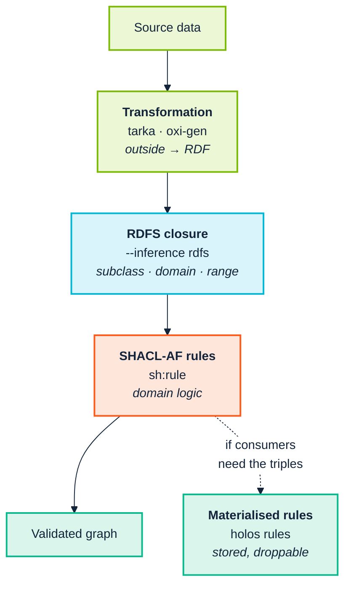

<p align="center">
  
</p>

# 11. Rules and inference

> *Part III — The practice · SemOps element 4 · Operating-model layer 2*

> **Stories answered here**
> *As a knowledge engineer, I want the model to derive what follows from the
> data, rather than making every consumer re-implement the same logic.*
> *As a SemOps engineer, I want to know what a rule will do to my gate before I
> turn it on.*

A three-year-old who says "doggy run" has not been told that dogs are animals
that move. They have worked out a small rule from what they have seen, and from
then on they apply it to every dog they meet. Inference is the grown-up,
machine-checked version of that: saying once what follows, so that nobody has to
say it again for every case.

Every chapter so far has treated a graph as something to *check*. This one is
about deriving triples that were never asserted, and about the awkward fact that
the moment you do, your gate is validating data that did not exist when the
commit was made.

SemOps names this as its own element, *Reasoning & Inference Operations*: rule
deployment and versioning, incremental strategies, validation of inferred
triples, regression tests for reasoning changes. It is the element most often
skipped, because inference feels like a modelling luxury until something
downstream re-implements it in application code for the fourth time.

---

## 11.1 The engine that runs the rules

The Ontology Quality Suite does not run SHACL-AF rules (there is no `--advanced`
flag on any of its subcommands) and the VS Code extension does not either. Both
validate. Rules live in the **SHACL Engine** introduced in
[Chapter 7](07-the-toolchain.md), the same engine the suite and the extension
validate on, so adopting rules does not add a second semantics. It exposes more
of an engine you are running already.

```bash
pip install shacl        # Python bindings (no command line)
npm install shacl-wasm   # ESM build for bundlers; shacl-wasm-node for require()
```

The `shacl` command used in the rest of this chapter comes from the engine's
[GitHub releases](https://github.com/pwin/SHACL_Engine/releases), not from PyPI.

From Python, rules are reached through the `inference` argument rather than a
separate flag:

```python
import shacl
shapes = shacl.Shapes.from_file("shapes.ttl")          # compile once
report = shapes.validate_file("data.ttl",
                              inference="rules")        # or "rules-iterated"
print(report.conforms, len(report.results))
```

> **Check your version before believing any of this.** As released, rules
> arrived in 0.1.8 in every binding at once (on npm in 0.1.9, which exists only
> because the npm publish of 0.1.8 failed). Builds from source just before
> that still called themselves 0.1.7 and had rules in the CLI only, which is
> what an earlier edition of this manual described. The same commit fixed a real
> defect, in which `$this` was not substituted into a CONSTRUCT-based rule, so a
> SPARQL rule ran for **every node in the graph**. No release carried it, but if
> you built from source in mid-August 2026, re-run your SPARQL rules. This
> edition was measured at **0.3.4**. An unrecognised `inference` value has been
> an error naming what is accepted throughout, never a silent fallback to
> validating without the rules. Check with `shacl --version`.

### What 0.3.0 changed: what "conforms" means

This is the change most likely to surprise you, so it comes first.

Until 0.3.0 the engine followed a common convention rather than the
specification: only a `sh:Violation` broke conformance. The specification says
otherwise. `sh:conforms` is false whenever the report holds a result of
severity `sh:Violation`, `sh:Warning` or `sh:Info`, unless the report declares
otherwise with `sh:conformanceDisallows`. (SHACL 1.2 adds `sh:Debug` and
`sh:Trace`, which report without blocking.) The engine's own harness had been
recomputing the expected reports' conformance under the engine's rule instead
of reading what the tests wrote, so it agreed with itself. Comparing reports as
the W3C suite compares them, as whole graphs, is what found it.

Verified on 0.3.4, with a shape whose only result is a Warning:

```
shacl -d data.ttl -s shapes-warn.ttl                    conforms false   exit 1
shacl -d data.ttl -s shapes-warn.ttl --allow-warnings   conforms true    exit 0
                                                        (the report records
                                                         sh:conformanceDisallows sh:Violation)
```

`--allow-warnings` means what it means in pySHACL, whose default this was wrongly
taken to be; `--allow-infos` is its milder sibling, and `--min-severity` sets the
threshold directly. Two things
follow, and both reach well beyond this tool.

- **A dependency's minor release changed what a report means.** Nothing in your
  shapes moved. Your gate could still go from green to red, or the reverse if
  you were relying on Warnings passing. The suite responded by pinning
  `shacl>=0.3.0,<0.4` with a comment saying exactly that, and
  [Chapter 9](09-continuous-integration.md) §9.5 argues for treating every
  validator upgrade the way you would a compiler upgrade.
- **The surfaces disagreed for two releases.** The WebAssembly build kept the old
  rule through 0.3.0 and 0.3.1, so `shacl-wasm` called a warnings-only graph
  conforming while the CLI and the Python binding did not. The release notes
  said the default had changed everywhere. Nothing tested the verdict on a
  warnings-only report through WebAssembly; now something does. This is the
  same lesson as [Chapter 7](07-the-toolchain.md) §7.1, three surfaces of one
  engine, and the thing that drifted was the behaviour the tests did not pin.

### What 0.2.0 changed, and the one surface it did not reach

The major bump at 0.2.0 was one reordered argument: the JavaScript one-shot took
`(shapes, data)` and now takes `(data, shapes)`, matching every other surface.
Reordering a published signature is normally a poor trade. What made it worth
doing was the failure it removed. A transposed call compiled the *data* as a
shapes graph; a data graph declares no shapes; and **validating against no
shapes conforms**. The caller was told their graph was valid when not one
constraint had been evaluated.

So the one-shots now refuse a shapes graph that declares nothing. Still true at
0.3.4, verified through the Python binding:

```
validate(data, shapes)     conforms = False | results = 1
validate(shapes, data)     REFUSED: the shapes graph declares no shapes, so this
                           would report that the data conforms without having
                           checked anything
```

**Until 0.3.4 the command line did not refuse.** Pointed at a shapes graph with
no shapes in it, it said `conforms: true` and exited 0. Worse, `-s` defaults to
the data graph, "matching the convention that a self-describing document carries
its own shapes", so a CI step that simply forgot `-s` went green:

```
shacl -d data.ttl                 conforms: true    exit 0     (0.3.3)
```

That is the convenience surface above all others, and the one that has to speak
up, and since 0.3.4 it does. Both cases exit 2, as "could not validate", with
messages that tell them apart, because they send you to different places:

```
error: no --shapes was given, so data.ttl was used as its own shapes graph, and
it declares no shapes. Nothing would be checked and the report would say the
data conforms. Pass --shapes, or --allow-no-shapes …
```

`--allow-no-shapes` keeps the old behaviour for the caller who means it. pySHACL
still answers `Conforms: True` here, and the engine's README names this among
its differences from pySHACL. Whatever your version, **pass `-s` explicitly in
automation, and keep one deliberately failing case in the job**, so a gate that
cannot fail shows up as one.

Two things generalise:

- **An empty rule set must not report success.** It is the same failure as a
  check that matches nothing ([Chapter 9](09-continuous-integration.md) §9.8),
  a filter that matches nothing (§9.4), and a manifest role nobody recognises
  ([Chapter 13](13-operate-and-consume.md) §13.1). Whenever "nothing to do" and
  "all clear" produce the same output, the tool is unsafe at exactly the moment
  it matters.
- **A fix is only as good as the surfaces it reaches.** The 0.2.0 refusal
  reached two of three; the 0.3.0 conformance default reached two of three.
  When you read "fixed" in a changelog, ask *where*.

### Conformance, and a perfect score that broke things

The engine passes **425 of the 426** W3C SHACL 1.0 and 1.2 tests, and every
report-producing test is isomorphic to the expected report as a graph, which is
how the suite itself says to compare. It writes the run as an EARL report, the
vocabulary a specification's implementation report is compiled from.

The one exception is deliberate, and its story belongs in
[Chapter 4](04-from-research-to-industry.md). For a few days at 0.3.0 the engine
enforced SHACL §5.3.2's subquery rule to the letter and passed all 426. That
version also refused three of the Ontology Quality Suite's own checks:
graph-wide aggregates that are well defined under the way this engine pre-binds
`$this`. 0.3.1 narrowed the rule to the case it protects against, gave up the
perfect score, and named the one test it now disagrees with, with the
reasoning, in the README.

> **A full score on a conformance suite and a working product are different
> things, and when they conflict, say so in writing.** That README section is a
> better model for a vendor's conformance claim than any percentage.

---

## 11.2 Four ways to derive a triple

Before reaching for rules, be clear which mechanism you want. They overlap, and
choosing wrongly is the usual cause of a pipeline nobody can debug.



| Mechanism | Use it when | Chapter |
|---|---|---|
| **Transformation** (tarka / oxi-gen) | The data is not RDF yet. One row in, some triples out | [10](10-ingest-and-transform.md) |
| **RDFS closure** (`--inference rdfs`) | You need `rdfs:subClassOf`/`subPropertyOf`/domain/range entailments, and nothing more | This chapter |
| **SHACL-AF rules** (`sh:rule`) | The derivation is *domain logic*: conditional, computed, or specific to your model | This chapter |
| **Materialised rules** (HOLOS) | Consumers need the derived triples *stored*, kept apart from what was asserted | This chapter, [13](13-operate-and-consume.md) |

The distinction that matters in practice: **a transformation runs once, at
ingest, and its output is what you store. A SHACL-AF rule runs at validation
time, and its output may never be stored at all.** If downstream consumers need
the derived triples, a rule in your shapes does not give them to you.

Earlier editions stopped there and told you to materialise and load the triples
yourself. HOLOS now does it. `holos rules` runs a file of SPARQL `CONSTRUCT`
rules over a store, to a fixpoint, and writes what they derive into a graph of
its own:

```
$ holos rules --store ./store --rules rules.rq
1 rule(s) from rules.rq:
  rule 1

derived 5 fact(s) into <https://holos.dev/ns#derived>
  rounds  2
  store   40 -> 45 quads
```

Verified on the acme employees, with one rule typing every `acme:Employee` as a
`foaf:Agent`. Note the format: plain `CONSTRUCT` blocks, not SHACL-AF. And note
the separate graph. Derived triples can be told apart from asserted ones,
queried with them or without them, and dropped wholesale when the rules change.
That separation is what makes materialisation safe to repeat. (`holos rules` is
in the `holos` command from the HOLOS release; the `holosdb` Python package does not
expose it.)

### Why RDFS closure is not optional trivia

SHACL follows `rdfs:subClassOf` when deciding class membership, and **nothing
else**. A shape targeting `ex:parent` through `sh:targetSubjectsOf` will not see a
subject that only has `ex:father`, however clearly `rdfs:subPropertyOf` says one
implies the other. Materialising the closure first closes that gap:

```bash
shacl -d data.ttl -s shapes.ttl --inference rdfs
```

It covers `rdfs2`, `rdfs3`, `rdfs5`, `rdfs7`, `rdfs9` and `rdfs11`: domain, range,
both hierarchies and their transitivity. The axiomatic and reflexive rules are
deliberately left out, because they entail `rdf:type rdfs:Resource` for every
term, which no shape is improved by. It is off by default because it changes the
report; a `sh:closed` shape in particular starts seeing inferred predicates and
failing on them.

Since 0.3.3 the engine also hands the closure out: `shacl.rdfs_closure` in Python,
`rdfsClosure` in WebAssembly, Turtle in and Turtle out. A caller that reads one graph
more than once can close it once and give every reader the same result, and the
quality suite does exactly that from 0.23.0, which is how its SPARQL checks came to
see the entailments its shapes always had ([Chapter 7](07-the-toolchain.md) §7.4).
One edge is worth knowing. `rdfs3` types the *object* of a triple, so a property
with a declared range and a literal value entails that the literal is an instance
of the range: true in RDFS, and unwritable in RDF, where a literal cannot be a
subject. The closure drops such triples, which is what makes it shareable at all.

---

## 11.3 Triple rules

`sh:subject`, `sh:predicate` and `sh:object` are node expressions evaluated per
focus node. Applied to the Acme fixture, the two commonest shapes a rule takes:

```turtle
acme:PersonRules a sh:NodeShape ;
    sh:targetClass acme:Employee ;

    # 1. Constant object: every Employee is also a foaf:Agent
    sh:rule [ a sh:TripleRule ;
        sh:subject sh:this ; sh:predicate rdf:type ; sh:object foaf:Agent ] ;

    # 2. Path object: one triple per value found
    sh:rule [ a sh:TripleRule ;
        sh:subject sh:this ; sh:predicate acme:colleague ;
        sh:object [ sh:path acme:worksIn/^acme:worksIn ] ] .
```

Rules are **off by default** and enabled with `-a`:

```bash
shacl -d data.ttl -s shapes.ttl --advanced
```

**The inferred triples are the cross product of the three expressions.** A path
yielding three values yields three triples. That is what you want for rule 2,
and worth remembering before you write a rule whose subject is also a path.

The node expressions available are SHACL-AF's: `sh:this`, a constant,
`[ sh:path P ]` with an optional `sh:nodes` operand,
`[ sh:filterShape S ; sh:nodes N ]`, `sh:union` and `sh:intersection`. Anything
else is an error rather than an empty result; see [§11.7](#117-what-is-not-there).

### Verified behaviour

Running a rule that types every `ex:Person` as `ex:Party`, then validating the
inferred `ex:Party` instances against a shape requiring a property none of them
have, gives **exactly one violation per source instance**: 1,000 on the
1,000-instance dataset and 100,000 on the 100,000-instance one. Every focus node,
once each, no misses and no duplicates.

That is the check worth copying: **validate the derived data, so a rule that
silently does nothing shows up as a missing violation rather than as silence.**

---

## 11.4 SPARQL rules

`sh:construct` takes a `CONSTRUCT` query with `$this` pre-bound to the focus node.
This is where computation lives:

```turtle
acme:BoxRules a sh:NodeShape ;
    sh:targetClass acme:Box ;
    sh:rule [ a sh:SPARQLRule ; sh:construct """
        PREFIX acme: <https://acme.example.org/ns/>
        CONSTRUCT { $this acme:area ?a }
        WHERE { $this acme:width ?w ; acme:height ?h . BIND(?w * ?h AS ?a) }""" ] .
```

Verified at 0.3.4: with `width 3` and `height 4`, a shape asserting
`sh:path acme:area ; sh:hasValue 12` conforms. The arithmetic runs and the
derived value is what validation sees.

Prefixes can come from an inline `PREFIX` line, as above, or from SHACL's own
`sh:declare`/`sh:prefixes` mechanism. Since 0.3.0, with no `sh:prefixes` on a
query, only declarations on nodes typed `sh:ShapesGraph` apply. The earlier
fallback took every `sh:declare` in the graph and could pick up a decoy.

> **Fixed before 0.1.8 shipped.** In those pre-release builds, a rule relying on
> a shapes-graph-level `sh:declare` alone was not resolved, and the engine
> rejected the **whole shapes graph** at compile time, whether or not `-a` was
> passed. The same fault made the WebAssembly build answer `conforms: true` where
> the native one errored, the dangerous direction. Rule
> compile errors are now held on the rule and raised only if that rule would have
> fired, so validation that never asked for rules is unaffected and a broken rule
> is still not silently skipped.

---

## 11.5 Four ways to get a wrong answer

These produce silence, not errors. Every one reproduces exactly as described, at
0.3.4, in [notebook 2](../notebooks/02-rules-and-inference.ipynb).

**A rule fires on its shape's targets, so a shape with no target does nothing.**
This is the commonest mistake, because attaching a rule to a nested property
shape reads perfectly naturally:

```turtle
acme:S a sh:NodeShape ; sh:targetClass acme:Employee ;
    sh:property [ sh:path acme:name ;
        sh:rule [ … ] ] .        # never fires: this shape has no target
```

Verified: the rule never runs, nothing is inferred, and no message says so.

**One pass, so a transitive rule does not close.** SHACL-AF defines a single
iteration. A rule deriving `ex:sub` from two hops of `ex:sub` reaches two hops and
stops. On a chain `a→b→c→d`, one pass leaves `a` short of `d`:

```bash
shacl -d data.ttl -s shapes.ttl -a                    # one pass  -> a does not reach d
shacl -d data.ttl -s shapes.ttl -a --iterate-rules 10 # fixpoint  -> it does
```

`--iterate-rules` is outside the specification. A rule set with no fixpoint, one
minting a fresh term each round, stops with an error rather than running until
memory does.

**Rules at the same `sh:order` cannot see each other's inferences.** Two rules both
at the default order 0 each see the graph as it was before either ran. Verified
with a two-step chain (`Person → Step1 → Step2`): at equal order `Step2` is never
reached; with `--iterate-rules 5`, it is. Give the consumer a higher `sh:order`,
or iterate.

**Negation is not monotonic, and iteration exposes it.** A conclusion drawn from
absence *outlives* the absence, because rules only ever add triples:

```turtle
# Round 1 marks ex:a as Unnamed. Round 2's rule then gives it a name.
# The mark stays. It is simply no longer true.
```

SHACL 1.2 Rules answers this by requiring a stratified rule set; SHACL-AF does not,
so it is the author's problem. If a rule tests for absence, keep to a single pass
or make sure nothing later supplies what it tested for.

> **And one that is not a hazard:** rules never modify the graph you passed in.
> The expanded graph is a new one, so a report is always relative to an input you
> still have.

---

## 11.6 Rules at scale

> These figures were measured for the previous edition, at engine 0.2.0, and have
> not been re-measured for this one. Since then 0.3.0 added a first-level index
> on each permutation and parallel validation, which the engine's own
> measurement puts at 0.61 s → 0.23 s whole-process on its 100,000-instance
> benchmark. Expect the validation half below to be faster now, not slower.

Whole-process wall time, two rules (one triple rule, one SPARQL rule) plus
validation of the derived triples:

| instances | triples | validate only | rules + validate |
|---:|---:|---:|---:|
| 1,000 | ~6,900 | — | 0.9s |
| 10,000 | ~69,000 | — | 1.1s |
| 100,000 | ~690,000 | 2.7s | **11.9s** |
| 100,000, `--iterate-rules 5` | ~690,000 | — | 18.7s |

Rules cost roughly **4.5× validation alone** at 100k, and iterating to five
rounds roughly 7×. In absolute terms that is twelve seconds to derive and
validate over two-thirds of a million triples, comfortably inside a CI budget.

For context on the validation half, the same engine against pySHACL on the same
data, with identical result counts at every size:

| instances | ours | pySHACL | speedup |
|---:|---:|---:|---:|
| 1,000 | 0.040s | 2.992s | 75× |
| 10,000 | 0.199s | 24.369s | 122× |
| 100,000 | 1.808s | 206.250s | 114× |

Two caveats the engine is candid about, and which matter more than the ratio.
**Loading dominates**: at 100k, validation was 0.46 s of the 1.81 s total, so the
first place to look for speed is the parser. (The CLI now offers `--build-index`,
which caches the parsed graph beside the file for later runs.) And the index holds
the graph **three times over**, once per permutation, with no streaming path, so
do not reach for this on a graph too large to hold three sorted copies of.

Parallel validation keeps one promise worth knowing about: **the same bytes on
any machine.** Results are sorted by focus node before they are returned, so a
report no longer depends on how many threads ran it. That changed the report's
grouping (by focus node now, rather than by constraint), which is worth knowing
if anything of yours diffs report text.

### The WebAssembly build has a different cost model

Those figures are for the native binary. The same engine compiled to
WebAssembly, which is what the editor runs and what a browser would, behaves
differently at size, because wasm32 has a single linear memory that
`memory.grow` may have to relocate, copying the whole heap. Measured for the
previous edition on the engine's scale probe:

| instances | triples | first run | second run | resident |
|---:|---:|---:|---:|---:|
| 1,000 | 4,000 | 56 ms | 26 ms | 89 MB |
| 10,000 | 40,000 | 205 ms | 137 ms | 76 MB |
| 100,000 | 400,000 | **12,611 ms** | **3,119 ms** | 329 MB |

At ontology scale, the hundreds to low thousands of triples an editor validates,
the difference is noise. At 400,000 triples the first run costs four times the
second.

- **Reuse the compiled validator.** A caller that validates one document per
  process pays the growth cost every time; one that holds a `Validator` and
  validates many pays it once.
- **WebAssembly is not a drop-in for bulk data.** Editor validation, browser
  validation, a partner checking their own submission: all fine. A nightly pass
  over a production graph belongs on the native binary.

---

## 11.7 What is not there

Stated plainly, because a rule engine's gaps are where the silent wrong answers
live.

| Not implemented | Consequence |
|---|---|
| **SHACL functions** (`sh:SPARQLFunction`) | A rule calling one errors (exit 2) rather than returning empty. Verified at 0.3.4 |
| **Result annotations** (`sh:resultAnnotation`) | Extra properties from a SPARQL constraint's solution are not copied onto results |
| **SHACL 1.2 Rules** (`RULE { } WHERE { }`) | A different design from SHACL-AF; its test corpus ships with the engine but is not wired into the conformance harness. (HOLOS's `holos rules` takes plain `CONSTRUCT` files, which is a third format again) |
| **OWL-RL pre-inference** | RDFS is available and opt-in; nothing beyond it. This is why the suite's `--inference owlrl` went when pyshacl did ([Chapter 7](07-the-toolchain.md) §7.4) |
| **Rules in the VS Code extension** | The engine supports them; the extension does not ask for them. See below |

### Rules in the browser: the engine can, the editor does not

Every binding runs rules, CLI, Python and WebAssembly alike, through the same
`inference` modes:

```js
import { Validator } from 'shacl-wasm';
const v = Validator.fromTurtle(shapesTurtle);
const report = v.validateTurtle(dataTurtle, null, 'rules');   // or 'rules-iterated'
```

An unrecognised mode is an **error** rather than a silent fallback to `"none"`.
That's the failure behaviour that matters, because a browser quietly validating
without applying rules would report conformance it never established.

**What has not changed is the editor.** The extension now bundles
`shacl-wasm-node` 0.3.2, so the capability is present, but its runner still asks
for `inference: "none"` deliberately: inference belongs to the reasoner tier, and
a SHACL finding should be about what the document says rather than about what a
second pass added underneath it. That is a defensible position and I don't argue
with it. It just means **rules in your shapes do not fire in the editor.** Use the
CLI or the Python binding for anything rule-bearing, and expect the editor's
report to differ from CI's when rules are in play.

### Named graphs are flattened, in the engine

Worth repeating because rules make it sharper: quad syntaxes parse, and then every
named graph and the default graph are merged into one before validation. A rule's
inferences are not attributed to any graph. See
[Chapter 13](13-operate-and-consume.md) §13.1 for the per-graph alternative.

---

## 11.8 Rules are a governed artefact

Everything [Chapter 12](12-release-and-change.md) says about ontology change
applies to rules, with one addition: **a rule change alters the meaning of data
you have already validated.** Adding a rule that types every `Employee` as an
`Agent` retroactively brings every `Agent` shape to bear on your whole employee
table.

Four practices:

- **Version rules with the shapes, in the same repository.** They are not
  configuration.
- **Pin `--advanced`, `--iterate-rules` and the conformance threshold in CI**,
  exactly as [Chapter 9](09-continuous-integration.md) pins the engine. Same
  commit, same answer, on every machine.
- **Validate the derived triples, not just the source.** A rule that stops firing
  is invisible unless something downstream asserts it should have fired.
- **Treat `--iterate-rules > 1` as a deliberate, documented decision.** It is
  outside the specification, so another SHACL processor will not reproduce your
  results.

### Exit codes make this gateable

```
0   conforms
1   does not conform: a result at or above the threshold
    (Info by default, so Warnings and Infos count; see §11.1)
2   could not validate (bad input, unsupported feature, compile error, and
    since 0.3.4 no shapes to validate against)
```

Verified across all three at 0.3.4. That separation is what lets a CI job tell
*"the data is wrong"* from *"the rules did not compile"*, and a job that treats
them alike will eventually go green on a rule set that never ran.

> **`holos validate` became a gate in HOLOS 0.22.0.** Up to 0.21.1 it printed
> `conforms false` and exited 0, with either of its validators, so a CI step built
> on it passed on the violations it was there to stop. From 0.22.0 it exits as
> the `shacl` CLI does: 0 conforms, 1 does not, 2 could not validate (a missing
> file, an unknown `--engine`, or a shapes graph the chosen engine refuses, such as
> `sh:sparql` under `--engine native`). It also defaults to the `adapted`
> validator now, as `holosdb`'s `Store.validate()` always has, so the same shapes
> no longer pass in one place and are refused in the other. On 0.21.x, gate with
> the `shacl` CLI, or from Python, where `Store.validate()` returns a dictionary
> with a `conforms` key.

---

> **Run it:** [notebook 2 — Rules and inference](../notebooks/02-rules-and-inference.ipynb)
> runs every rule form above and reproduces all four silent-failure hazards.

## 11.9 Maturity checkpoint

Rules run in CI, versioned alongside the shapes, with derived triples validated
and the flags pinned, is most of SemOps element 4, *Reasoning & Inference
Operations*. With `holos rules` able to materialise derived triples into a graph
of their own, the "deploy the inferences" half of the element now has a home too,
albeit an early one.

What is still missing at Level 4 scale: incremental reasoning (every run here is
a full pass) and performance monitoring of inference jobs. Both remain genuine gaps.

---

| ← [10. Ingest and transform](10-ingest-and-transform.md) | [12. Release and change →](12-release-and-change.md) |
|---|---|
