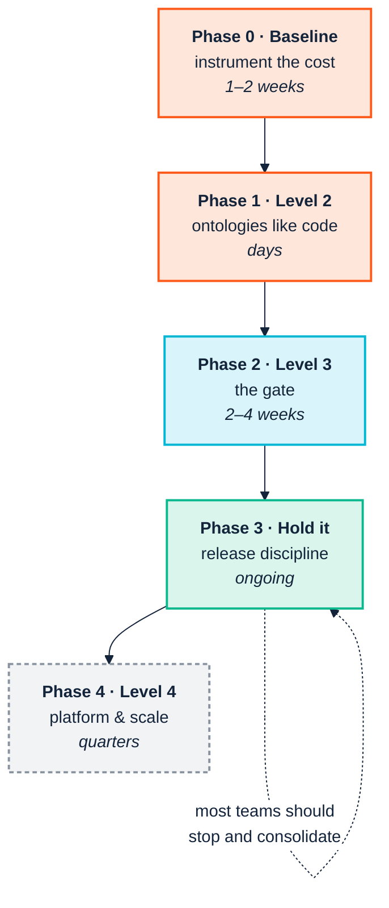

<p align="center">
  
</p>

# 15. Adoption roadmap

> *Part IV — The ledger*

The maturity model tells you where you are. This chapter tells you what to do on
Monday.

I'll say one thing first, because it gets lost in roadmaps. The process of
building an ontology is a social one before it is a technical one. People have to
sit together and work out what kinds of thing their business has, which words
everyone uses for them, and how to define them without going round in circles.
Done well, that process builds a team. Done badly, it exposes the fracture lines
that were already there. Each phase below has a technical deliverable. Each one
also has a human one, and the human one is usually what decides whether the
programme is still alive a year later.

The sequencing principle throughout: **automate before you accelerate.** Every
transition below establishes a control before it increases throughput, for the
reason [Chapter 5](05-genai-and-agents.md) sets out. An organisation that raises
its change rate before it has a gate has industrialised the production of
unreviewed model.



---

## Phase 0 — Baseline before you build

**One to two weeks. Skipping this is the commonest and most expensive mistake.**

Once the ontology exists you can no longer measure what it saved, because the
counterfactual is gone. Capture the numbers first.

| Do this | Why |
|---|---|
| Ask four analysts to tag two weeks of calendar time as "reconciling definitions" | Produces a cost figure in the business's own terms ([Ch. 1](01-the-business-case.md)) |
| Record mean lead time for the last five integrations | The curve you are claiming to bend |
| Time one lineage question end to end | The most legible before/after story you will get |
| Name the owner | Governance abandonment is the terminal failure mode. If nobody's objectives mention this, you do not have a programme |
| Pick a first use case with a *visible* failure | Legible beats valuable. An embarrassing three-week regulator question is worth more as a first case than a larger, diffuse inefficiency |

**The human deliverable:** the people whose definitions will be modelled know it is
happening, and know who to talk to.

**Exit criterion:** you can state, in one sentence and with a number, what is broken
today.

---

## Phase 1 — Reach Level 2: ontologies like code

**Days. This is a decision more than a project.**

| Step | Command or action |
|---|---|
| Ontology, shapes, queries into Git | — |
| Pin the toolchain | `uv lock`, and commit the lock: the suite, holosdb and `shacl` together ([Ch. 9](09-continuous-integration.md) §9.5) |
| Install the extension on every modeller's machine | `.vsix` from the [webapp releases](https://github.com/pwin/consolidated-ontology-quality-suite-webapp/releases/latest) |
| Establish the local loop | *Run Local Checks*, Ontology Outline, *Show Metrics* |
| Run the tightest gate by hand | `ontology --ontology <yours> --import-dir lib/vocab` |
| Keep local copies of your imports | Copy upstream vocabularies into `lib/vocab`; never rely on `--allow-network` |
| Record your namespace | Copy the exact `@prefix` string somewhere the team can find it. You will need it repeatedly, and getting it wrong fails quietly ([Ch. 9](09-continuous-integration.md)) |

Two habits to establish now, while they are cheap:

**Design the IRI scheme deliberately.** Schema terms and instance data should sit
under a common prefix you can filter on. `https://acme.example.org/ns/` and
`https://acme.example.org/data/` share `https://acme.example.org/`, which is what
makes `--own-namespace` usable across both ([Ch. 10](10-ingest-and-transform.md)).
Retrofitting an IRI scheme is a migration.

**Decide named graphs before the first production load.** Per-source named graphs
are nearly free at load time (`tarka --post --graph`) and effectively impossible to
retrofit ([Ch. 13](13-operate-and-consume.md)).

And one option worth trying, not mandating: if the people writing the ontology are
comfortable in TypeScript, let them write it as a `.ontology.ts` script
([Ch. 8](08-model-and-validate.md) §8.2). The type checker catches mistakes of kind
before the gate ever sees them, and the conversation moves from labels to verbs
sooner. Commit the script; gate on the Turtle it builds.

**The human deliverable:** a domain expert has looked at the outline or the graph
view and corrected something. If nobody has, the review loop is not yet real.

**Exit criterion:** every modeller sees findings in their editor, and the ontology's
history is in Git.

---

## Phase 2 — Reach Level 3: the gate

**Two to four weeks. This is the transition worth real effort.**

It converts "we have standards" into "the standards are enforced without anyone
remembering to enforce them", and it is the prerequisite for everything in Phases 3
and 4.

### Week 1 — the gate that cannot be ignored

```bash
ontology-quality-suite ontology \
  --ontology ontology/acme-org.ttl --import-dir lib/vocab \
  --fail-on Violation
```

Start here, not with the full registry. It is the narrowest, highest-signal check,
and a gate people trust from day one is worth more than a comprehensive one they
learn to bypass.

### Week 2 — scope the registry, then add it

```bash
ontology-quality-suite checks \
  --ontology ontology/acme-org.ttl --import-dir lib/vocab \
  --own-namespace "https://acme.example.org/" \
  --themes ontology/themes.json \
  --engine sparql --fail-on Violation
```

**Do not skip `--own-namespace`.** Unscoped, the fixture in this manual produces 479
findings where 23 are yours, and the gate is dead within two sprints
([Ch. 9](09-continuous-integration.md)). And do not reach for `--exclude-imports`
instead: it introduces four *false* findings, which damages trust faster than noise
does. The scoped run returns the same 23 findings every time, which is what a gate
has to do.

Write the `--themes` file with the people who will read the report, in their words.
It takes an hour, and it turns the report into something a steward recognises as
theirs.

Verify the filter is live by pointing it at a known-failing input once. A gate that
cannot fail is indistinguishable from a gate that passes.

### Week 3 — the pipeline stages

| PR touches | Gate |
|---|---|
| A transformation query | `sketch`: needs no CSV, runs in seconds |
| Data | `tarka run … --test 100`, then `data --own-namespace`, plus `--sample N` if large |
| A taxonomy | `pattern-consistency --output-data` |

Two things are not optional in practice. `--output-data` is one: without it,
per-row controlled values are invisible ([Ch. 12](12-release-and-change.md)). The
other: if your data gate is scoped, **assert the reasoner's verdict in an unscoped
run beside it**, because the filter removes the finding that says the reasoner
did not run ([Ch. 10](10-ingest-and-transform.md) §10.4).

### Week 4 — documentation and artefacts

```bash
PYTHONHASHSEED=0 ontology-quality-suite docgen \
  --ontology ontology/acme-org.ttl --out-dir docs/reference
```

Publish it. The `PYTHONHASHSEED` is a workaround, not decoration. Without it
`docgen` reorders its own output on every run, so the page is undiffable and two
readers get the terms in a different order ([Ch. 13](13-operate-and-consume.md)).

Then **retain `full_results.csv` from every run, timestamped**, and paste
`findings.txt` into the pull request. The first costs nothing and becomes your only
quality time series ([Ch. 14](14-coverage-and-gaps.md)); the second puts the
findings where the reviewer already is.

**The human deliverable:** the first time the gate blocks a pull request, someone
other than the person who set it up explains why, from the report.

**Exit criterion:** a pull request that breaks the ontology fails, and the failure
names something the team owns.

---

## Phase 3 — Hold it: release discipline

**Ongoing. Most teams should stop and consolidate here.**

| Practice | Command | Cadence |
|---|---|---|
| Evidence-based semver | `version-diff old.ttl new.ttl --json` | Every release |
| Change impact | `consistency --new … --old … --queries …` | Every breaking change |
| Migration tombstones | `oldTerm owl:equivalentClass newTerm`, conventionally from the retiring IRI | Every rename |
| Wide audit | `checks` with imports, unscoped, `--fail-on never` | Weekly, or on upstream change |
| Live-store check | `consistency-remote --manifest graphs.json --fail-on-misalignment` | After every deployment |
| Gate tests | A fixture and a control per house rule; the board pattern ([Ch. 9](09-continuous-integration.md) §9.8) | Every new check |

Add one governance control, which is a branch protection rule rather than a
command: **a MAJOR bump requires a named reviewer.** The tool establishes the fact;
the platform enforces the policy ([Ch. 12](12-release-and-change.md)).

About those tombstones. Earlier editions put a review-checklist item here warning
that rename detection reads `owl:equivalentClass` in one direction only. It does
not, and has not since long before those editions were written
([Ch. 12](12-release-and-change.md) §12.3). Write the tombstone from the retiring
IRI because it reads naturally and is the convention. The direction is only
load-bearing if you use `dcterms:isReplacedBy`, where it is the meaning.

### If you work across organisational boundaries

Four additions, all cheap ([Ch. 3](03-across-the-boundary.md)):

- **Publish your check registry** as a directory partners can point
  `--registry`/`--shapes`/`--sparql` at, so they validate before submitting rather
  than after rejection.
- **Accept CSV, or Parquet.** The triplify path means a partner never authors RDF.
- **Attach `diff.json`** to every change notice, so partner tooling can act without
  parsing your prose.
- **Keep each partner in its own named graph**, and record the conformance verdict
  beside it.

**The human deliverable:** the release notes are read by someone outside the team,
and they understand them.

---

## Phase 4 — Level 4, and knowing when not to

**Quarters, and mostly not semantic work.**

Level 4 is container deployment, environment promotion, continuous ingestion with
retry logic, an observability stack, and managed semantic APIs. Most of it is still
not in this toolchain, and most of it does not need specialist semantic tooling
([Ch. 14](14-coverage-and-gaps.md)).

What *is* here for Level 4:

| Need | What to use |
|---|---|
| Speed at scale | The default engine, on holosdb and the native SHACL engine |
| Large data graphs | `data --sample N` |
| Live-store validation | `consistency-remote --sample-limit N` |
| Answers that respect who is asking | `holosdb`, embedded, with a policy (**early**) |

The last row is new, and young. If what you need is one service that answers each
caller with exactly what they may see (a partner portal, an agent's view of the
canonical definitions), **pilot it there**, beside a mature store, and let it earn
the rest.

> **Consider not doing Phase 4.** A team solidly at Level 3, with a gate that holds
> and releases that are evidence-based, has captured most of the available value.
> Level 4 is justified by *scale*: many consumers, large graphs, strict
> availability. Pursued for its own sake it is an expensive way to acquire
> operational burden.
>
> And Level 5 is overwhelmingly organisational. A team frustrated that tooling will
> not carry them there has correctly identified that the remaining problem is
> [Chapter 2](02-people-and-cognition.md)'s, not the toolchain's.

---

## The first ninety days, on one page

| Days | Focus | Deliverable |
|---|---|---|
| **1–10** | Baseline | A number, a named owner, one legible use case |
| **11–20** | Level 2 | Ontology in Git; toolchain pinned; extension on every desk; IRI scheme decided |
| **21–40** | The gate | `ontology --fail-on Violation` in CI, and it has failed at least once |
| **41–60** | Scope and extend | `checks --own-namespace` with a themes file; `sketch` on query PRs; first house rule written, with a fixture and a control |
| **61–75** | Release discipline | `version-diff` on release; MAJOR requires a reviewer |
| **76–90** | Make it visible | `docgen` published; `full_results.csv` retained; report the baseline delta |

The last row matters more than it looks. A programme that reaches day 90 without
having reported back against Phase 0's number will be asked to justify itself in a
language it did not prepare for.

---

## The shortest version

If you read nothing else in this manual:

1. **Measure the cost before you fix it.** You cannot reconstruct the
   counterfactual.
2. **Name an owner.** Unowned ontologies decay quietly, and decay is the dominant
   failure mode.
3. **Gate on `--fail-on Violation`, scoped with `--own-namespace`.** Unscoped gates
   die; `--exclude-imports` produces false findings.
4. **Prove every gate can fail.** A filter, a check, a shapes file or a manifest
   that matches nothing looks exactly like a pass. Keep one deliberately failing
   case in every job, and read what it prints.
5. **Automate before you accelerate.** Especially before adding agents.

---

| ← [14. Coverage and gaps](14-coverage-and-gaps.md) | [Appendix A: Diagram conventions →](diagram-style.md) |
|---|---|
