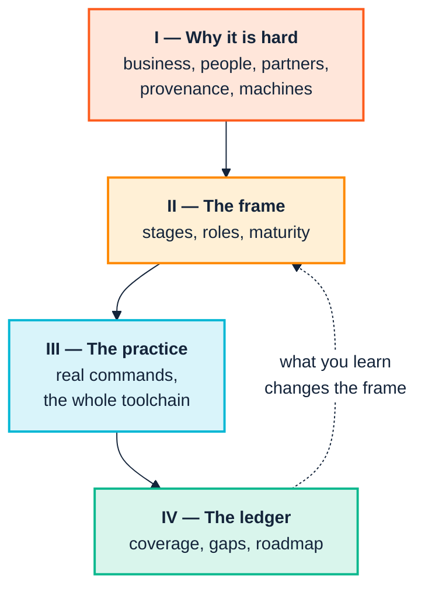

<p align="center">
  
</p>

<h1 align="center">The SemOps Manual</h1>

> **Annotated edition.** After each claim that has been checked, an *Evidence* line links to the commands, data and output behind it in [EVIDENCE.md](../EVIDENCE.md#chapter-00), which links back here. The plain edition of this page is [here](../../README.md).

<p align="center">
  <em>Running a semantic practice the way you run software —<br/>
  people, process, and a toolchain that actually exists.</em>
</p>

---

## What this is

**SemOps** is the operational discipline required to build, deploy, govern and
evolve semantic knowledge systems continuously: what DevOps did for software,
applied to ontologies, mappings, rules and knowledge graphs.

There is a lot of SemOps *strategy* about: maturity models, operating models,
nine-stage pipeline blueprints, polyglot technology menus. Strategy is cheap. Why
do semantic programmes stall, then? Almost never because nobody drew the diagram.
It is because the diagram had no commands under it, no named owner, and no answer
for the person who has to justify the spend in October.

This manual is the missing middle. It takes the SemOps strategy material as given
and connects it, stage by stage, to **a toolchain that is built, tested and
runnable today**:

| Tool | What it is | Get it |
|---|---|---|
| **Ontology Development Suite** | The desk: a VS Code extension with live diagnostics, outline, graph view, query workbench, and a TypeScript DSL for writing ontologies as code | [`.vsix` from the v0.15.0 release](https://github.com/pwin/consolidated-ontology-quality-suite-webapp/releases/tag/v0.15.0) · npm [`ontology-suite`](https://www.npmjs.com/package/ontology-suite) |
| **Ontology Quality Suite** | The gate: a Python CLI and library with the 61-check registry, OWL2 reasoning, version diffing, change impact and repair, live-store checks | PyPI [`ontology-quality-suite`](https://pypi.org/project/ontology-quality-suite/) |
| **SHACL Engine** | The validator underneath both: SHACL and SHACL-AF rules in Rust | PyPI [`shacl`](https://pypi.org/project/shacl/) · npm [`shacl-wasm`](https://www.npmjs.com/package/shacl-wasm), [`shacl-wasm-node`](https://www.npmjs.com/package/shacl-wasm-node) · CLI from the [releases](https://github.com/pwin/SHACL_Engine/releases) |
| **HOLOS** | The store: RDF 1.2 and SPARQL 1.2, with access policy enforced at the index scan; the SPARQL engine underneath both suites | PyPI [`holosdb`](https://pypi.org/project/holosdb/) · npm [`holos-wasm`](https://www.npmjs.com/package/holos-wasm), [`holos-wasm-node`](https://www.npmjs.com/package/holos-wasm-node) · CLI from the [releases](https://github.com/pwin/triplestore/releases) |
| **tarka** | The triplifier: CSV, Parquet and Polars data frames to RDF, through TARQL queries or OTTR templates | PyPI [`tarka-rdf`](https://pypi.org/project/tarka-rdf/) · CLI from the [releases](https://github.com/pwin/tarka/releases) |

<a id="ev-c00-01"></a>*Evidence:* [C00.01 — A 61-check registry](../EVIDENCE.md#c00-01) (reproduced: PASS)

[Chapter 7](docs/07-the-toolchain.md) introduces them, says which versions this
edition was measured against, and explains the one idea that matters more than
any of them.

Every command shown in Part III was **executed for real**, against the ontology
suite's own bundled `examples/acme_robotics/` fixture, and re-run for this edition
on 13 October 2026. Where the output differs from what a strategy document would
lead you to expect, the manual reports what actually happened and explains why.
[Chapter 9](docs/09-continuous-integration.md) has the sharpest example, where the
obvious flag is the wrong one.

<a id="ev-c00-02"></a>*Evidence:* [C00.02 — Every Part III command was executed, and re-run for this edition](../EVIDENCE.md#c00-02) (argument)

You don't have to take any of it on trust. [evidence/](../README.md) holds the
commands, input data and recorded output behind every checkable claim, and an
annotated copy of the manual with a link from each claim to its evidence and back.

Where the toolchain has no answer for a SemOps concept, this manual says so plainly
and marks it grey. [Chapter 14](docs/14-coverage-and-gaps.md) is the honest ledger,
and this edition's copy includes a list of things earlier editions had wrong.

---

## The shape of the argument



Part I is unusual in a technical manual, and it is first on purpose. The failure
modes that kill semantic programmes are overwhelmingly organisational, cognitive
and commercial rather than technical. Building an ontology is a social process
with a technical output: done well, it brings a team onto the same wavelength;
done badly, it shows you the fracture lines that were already there. A team that
can run every command in Part III and has not read Part I will build something
correct that nobody adopts.

---

## Read it on paper

**[Download the A4 PDF](https://github.com/pwin/SemOpsManual/releases/latest)**:
the whole manual as a single A4 document, with a title page, contents with page
numbers, all nineteen diagrams rendered, and an index of commands, flags and check
identifiers.

<a id="ev-c00-03"></a>*Evidence:* [C00.03 — Nineteen diagrams](../EVIDENCE.md#c00-03) (reproduced: PASS)

The PDF is published as a release asset rather than committed, so the repository
does not carry a fresh multi-megabyte binary for every revision. Build it yourself
with `cd tools && npm install && node build-pdf.mjs`; see [tools/](../../tools/). The
same build also produces the
[web edition](https://www.semantechs.co.uk/SemOps_Manual/).

---

## Run it yourself

Three self-contained Jupyter notebooks cover the parts where watching the tool
behave teaches more than reading about it. Each writes its own fixtures to a
temporary directory, so nothing needs to exist on disk first.

| Notebook | Chapters | What you watch happen |
|---|---|---|
| [1 — Validation and the gate](../../notebooks/01-validation-and-the-gate.ipynb) | 8, 9 | An unscoped gate drowning in other people's findings, the flag that fixes it, and the near-miss filter that returns a confidently empty report |
| [2 — Rules and inference](../../notebooks/02-rules-and-inference.ipynb) | 11 | SHACL-AF rules deriving triples, and all four ways a rule silently does nothing |
| [3 — Release and change](../../notebooks/03-release-and-change.ipynb) | 12 | Evidence-based semver, change impact, which migration tombstones are read in both directions, and a repair that leaves your comments alone |

```bash
pip install ontology-quality-suite shacl jupyterlab && jupyter lab
```

Notebook 2 also wants the `shacl` command on your `PATH`, from the engine's
[releases](https://github.com/pwin/SHACL_Engine/releases); `pip install shacl`
gives you the Python library only. See [notebooks/](../../notebooks/) for the details
and how they are generated.

<a id="ev-c00-04"></a>*Evidence:* [C00.04 — pip install shacl gives the library only](../EVIDENCE.md#c00-04) (reproduced: PASS)

---

## Contents

### Part I — Why this is hard

| # | Chapter | What it covers |
|---|---|---|
| 1 | [The business case](docs/01-the-business-case.md) | The problems semantics actually solves, why they are invisible on a balance sheet, and how to fund work whose payoff is a cost that never arrives |
| 2 | [People and cognition](docs/02-people-and-cognition.md) | Definitions as territory, strings to things, the priesthood, cognitive styles and capacity, and how organisations move from labels to verbs |
| 3 | [Across the boundary](docs/03-across-the-boundary.md) | Working with peers, consortia and supply chains, where the incentives, not the RDF, are the hard part |
| 4 | [From research to industry](docs/04-from-research-to-industry.md) | What university projects produce, what industry needs, and how to read a conformance score |
| 5 | [GenAI and agents](docs/05-genai-and-agents.md) | What large models change, what they emphatically do not, and why agents raise the value of exactly the discipline SemOps describes |

### Part II — The SemOps frame

| # | Chapter | What it covers |
|---|---|---|
| 6 | [Stages and stories](docs/06-stages-and-stories.md) | The nine pipeline stages, the six operating-model layers, the five maturity levels, and the cast of roles, reconciled into one picture |
| 7 | [The toolchain](docs/07-the-toolchain.md) | The tools, why they now run on engines of their own, installation, and a decision table from question to command |

### Part III — The practice

| # | Chapter | What it covers |
|---|---|---|
| 8 | [Model and validate](docs/08-model-and-validate.md) | Stage 2: the author's loop in the editor, ontologies as TypeScript, and house rules alongside the built-ins |
| 9 | [Continuous integration](docs/09-continuous-integration.md) | Stage 3: the gate, why the obvious flag is the wrong one, reports for people, and how to test the gate itself |
| 10 | [Ingest and transform](docs/10-ingest-and-transform.md) | Stage 6: `sketch`, triplifying with tarka (TARQL or OTTR), `data`, and drift across a set of mappings |
| 11 | [Rules and inference](docs/11-rules-and-inference.md) | SHACL-AF rules, what "conforms" now means, the four silent hazards, and materialising what rules derive |
| 12 | [Release and change](docs/12-release-and-change.md) | Stages 1 and 4: evidence-based semver, impact analysis, migration tombstones, and repairs that apply themselves |
| 13 | [Operate and consume](docs/13-operate-and-consume.md) | Stages 7–9: live-store checks, access policy at the scan, documentation, and what consumers need |

### Part IV — The ledger

| # | Chapter | What it covers |
|---|---|---|
| 14 | [Coverage and gaps](docs/14-coverage-and-gaps.md) | The honest matrix (SemOps concept → command, or → grey), the rough edges, and what earlier editions had wrong |
| 15 | [Adoption roadmap](docs/15-adoption-roadmap.md) | A sequenced path from Level 1 to Level 3, with what to do on the first day of each |
| A | [Diagram and brand conventions](docs/diagram-style.md) | The palette, and the width rules that keep every diagram readable on screen and on A4 |

---

## How to read it

**If you are deciding whether to fund this**: Chapters 1, 3 and 4, then the
coverage matrix in 14. About forty minutes.

**If you have been handed a stalled semantic programme**: Chapter 2 first. The
diagnosis is usually there rather than in the technology.

**If you are the engineer**: skim 6 and 7, then work through Part III with a
terminal open. Every command runs against fixtures bundled in the ontology suite,
so nothing needs inventing to follow along.

**If you are writing the business case**: Chapters 1 and 14, and steal the
maturity-level framing wholesale.

---

## Conventions

Findings, commands and outputs in Part III are real. Where a number appears
(*"23 findings"*, *"confidence 100%"*) it is the number the tool printed on the
run described, not an illustrative figure.

**Two outputs move unless you pin one variable, and both are labelled where they
appear.** A scoped `data` run reports 54 or 55 findings depending on whether the
optional DL reasoner runs, and `docgen` reorders its page. Both turn out to follow
Python's per-process hash seed, so `PYTHONHASHSEED` makes `docgen` reproducible
and the reasoner very nearly so: nine runs in ten
([Chapter 14](docs/14-coverage-and-gaps.md) §14.4). In an unscoped run you can tell
whether the reasoner ran from the report itself, since `REA-021` present means it
did and `REA-022` means it did not. In a scoped run you cannot, because the scoping
filter removes `REA-022` along with everything else that isn't yours
([Chapter 10](docs/10-ingest-and-transform.md) §10.4). Everything else is exactly
reproducible across repeated runs, and survived a change of the engine underneath.

<a id="ev-c00-05"></a><a id="ev-c00-06"></a>*Evidence:* [C00.05 — 54 or 55, and REA-021 or REA-022](../EVIDENCE.md#c00-05) (reproduced: PASS) · [C00.06 — Everything else is exactly reproducible](../EVIDENCE.md#c00-06) (reproduced: PASS)

That last point is why [Chapter 9](docs/09-continuous-integration.md) §9.8 argues
for asserting on check identifiers rather than counts: counts move when the rules
move, and identifiers say what moved.

Grey boxes and dashed borders in diagrams mean **not covered by this toolchain**.
They are a deliberate, load-bearing part of the notation; see
[Appendix A](docs/diagram-style.md).

Diagrams are Mermaid and render natively on GitHub. They are built to stay
readable when printed A4 portrait; the rules that achieve that are documented in
Appendix A for anyone extending the manual.

---

## Licence

MIT — © 2026 Peter Winstanley. See [LICENSE](../../LICENSE).

This covers the text, the diagrams and the build tooling: use it, adapt it, and put
it in front of your own organisation. Attribution is required; a warranty is not
offered.

Two things the licence does not reach. The **Semantechs mark** in
[`assets/`](../../assets/) is a trademark, and a copyright licence does not grant rights
in it: reuse the manual freely, but replace the branding if you republish. The
**third-party vocabularies** referenced throughout (the W3C Organization Ontology,
FOAF, gist) carry their own terms, as do the tools the manual documents.

---

<p align="center">
  <br/>
  <sub><b>Semantechs</b> · Turtle, OWL, SPARQL — and the operating discipline around them</sub>
</p>
