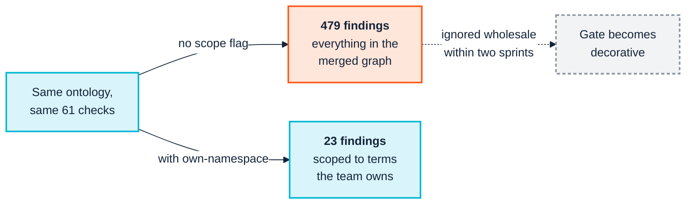

  

# 2. People and cognition

> **Annotated edition.** After each claim that has been checked, an *Evidence* line links to the commands, data and output behind it in [EVIDENCE.md](../../EVIDENCE.md#chapter-02), which links back here. The plain edition of this page is [here](../../../docs/02-people-and-cognition.md).

> *Part I — Why this is hard*

Semantic technology has an unusual property among enterprise technologies: **its
artefacts are arguments about meaning, and meaning is political.** A schema change
is a technical act. A definition change is a negotiation about whose account of the
business is correct.

Is that a reason to dread it? Not really. The same property is what makes building
an ontology one of the better team-building exercises an organisation can go
through. People have to sit together and work out what kinds of thing they have,
what words they all use for them, and how to define them without going round in
circles. That is a social process with a technical output, and this chapter is
about the social half: the human system the toolchain has to survive contact with.

It is not soft-skills garnish appended to the engineering. It decides which
technical choices are viable. The reason [Chapter 9](09-continuous-integration.md)
recommends a particular CI flag over the obvious one is, in the end, a cognitive
argument as much as a correctness one.

---

## 2.1 Definitions are territory

When finance and product disagree about "active customer", the disagreement is not a
misunderstanding to be cleared up. Each definition is load-bearing for someone's
targets, someone's forecast, someone's bonus. Asking the two teams to "agree a single
definition" asks one of them to accept a number that makes their performance look
worse.

Here is where our technology genuinely helps, and it is worth understanding why. A
vocabulary built from *labels* forces a winner: there is one string, "active
customer", and somebody's meaning has to own it. A vocabulary built from
*identifiers*, namespace-based IRIs with labels hung on them, does not. Two concepts
can share a label and keep separate identities; two labels can point at one concept.
People call this the move from "strings to things", and its practical effect is
easy to state: **gone are the days when everyone stayed in the room until one winner
got their way.**

The naive semantic response stops there: *both can exist, we will model them as
distinct subclasses with clear labels.* That is technically correct and socially
incomplete. It resolves the representation problem and leaves the real question
untouched: **which one goes in the board pack?**

Three practical consequences:

**Model the disagreement, do not resolve it.** `BilledActiveCustomer` and
`EngagedActiveCustomer` as distinct, well-labelled terms is a better outcome than a
compromise definition that neither team uses. The ontology's job is to make the
distinction visible and unambiguous, not to adjudicate it.

**Get the adjudication done by someone with the authority to do it.** If the
programme needs a decision about which definition is canonical, that decision needs
an owner senior enough to make it stick. A knowledge engineer does not have that
authority and should not be manoeuvred into pretending they do. The common failure
is a modeller quietly picking one, shipping it, and discovering six months later
that half the business has been ignoring the model.

**Record who decided, and when.** Definitions get relitigated. Without the decision
trail, the same argument recurs annually with fresh participants and no memory of
why the current answer was chosen.

And be ready for what the process reveals. Sometimes building the vocabulary
exposes fracture lines that were already in the organisation: two teams who have
been quietly working to different definitions for years, each assuming the other
agreed. That is not the ontology's fault. It is arguably the most valuable thing
it will find in its first month, and it needs handling by someone with the
standing to handle it.

*Evidence:* [C02.01 — Building the vocabulary exposes fracture lines](../../EVIDENCE.md#c02-01) (argument)

---

## 2.2 The priesthood problem

Semantic technology attracts a particular failure: a small group becomes fluent in
OWL, SHACL and SPARQL, and gradually becomes the only group that can read the
organisation's most important asset.

This feels like success, because the team is indispensable, and it is the surest
predictor of decay. It produces:

- **A review bottleneck.** Every change queues behind the same three people.
- **Unchallengeable models.** Domain experts cannot read the artefact well enough to
  notice it is wrong, so they stop trying, and the modelling loses its only real
  error-correction mechanism.
- **A bus factor of two**, applied to the asset the organisation was told to treat
  as strategic.
- **A veneer of consultation.** Workshops happen; experts nod at diagrams they cannot
  verify; the model records the modeller's understanding, not the expert's.

The counter-measure is not "train everyone in OWL". It is to make sure **the
artefacts that domain experts must validate are rendered in a form they can actually
validate**, and that the formal artefact is generated from, or checked against, that
form. In this toolchain:

- Generated reference documentation, not raw Turtle, is what goes to a domain expert
  for review ([Chapter 13](13-operate-and-consume.md), `docgen`).
- The extension's outline and graph view render structure visually. A domain expert
  can see that `Contractor` sits under `Employee` and say "no, it does not" without
  reading a single axiom ([Chapter 8](08-model-and-validate.md)).
- Check findings carry a human-readable message and remediation, not just a rule
  identifier. `findings.txt` quotes the source line, and `--themes` groups findings
  under questions written in the reader's own words
  ([Chapter 9](09-continuous-integration.md)).

A word on the TypeScript DSL ([Chapter 8](08-model-and-validate.md) §8.2), because
it cuts both ways. It widens the circle of people who can *author*: far more
developers read TypeScript than read OWL. It does nothing for the people who need
to *validate*, who are mostly not developers at all. Use it to share the writing;
keep rendering for the review.

> A useful test: pick a domain expert who has never written RDF and ask them to find
> the deliberate error in your model using only the artefacts you would normally
> send them. If they cannot, your review process is theatre, and the priesthood has
> already formed.

---

## 2.3 Cognitive styles: people do not categorise the same way

Ontology work assumes a particular cognitive style (comfort with abstraction,
hierarchy, and the discipline of saying only what is formally true) and then treats
people who do not share it as obstacles. They are not; they are the domain.

Four styles show up reliably in modelling sessions. None is wrong, and a session that
only accommodates the first will produce a model that is formally elegant and
factually incomplete.

| Style | How they answer *"what is a Customer?"* | What they contribute | How they get lost |
|---|---|---|---|
| **Taxonomic** | Starts with the general case, refines downward, wants the hierarchy settled first | Structural coherence; spots inconsistent partitioning | Over-abstracts; builds levels nobody needs |
| **Narrative / procedural** | *"Well, when an order comes in…"*: tells you the process, not the type | Real edge cases; how the business actually behaves | Frustrated by requests to state things atemporally |
| **Exemplar-driven** | *"Acme Ltd is a customer. So is Bob, sort of."*: reasons from instances | Fast falsification of an over-clean model | Resists generalising; every case is special |
| **Formal / logical** | Asks whether the classes are disjoint and whether the property is functional | Precision; finds the contradictions | Optimises for logical tidiness over usefulness |

The practical move is to **elicit in the style the expert has, and translate**. An
exemplar-driven expert should be shown instances, not a class hierarchy. A narrative
expert should be allowed to tell the story, with the modeller extracting types
afterwards and playing them back as a story to confirm.

A specific trap: **the exemplar-driven expert is usually right and usually
ignored.** When someone says "Bob is sort of a customer", they have found a genuine
boundary problem. The taxonomic instinct is to rule it out of scope. Eighteen months
later, "sort of" cases are 15% of the data and the model has no place to put them.

### From labels to verbs

There is a pattern across whole organisations, not just individuals, and it is worth
naming because it shapes what they can absorb. Watch a two-year-old learning to talk
and you see labels first: *mummy*, *cat*, *car*, *sea*, with a lot of pointing.
Phrases come later, and with them verbs and adjectives. Enterprises acquiring
semantic capability tend to follow the same path. They start with collections of
labels, controlled vocabularies and simple taxonomies, and only later venture into
the verbs: the properties of an ontology that relate one thing to another and let
you say something.

*Evidence:* [C02.02 — Organisations move from labels to verbs](../../EVIDENCE.md#c02-02) (argument)

Two consequences follow for anyone running a programme.

**Meet the organisation where its language is.** A business that has only ever
maintained picklists will not be helped by a session on property chains. Start
with the labels it already has (the taxonomy layer that
[Chapter 12](12-release-and-change.md)'s `pattern-consistency` checks), then
introduce the verbs one at a time, in sentences the business would actually say:
*a task produces a deliverable*; *an order is placed by a customer*.

**Notice what focusing on classes does to your view.** The more a model is built
around classes, the more it follows the organisation's existing verticals, one
business area at a time. Model with relationships, and the same patterns turn out
to recur right across the enterprise. That is why an upper ontology such as gist
deliberately leaves most of its properties without a fixed domain or range. In the
current release, gist 14.1.0, 42 of its 66 object properties constrain neither;
when I counted gist 13 for that Semantic Arts piece it was 40 of 63, so the
pattern has held as the ontology has grown. It is a choice for flexibility, and it
has a cost you will meet in
[Chapter 3](03-across-the-boundary.md): a checker that expects every property to
say where it belongs has to be taught that some deliberately do not.

*Evidence:* [C02.03 — gist 14.1.0: 42 of 66 object properties constrain neither; gist 13: 40 of 63](../../EVIDENCE.md#c02-03) (reproduced: PASS)

This is also why the fixture in Part III is a small org chart rather than an
abstract domain. `Employee`, `Contractor` and `worksIn` are things every style can
reason about, which makes it a fair test of tooling rather than a test of whether
the reader thinks like a taxonomist.

---

## 2.4 Cognitive capacity is a hard budget

Working memory holds roughly four items. Not four ontology classes: four *chunks*,
where a chunk is whatever the person has already internalised well enough to treat
as one thing. An experienced modeller may hold "the employment subtree" as one
chunk; a newcomer holds five classes and has nothing left over to reason with.

Every design decision in a semantic toolchain either spends or conserves this
budget. Three places where the spending is visible and avoidable:

### The 479-finding report

Running the full check registry over the manual's fixture with its real `org:` and
FOAF imports resolved produces **479 findings**. Adding a single flag that scopes
the report to the terms the team actually owns produces **23**.

*Evidence:* [C02.04 — 479 findings, 23 once scoped](../../EVIDENCE.md#c02-04) (reproduced: PASS)

Both numbers are correct. The wide run is genuinely checking every triple in the
merged graph, including the internal documentation habits of the W3C Organization
Ontology. It is also **cognitively useless as a gate**. No team triages five hundred
findings per commit, so within two sprints the gate is either switched off or
ignored, and the twenty-three findings that were actually theirs are lost with the
rest.

This is the single most important practical lesson in the manual, and
[Chapter 9](09-continuous-integration.md) works through it with the real outputs,
including why the *obvious* way to cut the noise introduces four false findings of
its own.

### Saying each thing once

Even twenty-three findings can be presented in a way that wastes attention. The
suite's report for people, `findings.txt`, is built on a rule I would like more
tools to follow: **say each thing once.** A source line is quoted once however many
checks fired on it. A message that is the same template for twenty findings is
printed once, not twenty times with one word changing. The remediations sit together
under a single *how to fix* heading. On the manual's fixture the suite measured the
effect at 696 lines where the older reports took 1,685, for the same findings.

And where it cannot place a finding, it says so rather than guessing. A finding about
a term declared in an imported file has no line in *your* file, and the locator
declines to invent one. A confidently wrong line number sends a reader to the wrong
place; an honest "not located" sends them to the right question.

### Ontology size versus the review budget

A 40-class ontology can be reviewed by a domain expert in a sitting. A 400-class
ontology cannot be reviewed by anyone, in any sitting, ever; it can only be
spot-checked. Past that scale, correctness stops being a function of human attention
and becomes entirely a function of mechanical checking. Teams routinely cross that
threshold without noticing that their quality model has quietly changed.

### Error messages as cognitive artefacts

`LOG-001` means nothing. *"Class `acme:Contractor` is asserted disjoint with its own
transitive superclass `acme:Employee`, which makes `acme:Contractor` logically
unsatisfiable"*, followed by *"remove either the subclass axiom or the disjointness
axiom; the two together are contradictory"*, means something to a competent engineer
who has never studied description logic. The second form is what the suite emits,
and it is the difference between a check that teaches and a check that merely gates.

The opposite case taught me as much. For a while, one check's message on anonymous
restrictions read *"A label on _:1_b4 has no language tag"*, an internal identifier
that changes on every run and points at nothing a person can find. Its count,
severity and focus node were all correct, so every test passed. A message that names
something unfindable is a message nobody can act on, and that is now something the
testing repository asserts against ([Chapter 9](09-continuous-integration.md) §9.8).

---

## 2.5 The workshop is a social event with a technical output

Domain experts have finite patience for refinement workshops, and maintenance fatigue
is a documented killer of enterprise ontology programmes. Calendar declines end more
semantic initiatives than technical failures do.

Design accordingly:

- **Front-load the expensive human time; automate the recurring part.** The first
  elicitation genuinely needs a room. The 400 subsequent consistency questions do
  not, and if you spend expert goodwill on them, it will not be there when you need
  it for the questions only a human can answer.
- **Bring falsifiable artefacts, not blank paper.** A wrong draft gets corrected in
  ten minutes; an open question gets a forty-minute discussion and no decision.
  Experts are far better critics than authors. That is not a failing; it is how
  expertise works.
- **Close the loop visibly.** An expert who never sees their correction land
  concludes, correctly, that the session was extractive. Show the diff.
- **Let them leave on the same wavelength.** The best sessions end with people
  finishing each other's sentences about the business. That cohesion is worth
  protecting, and it is easily spent by a follow-up email full of check ids.

---

## 2.6 What this implies for the toolchain

Everything above resolves into requirements that Part III should be read against:

| Human problem | Toolchain requirement | Where it lands |
|---|---|---|
| Priesthood, unreadable artefacts | Generated docs and visual structure for non-specialists | [Ch. 8](08-model-and-validate.md), [Ch. 13](13-operate-and-consume.md) |
| Cognitive overload at the gate | Findings scoped to what the team owns, each thing said once | [Ch. 9](09-continuous-integration.md) |
| Check ids are the tool's language, not the reader's | Findings grouped under questions in the reader's words | [Ch. 9](09-continuous-integration.md) §9.4 |
| Maintenance fatigue | Drift detected mechanically; repairs proposed automatically | [Ch. 12](12-release-and-change.md) |
| Territorial definitions | Identity separated from label; change impact explicit before merge, so decisions have evidence | [Ch. 12](12-release-and-change.md) |

If a tool does not reduce the load on the humans, it will be abandoned regardless of
correctness. That is the whole argument, and it is worth carrying into every tooling
decision the programme makes.

---

## Sources

- [How Enterprise Ontologies Fail, And How to Stop It — Modern Data 101](https://www.moderndata101.com/blogs/how-enterprise-ontologies-fail-and-how-to-stop-it)
- [Enterprise Knowledge Graph Platform Comparison 2026 — OvalEdge](https://www.ovaledge.com/blog/enterprise-knowledge-graph-platform)
- [My Ontologist: Evaluating BFO-Based AI for Definition Support (arXiv)](https://arxiv.org/pdf/2407.17657)
- [Team Building — The Importance of an Ontology — Semantic Arts](https://www.semanticarts.com/team-building-the-importance-of-an-ontology/)
- [From Labels to Verbs — Child's Play! — Semantic Arts](https://www.semanticarts.com/from-labels-to-verbs-childs-play/)

---

| ← [1. The business case](01-the-business-case.md) | [3. Across the boundary →](03-across-the-boundary.md) |
|---|---|
