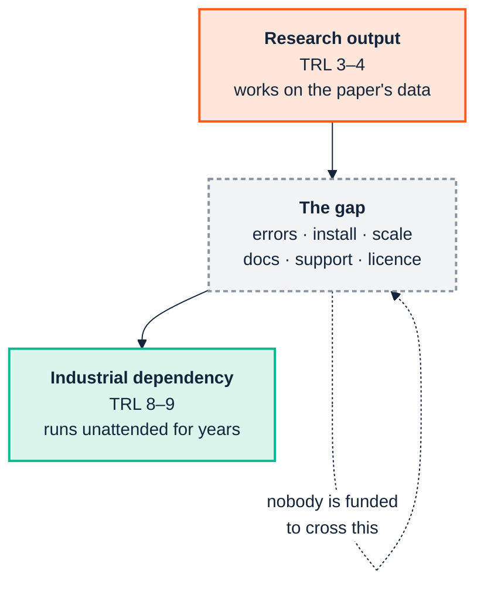

<p align="center">
  
</p>

# 4. From research to industry

> **Annotated edition.** After each claim that has been checked, an *Evidence* line links to the commands, data and output behind it in [EVIDENCE.md](../../EVIDENCE.md#chapter-04), which links back here. The plain edition of this page is [here](../../../docs/04-from-research-to-industry.md).

> *Part I — Why this is hard*

Semantic technology has deeper academic roots than almost any other part of the
enterprise data stack. Description logics, OWL, SHACL, OTTR, the reasoners and a
large share of the libraries all began in university research groups. We went
nearly two thousand years from Plato's "carving nature at its joints" to William
Woods asking "what's in a link?", and a good deal of the distance since has been
covered in seminar rooms. That is a genuine strength, because the formal
foundations are unusually solid. It also creates a characteristic and
under-discussed problem:

> **A research project and an industrial product optimise for different things,
> and the artefacts they produce are correspondingly different. Adopting a research
> artefact as though it were a product is one of the most reliable ways to derail a
> semantic programme.**

This chapter is about that mismatch, and about how to consume research output
responsibly rather than either naively or dismissively.

---

## 4.1 Different objective functions

Neither party is doing anything wrong. They are being rewarded for different
outcomes.

| | University project | Industrial product |
|---|---|---|
| **Success is** | A novel, defensible contribution, published | A system that runs unattended for years |
| **Rewarded for** | Novelty, generality, formal results | Reliability, predictability, supportability |
| **Timeline** | Funded 3 years; ends on a date | Indefinite; cost accrues after launch |
| **Team continuity** | The PhD student graduates | Deliberate handover and on-call |
| **Failure handling** | Out of scope; the paper reports the good case | The main event; most code is edge cases |
| **Evaluation** | Precision/recall against a gold standard | Did the build stay green, did anyone have to think |
| **Docs aimed at** | Reviewers who know the field | A newcomer at 4pm on a Friday |
| **"Done"** | Paper accepted | Never |

The consequential row is **timeline**. A research artefact's maintenance model is
usually *"the author will fix it if they have time and still care"*. That is not a
criticism (no grant funds a decade of maintenance) but it means the artefact carries
an implicit expiry date that does not appear anywhere in its README.

<a id="ev-c04-06"></a>*Evidence:* [C04.06 — A research artefact's implicit expiry date](../../EVIDENCE.md#c04-06) (argument)

---

## 4.2 What actually arrives

A research artefact typically arrives at roughly **TRL 3–4**: validated in a lab
setting, demonstrated on the paper's own dataset. Industrial dependency requires
roughly **TRL 8–9**. That is not a small increment; it is usually more work than the
original research.



Concretely, the things usually missing:

**Failure behaviour.** Research code tends to assume well-formed input, because the
paper's dataset was well-formed. Production input is not. The difference shows up as
stack traces rather than diagnostics.

**Installation as a solved problem.** "Requires Java 8, this specific JAR, and these
three environment variables" is acceptable in a lab and is a procurement event in an
enterprise.

**Scale characteristics.** Evaluated on 10,000 triples; your graph has 400 million.
Reasoning in particular has complexity characteristics that make this gap qualitative
rather than quantitative.

**Error messages for non-specialists.** Compare `LOG-001` with the suite's actual
message, *"Class `acme:Contractor` is asserted disjoint with its own transitive
superclass `acme:Employee`, which makes `acme:Contractor` logically unsatisfiable"*,
plus a remediation line. The first is a research artefact's idiom; the second is a
product's.

**Licence and provenance clarity.** Research code frequently has no licence file at
all, which means it is not usable, which is rarely what the author intended.

**Backwards compatibility as a commitment.** Research artefacts change shape between
versions because the research changed shape. That is correct behaviour for research
and disqualifying for a dependency.

---

## 4.3 A verified example from this manual's own toolchain

This is not hypothetical, and it happened again while preparing this edition.

The ontology suite supports real OWL2 DL reasoning through HermiT, a
research-lineage reasoner, reached through `owlready2`, a research-lineage
Python library. Running the quality gate on the fixture produced, in five runs of
ten:

```
LOG-001   logical    Class disjoint with its own ancestor              Violation
REA-022   reasoning  External DL reasoner unavailable --
                     only owlrl-based checks ran                       Info
```

with this message on `REA-022`:

> The external DL reasoner ('hermit') could not be run: `cannot access local
> variable 'entity' where it is not associated with a value`. Only the always-on
> owlrl RDFS/OWL2-RL closure and pattern checks (REA-001..004, LOG-001..007) ran.
> These are sound but not complete for full OWL2 DL — a class can be genuinely
> unsatisfiable without any of them firing.

<a id="ev-c04-01"></a>*Evidence:* [C04.01 — REA-022 carries owlready2's internal error](../../EVIDENCE.md#c04-01) (reproduced: PASS)

Three things are worth taking from that.

**The research-grade component failed in a research-grade way.** An internal Python
`UnboundLocalError` surfacing through the reasoner bridge is not a diagnosable error
for the team using it. There is nothing to act on in it. And it hid its cause for
every edition so far: the manual called the failure random and blamed HermiT.
Reading the traceback for this edition showed something else: owlready2's *loader*
drops a `TypeError` it does not recognise while building a class for one FOAF
property, and whether that error arises depends on Python's hash seed. HermiT was
never reached ([Chapter 14](14-coverage-and-gaps.md) §14.4). An error message that
names an internal variable doesn't just fail to help; it points everyone at the
wrong component.

<a id="ev-c04-02"></a>*Evidence:* [C04.02 — The failure is in owlready2's loader, not HermiT](../../EVIDENCE.md#c04-02) (reproduced: PASS)

**The industrial wrapper turned that into a usable signal.** Rather than crashing,
or (much worse) quietly reporting "no problems found", the suite emitted a
first-class finding that states which checks did not run, what that means for the
soundness and completeness of the result, and what to install to fix it. The
distinction between *"we checked and it is fine"* and *"we could not check"* is
preserved, and that distinction is the entire difference between a gate you can
trust and one you cannot.

**The dependency is optional by design, though not where I said it was.** Earlier
editions told you the DL reasoner lived behind an optional install extra. It does
not: `owlready2` installs with the suite, and always has. What is optional is the
**Java runtime** HermiT runs in. Hide Java and `REA-022` says so in different
words, the operating system's *cannot find the file specified*. The core gate, the
always-on `owlrl` closure plus pattern checks, needs neither, and it caught the
fixture's deliberate contradiction anyway, as `LOG-001`. The research-grade capability is available to those who want
it and load-bearing for nobody.

<a id="ev-c04-03"></a>*Evidence:* [C04.03 — Without Java, the operating system's message; LOG-001 regardless](../../EVIDENCE.md#c04-03) (reproduced: PASS)

That is the pattern to copy, and it generalises well past this one tool:

> **Consume research artefacts as optional enhancements behind a stable interface,
> with a supported fallback that is sufficient on its own. Never let the
> research-grade component sit on the critical path.**

There is a coda this time, and it is a warning about the *pipe* rather than the
component. That carefully preserved signal, `REA-022`, is a finding about the run,
so a run scoped with `--own-namespace` filters it out along with everything else
that is not yours ([Chapter 10](10-ingest-and-transform.md) §10.4). **A good failure
signal is only as good as the plumbing it has to travel through.** It is worth
tracing every "could not check" your tools emit all the way to the place a human or a
gate will read it.

And a second layer to the same story. Even when HermiT is installed and working, it
has real limitations of its own: the suite's reasoning documentation records a case
where it refuses an ontology using `xsd:date`. A tool being research-grade does not
mean it is unreliable. It means its failure modes are yours to discover, contain and
route around.

---

## 4.4 The evaluation mismatch

The two worlds do not even measure the same thing.

Research asks: *does this technique find the errors, on a gold-standard corpus,
better than the prior technique?* Precision and recall against a labelled set.

Industry asks: *did this stop a bad change reaching production, without costing the
team more attention than the bad change would have?*

The second question has a term the first does not: **the human cost of the output**.
A checker with better recall that produces 479 findings where 23 are yours
([Chapter 2](02-people-and-cognition.md)) scores well on the research metric and
fails in practice, because a gate nobody triages is not a gate.

Reproducibility divides the two cultures the same way. The unscoped run used to drift
by a few findings between identical invocations: immaterial to a recall benchmark
computed once against a gold standard, and disqualifying for a build gate a team has
to trust twenty times a day. It was fixed once someone measured it repeatedly rather
than once, which is itself the difference between the two evaluation cultures.

### When a perfect score is the wrong answer

Conformance suites sit between the two worlds, and this autumn produced two good
illustrations of using them well.

The SHACL engine passed all 426 W3C tests for a few days at 0.3.0, by enforcing one
rule about subqueries to the letter. That version also refused three of the quality
suite's own production checks: graph-wide aggregates that are perfectly well defined
under the way the engine handles `$this`. 0.3.1 narrowed the rule to the case it
exists to protect against, accepted a score of 425, and named the one test it now
disagrees with, with its reasoning, in the README
([Chapter 11](11-rules-and-inference.md) §11.1). A perfect score had been the version
that broke production.

<a id="ev-c04-04"></a>*Evidence:* [C04.04 — A perfect SHACL score broke production; 0.3.1 took 425](../../EVIDENCE.md#c04-04) (cited)

HOLOS reports its W3C results as **two numbers, because either alone misleads**:
correctness (how much of what runs passes) and coverage (how much of the suite runs
at all). Its SPARQL 1.1 line reads 512 of 512 for correctness and 82% for coverage.
A single "100%" would have been true, and would have hidden the 113 tests the
harness does not yet run. The same project withdrew its original 500,000
quads-per-second target in writing, explaining that it "was written before anything
was measured", and published where the time actually goes instead.

<a id="ev-c04-05"></a>*Evidence:* [C04.05 — HOLOS reports correctness and coverage: 512 of 512, 82%](../../EVIDENCE.md#c04-05) (cited)

> **When you evaluate a semantic component, ask for the coverage beside the score,
> the named exceptions beside the pass rate, and the measurements beside the
> targets.** A vendor who offers those unprompted is behaving like an industrial
> partner. One who offers a single percentage is behaving like a paper.

This is why [Chapter 9](09-continuous-integration.md)'s central recommendation is
about *scoping the report*, not about check quality. The checks were already good.
The industrial problem was never detection; it was attention.

---

## 4.5 How to consume research output well

Neither naive adoption nor blanket refusal. Eight practices:

1. **Pin exactly.** Research artefacts change shape between versions. Pin the version
   and upgrade deliberately.
2. **Wrap behind your own interface.** Never let a research library's API become your
   internal API, or you inherit its churn.
3. **Have a fallback that is sufficient alone.** The optional enhancement is never the
   critical path.
4. **Convert its errors into your diagnostics.** `REA-022` is the model: catch the
   incomprehensible failure, state what did not run and what that means, and make
   sure the statement reaches a reader.
5. **Check the licence before the capability.** An unlicensed artefact is not
   adoptable however good it is. Establish this first; it is cheap and occasionally
   fatal.
6. **Budget for the crossing.** If the artefact is load-bearing, someone must be
   funded to maintain the industrial wrapper. If nobody is, you have a dependency with
   an expiry date and no calendar entry.
7. **Keep a stricter second opinion.** The quality suite's checks passed every test
   on a lenient SPARQL engine and lost their messages on a conformant one
   ([Chapter 7](07-the-toolchain.md) §7.1). Run your rules under a strict reader as
   well as the one you ship with, and keep the lenient one as a witness rather than
   a judge.
8. **Use the research artefact as an oracle, not only as a runtime.** tarka
   reimplements OTTR's reference processor, Lutra, which came out of the Oslo research
   group that defined the language. In its author's words the semantics are
   Lutra's, "read from its bytecode and confirmed by running it", and its tests
   run Lutra live, when available, and require the same output. HOLOS does the same with the Oxigraph
   evaluator: a failure only counts against HOLOS if it diverges from that reference.
   You get the research artefact's precision in your test suite without putting it on
   your critical path.

---

## 4.6 The other direction

The traffic is not one-way, and industry's contribution is usually the unglamorous
half:

- **Real corpora.** Research is starved of realistic, messy, licensable data.
- **Failure reports.** The `xsd:date` reasoner limitation; the FOAF `owl:Thing`
  domain convention ([Chapter 3](03-across-the-boundary.md)); `sh:severity` written
  where one engine read it and another did not; a specification rule about subqueries
  that, read literally, refuses ordinary shapes. These are findable only by running
  tools against real work.
- **Scale evidence.** The engine benchmarks exist because someone ran both engines on
  a real-sized ontology and wrote down what happened. HOLOS's changelog records a
  GeoNames query taking 306 seconds where Apache Jena answered in under 30, and
  the change that took it to a quarter of a second. Publishing the embarrassing number first is what
  makes the good one credible.

The healthy relationship is: research supplies the formal foundations and the novel
techniques; industry supplies the corpora, the failure reports and the maintenance.
Both halves are needed, and the second half is the one that decides whether any of
it survives contact with an actual enterprise.

---

## Sources

- [Closing the gap between software engineering education and industrial needs (arXiv)](https://arxiv.org/pdf/1812.01954)
- [Generative AI solutions for software quality: Assessing industrial readiness — Software Quality Journal](https://link.springer.com/article/10.1007/s11219-026-09754-7)
- [A core ontology for modeling life cycle sustainability assessment on the Semantic Web — Journal of Industrial Ecology](https://onlinelibrary.wiley.com/doi/10.1111/jiec.13220)
- [Are Computer Science and Engineering Graduates Ready for the Software Industry? (arXiv)](https://arxiv.org/pdf/1805.08894)
- [From Labels to Verbs — Child's Play! — Semantic Arts](https://www.semanticarts.com/from-labels-to-verbs-childs-play/)

---

| ← [3. Across the boundary](03-across-the-boundary.md) | [5. GenAI and agents →](05-genai-and-agents.md) |
|---|---|
