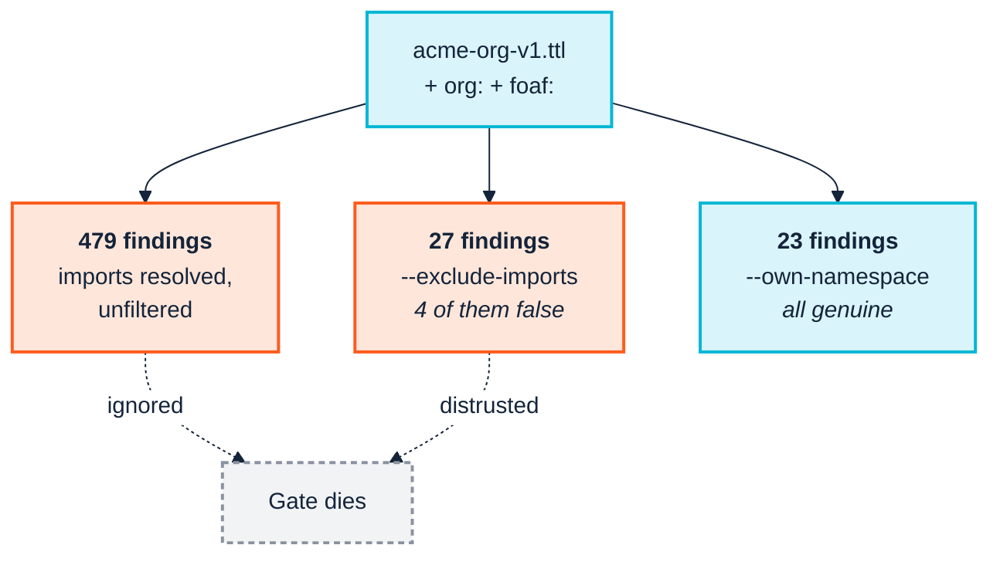

<p align="center">
  
</p>

# 9. Continuous integration

> **Annotated edition.** After each claim that has been checked, an *Evidence* line links to the commands, data and output behind it in [EVIDENCE.md](../../EVIDENCE.md#chapter-09), which links back here. The plain edition of this page is [here](../../../docs/09-continuous-integration.md).

> *Part III — The practice · SemOps stage 3 · Operating-model layer 3*

> **Stories answered here**
> *As a SemOps engineer, I want bad semantic changes rejected automatically, and
> I want the rejection to be about* our *code.*

Have you ever been copied into an email thread that was mostly other people's
business? You skim it, you find nothing addressed to you, and after the third
one you start filing them unread. Then one day the thread that mattered goes
the same way. That, more or less, is how a semantic quality gate dies, and this
chapter is about stopping it.

Stage 3 is where SemOps stops being a philosophy. The blueprint's stated goal is
blunt, *"automatically reject bad semantic changes"*, and the mechanism is
almost embarrassingly simple: one flag, `--fail-on`, and a non-zero exit code.

The simple part takes a paragraph. The rest of the chapter is about the part
that decides whether the gate survives its first month, which is **what the gate
reports, and to whom**.

---

## 9.1 The mechanism

```bash
python -m ontology_suite ontology \
  --ontology examples/acme_robotics/acme-org-v1.ttl \
  --import-dir examples/acme_robotics \
  --fail-on Violation
```

`--fail-on` takes `Violation`, `Warning`, `Info` or `never`. The command exits
non-zero when a finding at or above that severity exists. Against the fixture
this exits non-zero, because `LOG-001`, the deliberate `Contractor`/`Employee`
contradiction, is a real Violation.

<a id="ev-c09-01"></a>*Evidence:* [C09.01 — --fail-on Violation exits non-zero on the fixture](../../EVIDENCE.md#c09-01) (reproduced: PASS)

That is the whole gate. `version-diff` has its own variant (`--fail-on major`),
`consistency` and `pattern-consistency` use `--fail-on-misalignment` and
`--fail-on-mismatch`, and `consistency-remote` takes `--fail-on-misalignment`
too. Nothing more exotic is needed for a green or red build.

---

## 9.2 The problem: 479 findings

Now run the full registry the obvious way: the whole 61-check catalogue against
the ontology, with its real `org:` and FOAF imports resolved.

```bash
python -m ontology_suite checks \
  --ontology examples/acme_robotics/acme-org-v1.ttl \
  --import-dir examples/acme_robotics \
  --engine sparql --out-dir out/checks --fail-on never
```

```
Findings: 479 total (55 Violation, 340 Warning, 84 Info)
```

> **479 every time, and 479 on a new engine.** Three consecutive runs give the
> same count, and so did the runs after the suite moved its evaluation from
> rdflib and pyshacl onto holosdb and the native SHACL engine. Not one finding
> moved. That's what you hope for from an engine swap and rarely get.
>
> It has not always been so steady. An earlier edition reported "close to 300"
> with a drift of 289–298 between identical runs, traced to registry
> `CONSTRUCT`s binding **two** values per result while the merge step read an
> arbitrary one. Then the count moved from 301 to 479 with the fixture sitting
> perfectly still, because the registry grew from 50 checks to 61 and two of the
> new ones, `QUA-009` and `QUA-010`, fire on every undocumented term. **A
> registry upgrade changes your findings while your ontology sits still.** Read
> a jump in the count as "the rules moved" before you read it as "the model got
> worse".
>
> Underneath all of it is [§9.8](#98-testing-the-gate-itself)'s lesson: **a
> count is a fragile thing to assert on.** Through every one of those changes,
> the *set of check identifiers* behaved sensibly.

<a id="ev-c09-02"></a>*Evidence:* [C09.02 — The unscoped run reports 479 findings, every time](../../EVIDENCE.md#c09-02) (reproduced: PASS)

Every one of those findings is real. The suite is genuinely checking every
triple in the merged graph, and the merged graph includes the entire W3C
Organization Ontology and the entire FOAF vocabulary, complete with their own
documentation habits, blank-node axiom style and naming choices.

Wire that into CI with `--fail-on Violation` and you have gated your build on 55
violations, of which exactly one is yours. What happens next is predictable. The
team triages it once, concludes the tool is noisy, and either switches the gate
off or adds `|| true`. The 23 findings that were genuinely theirs are lost with
the other 456.

> **This is the commonest way a semantic quality gate dies.** Not because the
> checks are wrong (they are not) but because nobody considered
> [Chapter 2](02-people-and-cognition.md)'s cognitive budget. A gate nobody
> triages is not a gate.

<a id="ev-c09-22"></a>*Evidence:* [C09.22 — An ignored gate dies](../../EVIDENCE.md#c09-22) (argument)

So: whose problems are these? A domain steward owns the correctness of *their
own* additions to a shared vocabulary. They do not own the W3C's internal
documentation habits, and cannot fix them.

---

## 9.3 The obvious fix is wrong

The instinctive move is to stop resolving the imports at all:

```bash
python -m ontology_suite checks \
  --ontology examples/acme_robotics/acme-org-v1.ttl \
  --exclude-imports \
  --engine sparql --out-dir out/checks_excl --fail-on never
```

479 findings become **27**. Enormously better, and still wrong. Here is the
full breakdown:

<a id="ev-c09-03"></a>*Evidence:* [C09.03 — --exclude-imports gives 27 findings, four of them false](../../EVIDENCE.md#c09-03) (reproduced: PASS)

```
 2 × DAT-002  Warning    Dangling IRI reference
 1 × LOG-001  Violation  Class disjoint with its own ancestor
 1 × QUA-001  Warning    Class or property missing rdfs:label
 3 × QUA-004  Warning    Resource missing skos:prefLabel
 9 × QUA-009  Warning    Class or property without one skos:prefLabel per language
 9 × QUA-010  Warning    Class or property without a skos:definition
 1 × STR-003  Warning    Property missing both domain and range
 1 × STY-002  Warning    Property name not lowerCamelCase
```

Inspect the two `DAT-002` findings and the cause is immediate:

```
focus = acme:1.0.0       value = http://xmlns.com/foaf/0.1/
focus = acme:Employee    value = http://xmlns.com/foaf/0.1/Person
```

Both point at FOAF. `acme:Employee` is a subclass of `foaf:Person`, and with
imports excluded FOAF is not loaded, so `foaf:Person` looks like a dangling
reference. It is not dangling; it is simply absent. Two of the three `QUA-004`
findings are the same artefact, against `foaf:` itself and `foaf:Person`, whose
labels live upstream in a file you just declined to read.

**`--exclude-imports` traded 456 irrelevant findings for 4 false ones.** In some
ways that is worse. Irrelevant findings get ignored, but false findings get
*investigated*, and an engineer who spends an afternoon proving that
`acme:Employee` is fine learns exactly the same lesson about the tool's
trustworthiness.

---

## 9.4 The right fix: `--own-namespace`

Keep the imports resolved, so upstream context is real, `foaf:Person` genuinely
exists and cross-vocabulary reasoning works, and filter the **report** to
findings whose focus node lies in your own namespace:

```bash
python -m ontology_suite checks \
  --ontology examples/acme_robotics/acme-org-v1.ttl \
  --import-dir examples/acme_robotics \
  --engine sparql \
  --own-namespace "https://acme.example.org/ns/" \
  --out-dir out/checks_own --fail-on never
```

```
 1 × LOG-001  Violation  Class disjoint with its own ancestor
 1 × QUA-001  Warning    Class or property missing rdfs:label
 1 × QUA-004  Warning    Resource missing skos:prefLabel  -> acme:hasSkill
 9 × QUA-009  Warning    Class or property without one skos:prefLabel per language
 9 × QUA-010  Warning    Class or property without a skos:definition
 1 × STR-003  Warning    Property missing both domain and range
 1 × STY-002  Warning    Property name not lowerCamelCase
```

**Twenty-three findings. All twenty-three are Acme's. None are artefacts.**
Exact across repeated runs, with the same check identifiers every time.

<a id="ev-c09-04"></a>*Evidence:* [C09.04 — --own-namespace gives 23 findings, all Acme's](../../EVIDENCE.md#c09-04) (reproduced: PASS)

Eighteen of them are the documentation pair, `QUA-009` and `QUA-010`, firing once
each on all nine of Acme's terms. The fixture declares `rdfs:label` on most of
them but no `skos:prefLabel` and no `skos:definition` anywhere. That is a fair
finding rather than noise, and it is a useful shape to recognise: **a check that
fires on every term is telling you about a policy you have not adopted, not
about nine separate mistakes.** Decide whether you want SKOS documentation. If
you do, it is one pass of work; if you don't, the `--registry` mechanism in
[Chapter 8](08-model-and-validate.md) lets you drop both checks.

Compare the three runs directly. All three are the same ontology, registry and
engine:

| Run | Findings | Genuinely yours | Upstream noise | False |
|---|---|---|---|---|
| `--import-dir` alone | **479** | 23 | 456 | 0 |
| `--exclude-imports` | **27** | 23 | 0 | **4** |
| `--own-namespace` | **23** | 23 | 0 | 0 |

<a id="ev-c09-05"></a>*Evidence:* [C09.05 — The three runs compared: 479, 27, 23](../../EVIDENCE.md#c09-05) (reproduced: PASS)



### Reading the 23 as questions, not as check ids

Twenty-three findings is a list a person can read, but check ids are the tool's
vocabulary, not yours. `--themes` takes a small file mapping check ids to
questions in your own words, and puts a *by question* index at the top of
`findings.txt`:

<a id="ev-c09-06"></a>*Evidence:* [C09.06 — --themes groups findings under questions in your words](../../EVIDENCE.md#c09-06) (reproduced: PASS)

```json
{
  "Can a domain expert read what each term means?": ["QUA-001", "QUA-004", "QUA-009", "QUA-010"],
  "Is the model logically coherent?": ["LOG-001", "REA-021"],
  "Will our naming survive a code review?": ["STY-002"]
}
```

```
-- by question -------------------------------------------------------------

  Can a domain expert read what each term means?  (20)
      QUA-001 x1, QUA-004 x1, QUA-009 x9, QUA-010 x9

  Is the model logically coherent?  (1)
      LOG-001 x1

  Will our naming survive a code review?  (1)
      STY-002 x1

  not mapped to a question  (1)
      STR-003
```

I like this more than I expected to. It turns a report into the start of a
conversation with a steward, in the steward's words. And notice the last group:
a check with findings that no question covers is listed rather than dropped, so
"it found nothing" and "nobody asked" stay distinguishable. The map is many to
many, and it belongs to your project rather than to the tool, which is why it is
an input rather than registry data.

### A real mistake worth repeating

The first time I ran that command, while writing the first edition, I used
`--own-namespace "http://example.org/acme#"` and got:

```
Findings: 0 total (0 Violation, 0 Warning, 0 Info)
```

A confidently empty report, and at the time indistinguishable from a passing
gate. The fixture's namespace is `https://acme.example.org/ns/`: different
scheme, host and separator. `--own-namespace` is a **literal IRI-prefix string
match**, not a prefix-name lookup.

**The tool now says so.** Reported from that experience, the same command today
prints, before the count:

<a id="ev-c09-07"></a>*Evidence:* [C09.07 — A near-miss namespace warns, on stderr, and lists blank-node labels](../../EVIDENCE.md#c09-07) (reproduced: PASS)

```
WARNING: --own-namespace http://example.org/acme# matched none of the 479
findings, so this run reports nothing. It is a literal IRI-prefix match --
check the scheme, host and trailing separator against the ontology's own
@prefix line. Namespaces actually seen: N7b108cac662043fa969705589b18d8da/,
Nff4c262cf8a849d9af5c65a5bd228a8f/, http://purl.org/dc/elements/1.1/, …
```

Look at the first two "namespaces". They are blank-node identifiers with a slash
on the end, which is the internal-label leak from
[Chapter 7](07-the-toolchain.md) §7.1 turning up in a third place. It's harmless
here, because the real namespaces follow, but it's the kind of thing a reader
squints at, so it has a line in [Chapter 14](14-coverage-and-gaps.md) §14.4.

The warning fires only when there were findings to lose. A filter matching
nothing on a genuinely clean run is not an error, and warning there would train
people to ignore the message. It also goes to **stderr**, so a CI step that
captures only stdout will not show it. Two lessons survive the fix:

<a id="ev-c09-08"></a>*Evidence:* [C09.08 — The warning fires only when there were findings to lose](../../EVIDENCE.md#c09-08) (cited)

1. **Copy the namespace from the ontology, never from memory.** It is the string
   after `@prefix`, in full, including the trailing `/` or `#`.
2. **Verify the filter with a known-failing input once**, and keep that check.
   A gate that cannot fail is indistinguishable from a gate that passes.

### What the filter cannot see

One more thing, which I found while preparing this edition and which matters
more than the warning. The filter keeps a finding when its focus node *starts
with* your prefix. Most findings are about a term, so that is right. But a few
are about **the run itself**. `REA-022`, "the DL reasoner could not run", has
the focus node `oq:Graph`, which is in nobody's namespace. So a scoped run
drops it.

For `checks` this costs nothing, because `checks` does not run the reasoner. For
`data` and `run`, which do, it means a scoped gate cannot tell *"HermiT checked
and found nothing"* from *"HermiT never started"*.
[Chapter 10](10-ingest-and-transform.md) §10.4 shows it happening, and what to
do about it.

<a id="ev-c09-09"></a>*Evidence:* [C09.09 — A scoped run drops the 'reasoner did not run' finding](../../EVIDENCE.md#c09-09) (reproduced: PASS)

### When to run the wide pass anyway

Do not discard the wide run; just take it off the pull-request path. Run it
**periodically, or when an imported vocabulary changes**, as an audit rather than
a gate. That is when "FOAF published a new version and something in it now
conflicts with our assumptions" becomes findable, which is a different question
from "did this PR break anything".

| Cadence | Command | Purpose |
|---|---|---|
| Every PR | `checks --own-namespace <yours> --fail-on Violation` | Gate |
| Weekly / on upstream change | `checks --import-dir … --fail-on never` | Audit |

---

## 9.5 Wiring it up

The pattern generalises to three gate types, one per kind of pull request.

```yaml
name: semantic-ci
on: [pull_request]

jobs:
  ontology:
    runs-on: ubuntu-latest
    env:
      PYTHONHASHSEED: "0"      # docgen's order and the DL reasoner both follow it (Ch. 14 §14.4)
    steps:
      - uses: actions/checkout@v4
        with:
          # version-diff compares against the base branch, so the default
          # shallow checkout is not enough.
          fetch-depth: 0
      - uses: astral-sh/setup-uv@v5
      - run: uv sync --locked      # the suite, holosdb and shacl, at the locked versions

      # 1. Is the schema itself sound?
      - name: Ontology quality gate
        run: |
          uv run ontology-quality-suite ontology \
            --ontology ontology/acme-org.ttl \
            --import-dir lib/vocab \
            --fail-on Violation

      # 2. Does it pass our rules, scoped to terms we own?
      - name: Registry checks (our namespace only)
        run: |
          uv run ontology-quality-suite checks \
            --ontology ontology/acme-org.ttl \
            --import-dir lib/vocab \
            --own-namespace "https://acme.example.org/ns/" \
            --themes ontology/themes.json \
            --engine sparql \
            --out-dir out/checks \
            --fail-on Violation

      # 3. Is this release breaking, and does anything downstream break with it?
      - name: Change impact
        run: |
          git show "origin/${{ github.base_ref }}:ontology/acme-org.ttl" > /tmp/base.ttl
          uv run ontology-quality-suite version-diff \
            /tmp/base.ttl ontology/acme-org.ttl \
            --json --fail-on major --out-dir out/version-diff
        continue-on-error: true   # informational: a MAJOR bump needs sign-off, not a block

      - uses: actions/upload-artifact@v4
        if: always()
        with:
          name: semantic-reports
          path: out/
```

Five points about that job.

**Keep local copies of your imports.** `--import-dir lib/vocab` resolves
`owl:imports` against files in your own repository. `--allow-network` exists, and
CI is the last place you want it. A build whose result depends on a third
party's uptime is not reproducible, and an upstream vocabulary that changes
silently changes your gate silently.

**Pin everything, including the engines.** `uv sync --locked` installs exactly
what `uv.lock` records, and the lock now includes holosdb and `shacl` because
they are runtime dependencies. This is not fussiness. The SHACL engine's 0.3.0
changed the *default meaning* of `sh:conforms` to the one the specification
defines, under which a Warning or an Info breaks conformance too. The suite
responded by pinning `shacl>=0.3.0,<0.4`, with a comment saying a minor release
of the engine can change what a report says. **Treat a validator upgrade the
way you would treat a compiler upgrade:** deliberately, on a branch, with the
diff of the reports in front of you.

<a id="ev-c09-12"></a>*Evidence:* [C09.12 — The suite pins shacl below 0.4](../../EVIDENCE.md#c09-12) (reproduced: PASS)

Pin one more thing, which isn't a package at all: **`PYTHONHASHSEED`**. Two
behaviours in this toolchain follow Python's per-process hash randomisation:
`docgen`'s page order, and whether owlready2 can load FOAF for the DL reasoner
([Chapter 14](14-coverage-and-gaps.md) §14.4). Set it once, at job level. The page
order becomes a stable fact, and the reasoner's outcome one that holds nine runs in
ten instead of a coin toss on every push, so record which it was rather than
assert it.

**Upload the reports, and know which one is for whom.** Every report-writing
command writes one file per audience, and since 0.17.0 no file restates
another:

| File | Who reads it |
|---|---|
| `findings.txt` | A person at a terminal, or an agent: what, where, and the source line. Paste it into the PR |
| `full_results.csv` | A script: one row per finding, every field, now with `source_file` and `line` |
| `cucumber.json` | A CI plugin: every check as passed, pending or failed |
| `features/*.feature` | The same, as Gherkin text, one file per category |
| `report.html` | A browser: summaries, plots, and the first 500 findings |

<a id="ev-c09-10"></a>*Evidence:* [C09.10 — Which reports a run writes, and --reports minimal](../../EVIDENCE.md#c09-10) (reproduced: PASS)

Six files went in that release: `summary_by_category`, `summary_by_check` and
`top_offenders`, each as `.csv` and `.md`. Every one was a group-by over
`full_results.csv`, and a search of the suite, its notebooks, its docs and the
testing repository found no reader of any of them. If one of your scripts read
them, it broke at 0.17.0. (The suite's `REPORTS.md` dates the change to 0.15.0.
The commit history says 0.17.0, and that is the version that matters if you are
pinning.)

<a id="ev-c09-11"></a>*Evidence:* [C09.11 — The report set changed in 0.17.0, though REPORTS.md says 0.15.0](../../EVIDENCE.md#c09-11) (cited)

`findings.txt` is the one I would hand a reviewer. It quotes each source line
once however many checks fired on it, prints a template message once per check
rather than once per finding, and gathers the remediations under a single
*how to fix* heading. The suite measured it on the acme run when it landed:
696 lines for the same findings that had taken 1,685 across the old files.

`--reports minimal` writes only `findings.txt` and `full_results.csv`. On a
three-finding fixture that is 2 files instead of 20, and 8 KB instead of 334.
That suits a gate whose only reader is the exit code, and fixtures that seed one
defect each.

<a id="ev-c09-13"></a>*Evidence:* [C09.13 — --reports minimal writes two files](../../EVIDENCE.md#c09-13) (reproduced: PASS)

`cucumber.json` is still worth knowing about. Each check becomes a scenario
under its category, with `Given`/`Then` steps and a pass/fail status, which
essentially every CI system's test reporting understands. Semantic quality can
then appear on the same dashboard as unit tests without anyone writing an
integration. The `cucumber_feature` and `cucumber_scenario` fields in a registry
entry ([Chapter 8](08-model-and-validate.md)) populate it, which is a reason to
fill them in on your own house rules.

**A MAJOR bump should not block the build.** It should *demand a human*. The
job records it and continues; the enforcement belongs in a branch protection
rule requiring a named reviewer, which is a governance control rather than a
technical one ([Chapter 12](12-release-and-change.md)).

**Different PRs need different gates:**

| PR touches | Gate to run |
|---|---|
| The ontology | `ontology`, then `checks --own-namespace` |
| A transformation query | `sketch` first; it needs no CSV ([Ch. 10](10-ingest-and-transform.md)) |
| A taxonomy of controlled values | `pattern-consistency --output-data` ([Ch. 12](12-release-and-change.md)) |
| Data | `data`, with `--sample N` if the graph is large, and see §10.4 on scoping |

### A gate as a config file

The testing repository carries a small `gate.py` that reads an
`ontology-suite.yml` and turns it into a `run` invocation: config file in, exit
code out. It is worth copying for one reason above the convenience. The config
is where a project writes down, in a reviewable file, which checks it runs and
why. Here is its `sparql` key, abridged:

<a id="ev-c09-21"></a>*Evidence:* [C09.21 — A gate as a config file](../../EVIDENCE.md#c09-21) (cited)

```yaml
# Project-local checks *alongside* the suite's own, not instead of them.
registry: competency_tests/results/merged-registry.json
sparql:
  - competency_tests/checks/sparql/competency
  - "@builtin"
```

In the full file, the comment above those lines tells the story of a gate that
reported clean while running eight checks out of fifty, and it sits next to the
line that fixed it. That is where such a story belongs.

---

## 9.6 The one-command version

Once you know which stages apply, `run` composes them into a single merged
report:

```bash
python -m ontology_suite run \
  --ontology examples/acme_robotics/acme-org-v1.ttl \
  --import-dir examples/acme_robotics \
  --queries examples/acme_robotics \
  --own-namespace "https://acme.example.org/ns/" \
  --engine sparql --fail-on Violation --out-dir out
```

```
Findings: 27 total (3 Violation, 22 Warning, 2 Info)
```

and it exits 1. Two of those Violations are the same `LOG-001`, once from the
registry pass over the graph and once from the reasoning pass over its `owlrl`
closure, which the merge keeps apart (`data` does the same). The third is
`REA-021`, from a run where HermiT started. That's fine for a nightly job. It's less good as a PR gate, because a
single merged pass/fail tells a reviewer less than three named steps that each
fail for a stated reason, and one contradiction counted twice is a small tax on
the reader's trust. Prefer the explicit steps where a human reads the result.

<a id="ev-c09-14"></a>*Evidence:* [C09.14 — run reports 27 findings, one contradiction twice](../../EVIDENCE.md#c09-14) (reproduced: PASS)

---

## 9.7 Across the boundary

[Chapter 3](03-across-the-boundary.md) noted that the gate has no jurisdiction
outside your own organisation. The mechanics are unchanged; what happens to the
output is not:

| | Internal | Cross-boundary |
|---|---|---|
| Non-zero exit | Blocks the merge | Generates a notice with a deadline |
| `findings.txt` | A reviewer reads it | The partner reads it |
| The registry directory | Internal config | **A published artefact partners run themselves** |

That last row is the highest-leverage cross-boundary move available, and it
costs nothing you have not already built. Your check registry is a directory of
files, and `--registry`/`--shapes`/`--sparql` mean a partner can point at it and
validate before submitting rather than after being rejected.

---

> **Run it:** [notebook 1 — Validation and the gate](../../../notebooks/01-validation-and-the-gate.ipynb)
> builds a miniature version of this chapter's fixture and walks the same
> comparison, including the near-miss filter that returns an empty report.

## 9.8 Testing the gate itself

Everything so far has used the gate to test an ontology. This section turns it
round: **how do you know the gate still works?**

It is a real question, and the suite's own history answers it. Four times it
shipped a check that quietly matched nothing: `REA-001` on a bad symmetry
assumption, `DAT-001` twice (a `UNION` of `FILTER`-only branches that matched
nothing, and a boolean branch made unreachable because rdflib rewrote the lexical
form of an ill-typed boolean), and `EFF-002` with an unjoined `$this`. And this
autumn it shipped a check that fired perfectly and said nothing: `STY-003`, right
count, right severity, right focus node, and no message at all on most blank
nodes.

> **A check that cannot fire is worse than no check, because it looks like
> coverage.** It sits in the registry, it appears in the catalogue, it never
> produces a finding, and everyone concludes that part of the model is clean.

### The pattern: a fixture per error category

The practice that catches this is a companion repository of **deliberately
broken ontologies**, each isolating one category of error, each asserting the
check identifiers it must trigger. The one described here is public:
[`consolidated-ontology-quality-suite-python-testing`](https://github.com/pwin/consolidated-ontology-quality-suite-python-testing),
with [the fixtures](https://github.com/pwin/consolidated-ontology-quality-suite-python-testing/tree/main/ontologies)
and [the harness](https://github.com/pwin/consolidated-ontology-quality-suite-python-testing/blob/main/detect.py).
Seventeen fixtures, of which a sample:

<a id="ev-c09-19"></a>*Evidence:* [C09.19 — Seventeen fixtures; 58 of 61 checks pinned](../../EVIDENCE.md#c09-19) (cited)

| Fixture | Seeded error | Must report |
|---|---|---|
| `01-clean` | *(none: the control)* | nothing above Info |
| `03-disjoint-classes` | class disjoint with its own superclass | `LOG-001`, `REA-001`, `REA-020` |
| `06-datatype-conformance` | ill-formed `xsd:date`/`integer`/`boolean` | `DAT-001`, `CNF-003`, `CNF-004` |
| `07-naming-style` | `snake_case` class, untagged label, deprecated term | `STY-001`, `STY-002`, `STY-003`, `QUA-001` |
| `09-profile-violations` | `unionOf`, `complementOf`, `minCardinality 4` | `REA-010`, `REA-011`, `REA-012` |
| `14-blank-node-focus` | untagged labels on anonymous restrictions and an `owl:Axiom` | `STY-003`, with a message |

Re-run for this edition against suite 0.23.0, holosdb 0.21.0 and `shacl` 0.3.3:
**165 passed, 10 skipped**, unchanged by the engine move. No fixture or
expectation needed touching, and that is the point of what follows. (To run it
yourself you need the suite checked out beside it, which is what it tests, and
`oxi-gen` for the competency tests. Without `oxi-gen` forty of them stop at setup
and say why.)

<a id="ev-c09-15"></a>*Evidence:* [C09.15 — The testing repository: 165 passed, 10 skipped](../../EVIDENCE.md#c09-15) (reproduced: PASS)

**Assert check identifiers, not counts.** This is the whole trick. A regression
then shows up as *"`LOG-004` no longer fires"*, a named and actionable failure,
rather than *"expected 85 findings, got 83"*, which tells you nothing about what
broke. It also survives exactly the churn this manual keeps documenting: through
a drifting total, a registry that grew by eleven checks and a change of SPARQL
engine, the identifiers stayed put.

**Keep a clean control.** One fixture with no seeded error, declaring its labels,
domains, ranges and metadata properly, producing **nothing above Info**. Without
it you cannot attribute findings in the other fixtures to their seeded errors
rather than to background noise.

**Mark the error in the fixture.** Every seeded fault carries an `# ERROR:`
comment naming the check it should trigger, so the fixture documents its own
intent:

```turtle
# ERROR: class local name is snake_case, not UpperCamelCase -> STY-001
# ERROR: no rdfs:label / skos:prefLabel at all               -> QUA-001
:person_record a owl:Class ; rdfs:subClassOf owl:Thing .
```

**Make your fixtures look like real ontologies.** This is the one that hurt.
Across the first thirteen fixtures there were 101 `rdfs:label` subjects and not
one of them was a blank node. A real ontology is the other way round: most
labelled things are anonymous restrictions and axioms. So a check that misbehaved
only on blank nodes was undetectable whatever the tests asserted. Fixture 14
exists to fix that. When you write fixtures for your own house rules, ask what
the *real* data looks like, not what is easiest to type.

### Five assertions, not one

"Did the expected checks fire?" is the obvious test and the weakest of the five
worth writing:

| Assertion | Guards against |
|---|---|
| **Expected ids fired** | A check silently ceasing to work |
| **Forbidden ids did *not* fire** | False positives: a check becoming over-eager |
| **Severity ceiling** | A finding quietly escalating; the clean control may produce nothing above Info |
| **Every finding has a message that names something findable** | A check that fires correctly and tells the reader nothing |
| **Optional-reasoner ids**, asserted only when it ran | A flaky optional dependency turning into a red build |

The second is the one teams skip. Every fixture now carries a `forbidden` list
of ids it could *plausibly* trip, which is a more useful list than arbitrary
unrelated ids. **A check that starts firing when it should not is as much a
regression as one that stops firing**, and it does more damage, because it
erodes trust in every other finding in the report.

The fourth is new, and it found a second defect within minutes of being written:
`EFF-001`'s message read *"(reaching nced07cc7cad44c0499fd01e010fb1164b1)"*, an
internal identifier, on a fixture that had been in the repository all along.
Run it with `--engine sparql`. In the default mode the merge fills a missing
message from whichever formulation still has one, so a portable query that has
stopped producing messages is hidden.

<a id="ev-c09-20"></a>*Evidence:* [C09.20 — The message assertion found EFF-001 within minutes](../../EVIDENCE.md#c09-20) (cited)

The fifth is [Chapter 4](04-from-research-to-industry.md)'s argument made
executable. Findings only a full DL reasoner can produce are asserted **only
when that reasoner actually ran**, and reported as skipped otherwise. An
optional dependency that fails a build when it is absent is not optional; one
that silently reduces coverage is worse. Skipping, visibly, is the third way and
the right one.

### One folder per question

The fixtures above are organised by *error category*. The testing repository
now also has a second view, organised by *question*: 38 competency questions a
project asks of its ontology, mappings and outputs, of which 26 the suite can
answer, each in its own folder with the smallest data that poses it.

```bash
./run-all.sh                  # the board
SUITE=ontology-quality-suite ./run-all.sh   # the same folders, against any install
```

```
PASS   CT-01-iri-template-drift           TQL-001 reported for ?site_IRI -- sites.rq and readings.rq mint the …
PASS   CT-21-unit-wrong-for-quantity      CMP-021 reported for pressure-R1 -- litres measure volume, not force per unit area.
PASS   CT-39-finding-names-something-findable STY-003 reported twice -- once for the anonymous restriction, once for :Chassis.
…
27 green, 0 red
```

Re-run for this edition: **27 green, 0 red**, in two minutes. Three things about
how it is built are worth borrowing.

<a id="ev-c09-16"></a>*Evidence:* [C09.16 — The competency board: 27 green, 0 red](../../EVIDENCE.md#c09-16) (reproduced: PASS)

**Every folder carries the fault and a control in the same files.** CT-01's two
queries build `?site_IRI` from two different templates (the fault) and
`?asset_IRI` from the same template twice (the control). The script asserts both
directions, because a check that fired on everything would pass a fire-only test
while being useless.

**Each verdict explains itself.** *"Litres measure volume, not force per unit
area."* A red row on that board is a sentence a domain expert can read without
knowing what `CMP-021` is. That is [Chapter 2](02-people-and-cognition.md)'s
principle applied to the test suite itself.

**Building them taught the authors things about the questions.** Fourteen of the
38 can be answered from query text and declarations alone, before a single row
of data exists, and a project wanting fast feedback can have 27 answers from
artefacts it already holds. And one observation I keep coming back to: trimming
each folder to "one defect, one finding" turned out to be impossible in four
cases, because several checks are in tension in a minimal model. A class needs a
superclass or it is formally undefined, and `owl:Thing` as that superclass is
then a class nothing populates. **A clean minimal ontology is not writable.**
Worth knowing before you read a clean run as proof of anything.

<a id="ev-c09-17"></a><a id="ev-c09-18"></a>*Evidence:* [C09.17 — Fourteen of 38 questions need no data](../../EVIDENCE.md#c09-17) (cited) · [C09.18 — A clean minimal ontology is not writable](../../EVIDENCE.md#c09-18) (cited)

### Two practical traps

**Test against the library, not the report.** The harness imports
`ontology_suite.pipeline` and compares structured result rows rather than
scraping `report.html`. Report formats change (six files disappeared in one
release); a test suite coupled to their text breaks for reasons that have
nothing to do with the ontology.

**A non-zero exit from a broken fixture is success.** The CLI exits 1 whenever a
Violation is found, so every deliberately broken fixture exits 1: that is the
fixture working. Either assert on the findings rather than the exit code, or pass
`--fail-on never` when the exit code is not what you are testing.

### The stage decides which checks can fire at all

Worth knowing before you conclude a check is broken: the stages expose different
layers, and a check cannot fire in a stage that never runs it.

| Stage | What runs | What cannot fire |
|---|---|---|
| `checks --ontology` | Registry SHACL + SPARQL over the ontology alone | Conformance (`CNF-*`), reasoning |
| `data <file> --ontology` | The full pass: registry, ontology-vs-data conformance, `owlrl` closure and HermiT | Nothing, but it is the slowest |
| `ontology --ontology` | The as-authored evaluation | Everything except profile membership, **and that only with `--profile`** |

`REA-010`/`011`/`012`, the OWL2 profile checks, are the sharp case: they fire only
from `ontology`, and only when `--profile` is passed. A team that runs `checks`
and concludes their ontology is EL-clean has not tested that at all.

### It pays for itself

That [companion repository](https://github.com/pwin/consolidated-ontology-quality-suite-python-testing)
surfaced the merge nondeterminism in [§9.2](#92-the-problem-479-findings), the
severity misplacement in [Chapter 7](07-the-toolchain.md) §7.4, the unreachable
`DAT-001` branch, a crash on language-tagged literals, the namespace legend
landing in the project's own namespace, an ontology's default namespace reported
as undeclared, `--sparql` silently replacing the built-in tree, and the
`EFF-001` message. All are fixed. Taken with its competency board it now pins 58
of the registry's 61 checks; the other three are the extension's alone.

Its [`COMMANDS.md`](https://github.com/pwin/consolidated-ontology-quality-suite-python-testing/blob/main/COMMANDS.md)
gives every fixture as both a harness invocation and the equivalent bare CLI
command. The [`experiments/`](https://github.com/pwin/consolidated-ontology-quality-suite-python-testing/tree/main/experiments)
probes each isolate one defect to about thirty lines, which is a good model for
reporting a tool bug you want fixed rather than argued about.

The general form, for your own house rules
([Chapter 8](08-model-and-validate.md)): every check you write gets a fixture
that makes it fire, a control that must not, and an assertion that the message
says something. Otherwise you find out it never did on the day it mattered.

---

## 9.9 Maturity checkpoint

A team running these gates on every pull request, with reports retained, is at
**maturity Level 3, Automated Semantic Delivery**, for the validation
dimension: predictable releases, faster iteration, early detection of semantic
regressions.

Level 3's other dimensions (automated packaging, deployment to dev and test,
orchestrated ETL, ingestion monitoring) are partly
[Chapter 10](10-ingest-and-transform.md), partly
[Chapter 13](13-operate-and-consume.md), and partly not covered by this
toolchain at all ([Chapter 14](14-coverage-and-gaps.md)).

This is the transition worth spending real effort on. It is also the one that
makes agent participation safe: as [Chapter 5](05-genai-and-agents.md) argues, a
gate that genuinely rejects bad changes is what lets you accept proposals from a
much higher-throughput source without accepting the risk that comes with it.

---

| ← [8. Model and validate](08-model-and-validate.md) | [10. Ingest and transform →](10-ingest-and-transform.md) |
|---|---|
