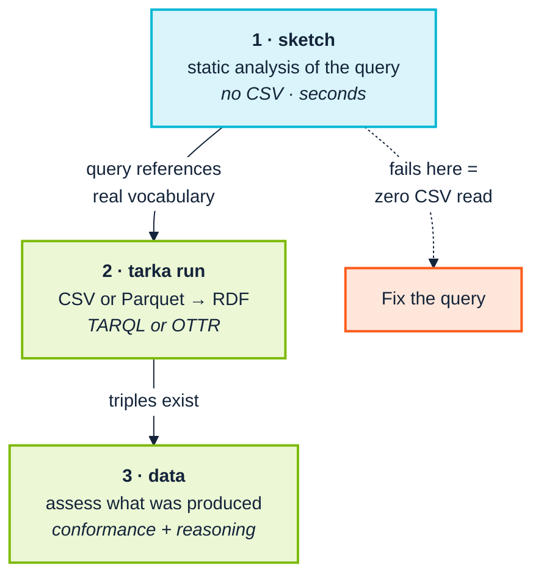

<p align="center">
  
</p>

# 10. Ingest and transform

> **Annotated edition.** After each claim that has been checked, an *Evidence* line links to the commands, data and output behind it in [EVIDENCE.md](../../EVIDENCE.md#chapter-10), which links back here. The plain edition of this page is [here](../../../docs/10-ingest-and-transform.md).

> *Part III — The practice · SemOps stage 6 · Operating-model layer 4*

> **Stories answered here**
> *As a data engineer, I want to know a transformation is wrong before I run it
> over four million rows.*
> *As a data steward, I want to know whether a finding is our problem or an
> upstream vocabulary's.*

Every CSV anyone has ever emailed you is a table of strings. `ENG`, `QA`,
`E004`, `Margaret Hamilton`. Triplification is the moment those strings become
*things*: an employee with an identity, a department you can point at, a
relationship with a name. People in our field like to call that move "strings to
things", and it is a good phrase, because it puts the weight in the right place.
The interesting work is not producing triples. It is deciding which strings
deserve to become which things, and checking that they did.

SemOps layer 4 asks for ETL orchestration, incremental ingestion, data-quality
checks, error handling and provenance capture. This toolchain covers the
**quality and correctness** half thoroughly, now includes a fast triplifier of
its own, and covers the **orchestration** half not at all. There is no scheduler
here, and Airflow, Argo or Prefect remain the right answers for that
([Chapter 14](14-coverage-and-gaps.md)).

What it provides is a three-stage pipeline arranged on one principle:
**cheapest check first**.



---

## 10.1 Before the pipeline: drafting from a CSV

Most real ingestion starts with a CSV somebody emailed you, and the first
question is what the ontology should even look like.

The extension's *Infer Ontology + Query from CSV* profiles a raw CSV, sniffing
types and cardinality, and drafts **both** a starter ontology fragment and a
CONSTRUCT query wired to it. It is a starting point, not an answer. An inferred
model reflects the shape of one extract, not the shape of the domain, and
[Chapter 2](02-people-and-cognition.md)'s exemplar-driven expert will find its
boundary cases in minutes.

The *Query Workbench* is the more durable tool. It gives a live, debounced
preview of the transformation's real output against sample rows, now evaluated
on holos-wasm-node, alongside a static sketch of the CONSTRUCT template and
conformance warnings against the ontology.

The point is the loop length. Discovering a wrong `BIND` after a full pipeline
run is a twenty-minute round trip; discovering it in a live preview is
immediate, and immediate feedback is what makes people willing to iterate on a
transformation rather than settling for the first one that runs without
erroring.

---

## 10.2 Stage 1: `sketch`, before any CSV is read

`sketch` is pure static analysis of the query text against the ontology. It
answers *"does this transformation even reference vocabulary the ontology
declares?"* without touching a single row of data.

```bash
python -m ontology_suite sketch \
  --queries examples/acme_robotics \
  --ontology examples/acme_robotics/acme-org-v1.ttl \
  --import-dir examples/acme_robotics \
  --out-dir out/sketch
```

```
Findings: 38 total (0 Violation, 0 Warning, 38 Info)
Sketch used 1 query file(s); 8 triples, 7 entities.
```

The summary line is the useful part: **8 triples, 7 entities from 1 query
file**. That is the shape the transformation will produce, derived from the
query alone. A reviewer who expected fifteen predicates and sees eight has found
a bug before any data moved.

<a id="ev-c10-01"></a>*Evidence:* [C10.01 — sketch: 38 Infos, 8 triples and 7 entities from one query file](../../EVIDENCE.md#c10-01) (reproduced: PASS)

The 38 Infos are 35 × `CNF-005` (imported classes the sketch never populates,
which is expected) and 3 × `TQL-003`, one each for `?name`, `?role` and
`?skill`. Those three are CONSTRUCT variables bound nowhere in the query, which
in TARQL is ordinarily correct: each CSV header binds a variable of the same
name. The message says exactly that, and asks a reviewer to confirm them against
the header. That is a good model for an Info: a fact, the reason it is usually
fine, and the one thing a person should glance at.

<a id="ev-c10-02"></a>*Evidence:* [C10.02 — The 38 Infos, and what TQL-003 says](../../EVIDENCE.md#c10-02) (reproduced: PASS)

`--queries` takes a file or a directory. Use `--query-pattern` to narrow or widen
the glob. That is the canonical name in every subcommand since 0.15.0, and
`--file-pattern` still works as an alias. (It used to mean the *query* glob in
some commands and the *data* glob in `data`, which was nobody's idea of fun.)

<a id="ev-c10-03"></a>*Evidence:* [C10.03 — --queries, --query-pattern (alias --file-pattern), four extensions](../../EVIDENCE.md#c10-03) (reproduced: PASS)

Four extensions are recognised as transformation queries: **`.sparql`, `.rq`,
`.tarql` and `.tq`**. The pairing with a CSV is by filename convention, and the
point worth drawing out is that **the mapping is a query in source control**,
diffable in a pull request and testable on its own, rather than transformation
code buried in a script. That is what makes the ingest layer reviewable by
someone who did not write it.

### The query itself is checked

Five checks in the registry look at the transformation rather than the graph it
produces:

| Check | What it catches |
|---|---|
| `TQL-001` | One target variable bound by structurally different expressions in different query files |
| `TQL-002` | A `?x_IRI` variable used in the `CONSTRUCT` but never bound |
| `TQL-003` | A `CONSTRUCT` variable neither bound nor appearing in the `WHERE` |
| `TQL-004` | A `?x_IRI` bound to `CONCAT` with nothing turning the result into an IRI |
| `TQL-005` | A `?x_DT` variable never given a datatype with `STRDT()` |

`TQL-004` repays reading twice. SPARQL's `CONCAT` returns a **string**, and TARQL
does not coerce it, so a variable named `?person_IRI` that is built by `CONCAT`
and never wrapped in `IRI()` fails in one of two quiet ways, depending on where
it sits. As a subject it produces nothing at all, because a string cannot be a
subject and every triple built on it is dropped. As an object it produces a
string literal where the model says there should be an IRI, so the data loads,
the counts look right, and every join through it finds nothing. Either way the
run exits 0. It's the strings-to-things move quietly not happening. (The
check's own message says only the first, *"Every triple using it is
dropped"*; tarka shows both.)

<a id="ev-c10-05"></a>*Evidence:* [C10.05 — A CONCAT-built IRI: dropped as a subject, a literal as an object](../../EVIDENCE.md#c10-05) (reproduced: PASS)

Two of these rest on a naming convention: `?x_IRI` for a constructed IRI, `?x_DT`
for a value given an explicit datatype. Adopt it even if you never run the
checks. It puts the intent in the variable name, where a reviewer sees it.

Since 0.17.0 the TARQL checks carry their position as **fields**
(`oq:sourceFile`, `oq:sourceLine`) rather than as `"(draft_alarms.rq:20)"` tacked
onto the message. A finding then lands in `findings.txt` under the file and line
it is about, and a script can sort and filter on it.

<a id="ev-c10-04"></a>*Evidence:* [C10.04 — TQL-004, with its position as fields](../../EVIDENCE.md#c10-04) (reproduced: PASS)

The stage also writes **`bind-facts.ttl`**, a node per `BIND` carrying its
target, expression, skeleton, file and line, plus one per `CONSTRUCT` variable
recording whether it is bound, and a plain-text **`bind-review.txt`** that
answers the three questions a reviewer asks of a set of `BIND`s. It is a small
instance of a habit I like a great deal: the transformation's own structure has
been turned into a graph, so it can be queried with the same tools as
everything else. Metadata about the mapping and the data it makes sit on the
same plane. You don't have to lift the pen and go somewhere else to ask about
either.

<a id="ev-c10-06"></a>*Evidence:* [C10.06 — sketch writes bind-facts.ttl and bind-review.txt](../../EVIDENCE.md#c10-06) (reproduced: PASS)

Because `sketch` needs no CSV, no triplifier and no data access, it is the right
gate for a pull request that changes a transformation query. It runs in seconds
and needs no production data in CI.

---

## 10.3 Stage 2: produce real RDF with `tarka`

The previous editions used `oxi-gen`, Semantic Arts' TARQL engine, which the
suite's `triplify` command drives. That still works. But the toolchain now has a
triplifier of its own, **tarka**, and it is the one I would reach for first.

```bash
tarka run -q examples/acme_robotics/employees.rq \
          -i examples/acme_robotics/employees.csv \
          -o out/triplify/employees.ttl
```

The output is genuine RDF, and for this fixture it is the same, term for term
and line for line, as the `oxi-gen` output quoted in earlier editions:

<a id="ev-c10-07"></a>*Evidence:* [C10.07 — tarka's output for E004 is the block quoted in earlier editions](../../EVIDENCE.md#c10-07) (reproduced: PASS)

```turtle
@prefix acme: <https://acme.example.org/ns/> .
@prefix foaf: <http://xmlns.com/foaf/0.1/> .
<https://acme.example.org/data/employee/E004> a acme:Employee , acme:Engineer ;
	foaf:mbox <mailto:margaret.hamilton@acme.example.org> ;
	foaf:name "Margaret Hamilton" ;
	acme:hasEmployeeId "E004" ;
	acme:hasRole "Test Engineer" ;
	acme:hasSkill "Automation" ;
	acme:worksIn <https://acme.example.org/data/department/QA> .
```

tarka takes `oxi-gen`'s options (`-q -i -o --ntriples -d -t -p -H -n --split
--dedup --test --bind-empty-strings --gzip`) and evaluates the `WHERE` clause on
spareval, the same evaluator `oxi-gen` and HOLOS use. Its own measurement, on a
200,000-row retail file across 8 cores, has it running the TARQL query 1.7
times as fast as `oxi-gen`, and the equivalent OTTR templates 2.6 times as
fast. `--test N` triplifies only the first *N* rows. Make that a habit before
every full run: it costs seconds and catches the transformation that is
syntactically fine and semantically wrong.

<a id="ev-c10-08"></a><a id="ev-c10-09"></a>*Evidence:* [C10.08 — tarka takes oxi-gen's options; --test N reads N rows](../../EVIDENCE.md#c10-08) (reproduced: PASS) · [C10.09 — 1.7× and 2.6× faster than oxi-gen, by tarka's own measurement](../../EVIDENCE.md#c10-09) (cited)

### TARQL or OTTR: two ways to say the same mapping

tarka also reads **OTTR templates**, in the stOTTR syntax, and compiles both to
one plan. To check the claim, I wrote the acme mapping as a template:

```stottr
@prefix mailto: <mailto:> .

acme:Employee [ ottr:IRI ?employee, xsd:string ?name, ottr:IRI ?mbox, xsd:string ?id,
                ottr:IRI ?dept, xsd:string ?role, xsd:string ?skill ] :: {
    ottr:Triple(?employee, rdf:type, acme:Employee),
    ottr:Triple(?employee, rdf:type, acme:Engineer),
    ottr:Triple(?employee, foaf:name, ?name),
    ottr:Triple(?employee, foaf:mbox, ?mbox),
    ottr:Triple(?employee, acme:hasEmployeeId, ?id),
    ottr:Triple(?employee, acme:worksIn, ?dept),
    ottr:Triple(?employee, acme:hasRole, ?role),
    ottr:Triple(?employee, acme:hasSkill, ?skill)
} .
```

```bash
tarka lint -l employees.stottr
# 1 template: 0 errors, 0 warnings
tarka run -l employees.stottr -T acme:Employee -i employees.csv --ntriples
```

Sorted, the 40 triples are identical to the TARQL query's. Verified.

<a id="ev-c10-10"></a>*Evidence:* [C10.10 — The OTTR template lints clean and gives the same 40 triples](../../EVIDENCE.md#c10-10) (reproduced: PASS)

Which should you use? They put the work in different places. A TARQL query
*builds* IRIs in its `WHERE` clause, which is exactly what `sketch` and the `TQL`
checks can inspect. An OTTR template *receives* IRIs and typed values through
parameters, and its library is type-checked by `tarka lint` against OTTR's own
type system. Templates are also modules. You can load a published library and
your own on top of it, use any template as the root, and give several roots per
row. In a piece I wrote for Semantic Arts about moving from labels to verbs, I
described information "bricks" that can be assembled, like Lego, into a house
or a boat or a space rocket. OTTR templates are about as close to that as our
field has come.

> **One silent failure, found while checking this.** My first version of the
> template had no `@prefix mailto:` line. tarka did not accept the `mailto:…`
> cells as IRIs (each looks exactly like a prefixed name with an undeclared
> prefix, and declaring `mailto:` fixed it), and, because `?mbox` is mandatory,
> dropped **every row**. Exit 0, no message, zero
> triples. Making the parameter optional instead dropped just the mailbox triple,
> equally quietly. In bOTTR mode tarka reports every instance it leaves out and
> exits 1. The `run` path does not, yet ([Chapter 14](14-coverage-and-gaps.md)
> §14.4). (The two modes also disagree about the cell itself. The same rows
> through a bOTTR map come out whole, because bOTTR reads a cell typed
> `ottr:IRI` as a full IRI, and `mailto:…` is one.) Until it does, **count what came out**: an empty output from a
> non-empty input should fail your pipeline.

<a id="ev-c10-11"></a>*Evidence:* [C10.11 — Without a mailto: prefix, run -l drops every row, silently](../../EVIDENCE.md#c10-11) (reproduced: PASS)

### Data frames, not just CSV

`-i` takes Parquet and Arrow IPC files as well as CSV, read with Polars, and the
Python module (`pip install tarka-rdf`, imported as `tarka_rdf`) maps a
`polars.DataFrame` straight to a frame of triples. Typed columns become typed
literals, so an integer column feeding an `xsd:integer` OTTR parameter gives
`"42"^^xsd:integer` without anyone writing `STRDT`. TARQL still binds every cell
as a plain string, as it does for CSV. For a data team that already lives in
data frames, this is the shortest path from where their data is to a graph.

<a id="ev-c10-12"></a>*Evidence:* [C10.12 — Parquet input, data frames, and typed literals from typed columns](../../EVIDENCE.md#c10-12) (reproduced: PASS)

### Shapes from the mapping, and what they cannot tell you

```bash
tarka shapes -q examples/acme_robotics/employees.rq -o employees.shapes.ttl
```

writes SHACL shapes for what the mapping *makes*:

```turtle
shape:EmployeeShape a sh:NodeShape ;
    sh:targetClass acme:Employee ;
    sh:property
        [ sh:path foaf:mbox ; sh:nodeKind sh:IRI ] ,
        [ sh:path foaf:name ; sh:datatype xsd:string ] ,
        [ sh:path acme:hasEmployeeId ; sh:datatype xsd:string ] ,
        ...
        [ sh:path acme:worksIn ; sh:nodeKind sh:IRI ] .
```

and `tarka run … --validate` checks the output against them. On the acme data
they conform.

<a id="ev-c10-13"></a>*Evidence:* [C10.13 — Shapes from the mapping, and --validate conforms](../../EVIDENCE.md#c10-13) (reproduced: PASS)

That is useful, and it is worth being exact about why. These shapes are a
**regression guard**: if a later edit to the mapping starts producing a literal
where it used to produce an IRI, they will catch it. What they cannot do is tell
you the mapping is *right*, because they were derived from the mapping. They
restate what it does. In a moment, `data` will find that every employee
`worksIn` a department nobody created. The generated shapes are perfectly
content with that, because `sh:nodeKind sh:IRI` is exactly what the mapping
makes. It's the same principle as the hand-written fixture in
[Chapter 7](07-the-toolchain.md) §7.1: **a check derived from the
implementation agrees with the implementation, including on the day it is
wrong.** Use generated shapes alongside model-derived ones, never instead of
them.

<a id="ev-c10-14"></a>*Evidence:* [C10.14 — Generated shapes accept the dangling departments](../../EVIDENCE.md#c10-14) (reproduced: PASS)

### Straight into a store

```bash
tarka run -q employees.rq -i employees.csv \
  --post http://127.0.0.1:7878/graph \
  --graph https://acme.example.org/graph/triplified/employees
```

streams the output as N-Triples into a SPARQL Graph Store Protocol endpoint as it
is made, in one request and therefore one transaction: here HOLOS's
`holos-server`, which serves the protocol at `/graph`, and equally Oxigraph,
Fuseki or GraphDB. A run that fails part-way ends the request with an error, so
the store takes nothing. Verified for this edition against `holos-server`: the
graph arrived whole, 40 triples. Note the `--graph`: per-source
named graphs are nearly free here and nearly impossible to add later
([Chapter 13](13-operate-and-consume.md) §13.1).

<a id="ev-c10-15"></a>*Evidence:* [C10.15 — --post streams into holos-server: the graph arrives whole](../../EVIDENCE.md#c10-15) (reproduced: PASS)

tarka speaks the protocol rather than linking any particular store in, and its
own reasoning is worth quoting for anyone designing across an organisational boundary: the
protocol reaches every store alike. tarka works in RDF 1.1 and SPARQL 1.1, and
builds the SHACL engine without its RDF 1.2 feature so that nothing in its build
starts parsing RDF 1.2 by accident.

<a id="ev-c10-16"></a>*Evidence:* [C10.16 — tarka speaks the protocol, in RDF 1.1, with the engine built without RDF 1.2](../../EVIDENCE.md#c10-16) (cited)

### The suite's `triplify`, for now

`python -m ontology_suite triplify` still shells out to the `oxi-gen` binary
(`--oxi-gen-bin`, or `ONTOLOGY_SUITE_OXI_GEN_BIN`), as does the extension's *Run
Full Triplify*. Neither knows about tarka yet. Point `data` at tarka's output,
as the rest of this chapter does, and nothing downstream notices the
difference. If you have no `oxi-gen` build, `triplify` says so in a warning and
produces nothing ([Chapter 14](14-coverage-and-gaps.md) §14.7).

<a id="ev-c10-17"></a>*Evidence:* [C10.17 — The suite's triplify still needs oxi-gen, and says so](../../EVIDENCE.md#c10-17) (reproduced: PASS)

---

## 10.4 Stage 3: `data`, assess what was actually produced

```bash
python -m ontology_suite data out/triplify/employees.ttl \
  --ontology examples/acme_robotics/acme-org-v1.ttl \
  --import-dir examples/acme_robotics \
  --engine sparql --out-dir out/data --fail-on never
```

```
Findings: 550 total (68 Violation, 363 Warning, 119 Info)
```

<a id="ev-c10-18"></a>*Evidence:* [C10.18 — data: 550 unscoped, 55 scoped (with HermiT running)](../../EVIDENCE.md#c10-18) (reproduced: PASS)

Five hundred and fifty, and [Chapter 9](09-continuous-integration.md)'s lesson
applies identically. Scope it:

```bash
python -m ontology_suite data out/triplify/employees.ttl \
  --ontology examples/acme_robotics/acme-org-v1.ttl \
  --import-dir examples/acme_robotics \
  --engine sparql \
  --own-namespace "https://acme.example.org/" \
  --out-dir out/data_own --fail-on never
```

```
Findings: 55 total (13 Violation, 40 Warning, 2 Info)
```

Note the namespace here is `https://acme.example.org/`, one level up from the
ontology's `https://acme.example.org/ns/`, because the data individuals live
under `https://acme.example.org/data/`. The filter is a literal prefix match, so
it must cover **both** the schema terms and the instance IRIs. Choosing that
prefix deliberately is part of designing your IRI scheme, and it is much easier
to get right at the start than to retrofit.

### 54 or 55, and why the report cannot tell you which

That run gave 55 three times running. The fourth time it gave 54. The missing
finding is `REA-021`, HermiT's verdict that `acme:Contractor` is unsatisfiable,
and it is missing because HermiT did not start.

<a id="ev-c10-19"></a>*Evidence:* [C10.19 — 54 when HermiT does not run, and the scoped report cannot say so](../../EVIDENCE.md#c10-19) (reproduced: PASS)

Earlier editions said you could tell which had happened from the report: *"if
`REA-021` is present you got the reasoner, and if `REA-022` is present you did
not."* The first half is true. The second half is not, and I should have caught
it sooner. `REA-022`'s focus node is `oq:Graph`, a finding about the run rather
than about any term, so a scoped run filters it out with everything else that
isn't yours. I checked three 54-finding runs: none contains `REA-021` and none
contains `REA-022`. **A scoped `data` gate cannot tell "HermiT checked and found
nothing" from "HermiT never ran".**

That is [Chapter 4](04-from-research-to-industry.md)'s distinction, between *we
checked* and *we could not check*, being erased by the very filter
[Chapter 9](09-continuous-integration.md) recommends. What to do about it:

- **Run the reasoner's verdict unscoped.** `ontology --ontology … --fail-on
  never` in the same job, asserting no `REA-022` in its `full_results.csv`, puts
  the "did it run?" question somewhere the filter cannot reach.
- **Or assert the positive.** If your ontology has a known contradiction you
  keep as a canary, as the fixture does, assert that `REA-021` is present.
- **And ask for the fix.** Findings about the run itself should survive the
  filter. That is the improvement [Chapter 14](14-coverage-and-gaps.md) §14.4
  suggests.

### What those findings actually say

Scoped, the findings become readable, and they fall into three genuinely
different kinds. Teach the distinction explicitly: treating them alike is what
makes people ignore all three.

**Real data defects.** The largest group:

<a id="ev-c10-20"></a>*Evidence:* [C10.20 — Real defects: every worksIn target is untyped and dangling](../../EVIDENCE.md#c10-20) (reproduced: PASS)

```
STR-006 [Violation]  Untyped object of a triple
   Object .../data/department/ENG of triple (.../employee/E001 acme:worksIn)
   is never given a type

DAT-002 [Warning]  Dangling IRI reference
   Reference target .../data/department/ENG is never used as a subject
```

Both are correct, and both point at the same real gap. The transformation
produces employees who `worksIn` a department IRI, but **nothing in the pipeline
ever produces the departments themselves**. Every employee references something
that does not exist in the graph. This is exactly the defect this stage exists
to catch. It is invisible in the CSV, invisible in the query text, invisible to
the shapes tarka generated, and obvious the moment you assess the output.

Read the list to the end, though. Of the ten of each, five are the departments.
The other five are the `mailto:` mailboxes, which are IRIs nobody intends to
describe. Same check, same severity, and not the same kind of finding at all.
Deciding that, once, and writing it down as a house rule or an exemption, is
what stops the real five being lost among the other five.

<a id="ev-c10-21"></a>*Evidence:* [C10.21 — Half the defects are mailboxes](../../EVIDENCE.md#c10-21) (reproduced: PASS)

**Inherited schema problems.** `LOG-001`, `QUA-001` on `acme:hasSkill`, `STR-003`
and `STY-002` on `acme:reports_to`: the same ontology findings as
[Chapter 8](08-model-and-validate.md), reappearing because `data` evaluates the
ontology alongside the data. Not new information; not noise either. If the
schema is broken, the data built on it inherits the problem.

**Coverage signals, not errors.**

```
CNF-005 [Info]  Ontology class never populated
   Class acme:Contractor is declared in the ontology but the data graph
   never uses it as an rdf:type
```

Nothing is wrong. `acme:Contractor` is declared and this extract has no
contractors. As an Info that is right, and genuinely useful: a class that is
*never* populated across any extract is either dead vocabulary or a
transformation that quietly stopped emitting it. Review it periodically; never
fail a build on it.

<a id="ev-c10-22"></a>*Evidence:* [C10.22 — CNF-005: Contractor never populated](../../EVIDENCE.md#c10-22) (reproduced: PASS)

### The reasoner, when it turns up

When HermiT starts, the scoped run carries one extra finding:

<a id="ev-c10-23"></a>*Evidence:* [C10.23 — REA-021 confirms LOG-001 by a different route](../../EVIDENCE.md#c10-23) (reproduced: PASS)

```
REA-021 [Violation]  Class found unsatisfiable by an external DL reasoner
   acme:Contractor is unsatisfiable (equivalent to owl:Nothing)
   according to the hermit reasoner
```

HermiT has independently confirmed what the pattern-based `LOG-001` found by a
completely different route: a rule-based closure and a real description-logic
reasoner agreeing on the same contradiction. Two independent confirmations of
one deliberate flaw is the ideal outcome, and it is why the suite runs both
rather than choosing.

Whether it turns up is decided by Python's hash seed. Earlier editions called it
per-invocation flakiness, and so did the suite's own walkthrough (*"occasionally
environment-flaky"*). Across this edition's unpinned runs it did look like a coin
toss: five in eight for scoped `data`. Pin `PYTHONHASHSEED` and it very nearly
stops. On this fixture seed 5 gave 55 in every run, and seed 0 gave 54 in nine runs
out of ten, because owlready2 fails to load FOAF's `foaf:primaryTopic` in some
orders, before HermiT is ever called ([Chapter 14](14-coverage-and-gaps.md) §14.4,
which also says what is known about the tenth). Set the seed for the whole CI job, and have the job
record which verdict it got rather than assume one.

<a id="ev-c10-24"></a>*Evidence:* [C10.24 — The suite's walkthrough called it environment-flaky](../../EVIDENCE.md#c10-24) (cited)

### Large graphs

For a data graph too large to reason over in full, `--sample N` caps the
*reasoning* pass to a bounded-description sample of *N* named subjects, while
still running the full (cheap) registry over everything:

<a id="ev-c10-25"></a>*Evidence:* [C10.25 — --sample caps the reasoning pass](../../EVIDENCE.md#c10-25) (reproduced: PASS)

```bash
python -m ontology_suite data out/triplify/employees.ttl \
  --ontology examples/acme_robotics/acme-org-v1.ttl \
  --sample 5000 --engine sparql --out-dir out/data
```

This is the Level-4 "operations at scale" adaptation in
[Chapter 6](06-stages-and-stories.md): reasoning is the expensive stage, and
sampling it is what keeps a nightly job inside its window.

---

## 10.5 Whose problem is it?

This is the question a data steward asks most often, and the split above answers
it in general form:

| Finding is about | Owner | Action |
|---|---|---|
| Your instance data | Data engineer | Fix the transformation or the source |
| Your ontology | Ontology owner | Fix the schema; it will recur on every extract |
| An upstream vocabulary | Nobody here | Filter it out of the gate; audit periodically |
| Coverage (`CNF-005`) | Data steward | Review, do not gate |
| The run itself (`REA-022`) | Whoever owns the pipeline | Never filter it away; assert on it unscoped |

The most expensive mistake is treating row 3 as row 1: engineers spending days
proving that a finding against someone else's vocabulary is not their fault.
`--own-namespace` exists to make that impossible. The newest row is the
reminder that a filter which removes everything that isn't yours can also remove
the one finding that is about *you*.

---

## 10.6 When every file is right and the set is wrong

Real projects do not have one mapping. They have a folder of them, written by
different people at different times against different versions of the model. The
failures that follow are the ones nobody sees, because **every file is
individually correct and the set disagrees with itself**.

The testing repository's competency questions 32 to 38 are about exactly this:

<a id="ev-c10-26"></a>*Evidence:* [C10.26 — CT-32 to CT-38: when every file is right and the set is wrong](../../EVIDENCE.md#c10-26) (cited)

| Question | What goes wrong |
|---|---|
| CT-32 | A template hangs a property off a class outside its `rdfs:domain` |
| CT-33 | A mapping still builds a term the model has deprecated |
| CT-34 | One class is built with different property sets by different files |
| CT-35 | One predicate is typed in one mapping and a plain string in another |
| CT-36 | A term resolves only because every file was named on the command line, not through `owl:imports` |
| CT-37 | Two mappings disagree about what a prefix means |
| CT-38 | The output moves where no move was intended, against a golden copy |

CT-32 taught me something. Its fixture includes a mapping that is wired to no CSV
at all, so it is never triplified, and `CNF-003`, the data-side check for a
property used outside its domain, can never see it. A mapping that has not run
cannot be checked by anything that waits for its output. **Check mappings as
mappings, before data exists**, as well as checking what they make.

<a id="ev-c10-27"></a>*Evidence:* [C10.27 — CT-32's mapping is wired to no CSV](../../EVIDENCE.md#c10-27) (cited)

The suite now publishes two facts that make set-level questions a query rather
than a script:

<a id="ev-c10-28"></a>*Evidence:* [C10.28 — tq:PrefixBinding and the per-file sketch dataset](../../EVIDENCE.md#c10-28) (reproduced: PASS)

- **`tq:PrefixBinding`**: one node per `PREFIX` declaration, with the prefix, the
  namespace and the file. "One prefix bound to two namespaces by two files" is
  then a `GROUP BY`. Nothing else can see it, because each file is internally
  consistent.
- **A per-file sketch dataset**: the same sketch with each query file's triples
  in a named graph named after the file, so `GRAPH ?g { … }` asks per-file
  questions. The default graph still holds the union, so a check written for the
  merged sketch keeps working.

You will notice that both are, again, the mapping's own structure turned into
graph data and put on the same plane as everything else.

> **And one thing the merged sketch gets wrong.** I checked this with a
> three-file set of my own, in which one older mapping bound `acme:` to a hash
> namespace. `sketch` printed *"prefix 'acme:' redefined … keeping first
> definition"* and then read **every** file with the first file's binding. The
> two files written against the ontology's own namespace were reported as
> building undeclared terms (`CNF-001`, `CNF-002`) in the hash namespace, and
> `acme:Employee`, which both of them build, as never populated (`CNF-005`).
> Take the odd file out and the same two files are clean. The per-file dataset
> reads all three correctly. Until the merged sketch does too, treat that
> warning as an error: a prefix bound two ways is CT-37's question, and a
> `GROUP BY` over the `tq:PrefixBinding` facts answers it.

<a id="ev-c10-29"></a>*Evidence:* [C10.29 — The merged sketch reads every file with the first file's prefixes](../../EVIDENCE.md#c10-29) (reproduced: PASS)

---

## 10.7 What is not here

Stated plainly, because SemOps layer 4 asks for it and this toolchain does not
provide it:

- **Orchestration and scheduling.** No DAG, no retry logic, no backfill. Airflow,
  Argo Workflows or Prefect, calling these commands as steps.
- **Incremental ingestion.** Every `data` run is a full pass. Incrementality is
  your pipeline's job.
- **Streaming.** This is batch. tarka streams its *output* into a store, but
  Kafka-shaped ingestion is out of scope.
- **Provenance capture, mostly.** tarka's `--graph` puts each load in its own
  named graph, which is the practical minimum and costs nothing. The tooling does
  not stamp per-statement provenance onto the output;
  [Chapter 3](03-across-the-boundary.md) §3.4 discusses the options.

That last one is worth planning before your first production load, not after.
[Chapter 3](03-across-the-boundary.md) explains why it becomes urgent the moment
data crosses an organisational boundary.

---

## 10.8 Maturity checkpoint

Running `sketch` as a query-PR gate, triplifying with `--test` before full runs,
and `data --own-namespace` on the output (with the reasoner's verdict asserted
unscoped) gives you **Level 3's data-quality dimension**: quality checks
automated, regressions caught early.

Level 3 also expects orchestrated ETL and ingestion monitoring, which are not
here. Level 4 expects continuous ingestion with error handling and retry logic,
also not here. Those are real gaps, not omissions from this chapter; see
[Chapter 14](14-coverage-and-gaps.md).

---

| ← [9. Continuous integration](09-continuous-integration.md) | [11. Rules and inference →](11-rules-and-inference.md) |
|---|---|
