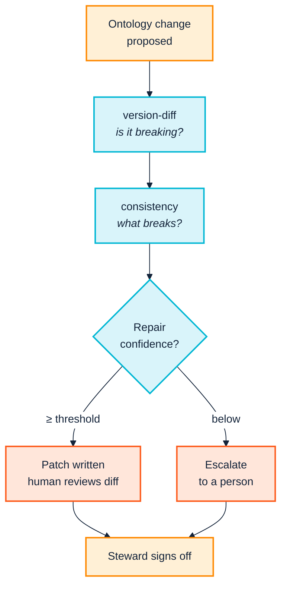

<p align="center">
  
</p>

# 12. Release and change

> **Annotated edition.** After each claim that has been checked, an *Evidence* line links to the commands, data and output behind it in [EVIDENCE.md](../../EVIDENCE.md#chapter-12), which links back here. The plain edition of this page is [here](../../../docs/12-release-and-change.md).

> *Part III — The practice · SemOps stages 1 and 4 · Operating-model layers 1 and 2*

> **Stories answered here**
> *As a domain steward, I need to know whether this release is breaking, and what
> breaks, before I approve it.*
> *As the person who has to fix the fallout, I want the mechanical part of the
> migration done for me.*

Gone are the days, or they should be, when a release meeting was decided by
whoever argued longest. "Is this a breaking change?" is a question that sounds as
if it needs judgement, and in most rooms it gets settled by confidence. The most
certain voice wins, the decision goes into nobody's notes, and six months later
the same argument happens again with different people.

The SemOps overview puts Knowledge Lifecycle Management first and calls it *"the
backbone of semantic governance"*: versioning, schema evolution, change-impact
analysis, approval workflows. This chapter is the most governance-facing in the
manual, and it is where the toolchain does something genuinely useful for the
people in that room. It turns *"is this breaking?"* from an opinion into a
command.

---

## 12.1 Evidence-based semver: `version-diff`

```bash
python -m ontology_suite version-diff \
  examples/acme_robotics/acme-org-v1.ttl \
  examples/acme_robotics/acme-org-v2.ttl \
  --exclude-imports --out-dir out/version-diff --json
```

Real output (IRIs shortened to `acme:` here for width):

<a id="ev-c12-01"></a>*Evidence:* [C12.01 — version-diff: the verdict comes from the axioms](../../EVIDENCE.md#c12-01) (reproduced: PASS)

```
Removed classes [MAJOR]:
  - acme:Engineer

Removed subclass edges [MAJOR]:
  - acme:Engineer no longer rdfs:subClassOf acme:Employee

Added classes [minor]:
  - acme:ProductManager
  - acme:SoftwareEngineer

Added properties [minor]:
  - acme:hireDate

Added subclass edges [minor]:
  - acme:ProductManager rdfs:subClassOf acme:Employee
  - acme:SoftwareEngineer rdfs:subClassOf acme:Employee

Added equivalentClass axioms [minor]:
  - acme:Engineer equivalentClass acme:SoftwareEngineer

Suggested version bump: MAJOR
```

Note the argument order: **old first, then new**. Reversed, you get a diff
describing the inverse release.

<a id="ev-c12-02"></a>*Evidence:* [C12.02 — Reversed, the diff describes the inverse release](../../EVIDENCE.md#c12-02) (reproduced: PASS)

**Note also `--exclude-imports` here, where §12.2 uses `--import-dir`.** That is
deliberate. `version-diff` compares Acme's own axioms against Acme's own axioms,
and merging two identical copies of `org:` and FOAF into both sides adds nothing
but time. `consistency` needs the opposite, because its TARQL-alignment check
reads the transformation's vocabulary: without FOAF resolved, `foaf:name` and
`foaf:mbox` are reported as undeclared properties. **Resolve imports when a check
reasons about terms you did not define; exclude them when it only compares terms
you did.** You will meet the same rule again inside a live store
([Chapter 13](13-operate-and-consume.md) §13.1).

<a id="ev-c12-03"></a>*Evidence:* [C12.03 — Without FOAF resolved, consistency reports foaf:name and foaf:mbox](../../EVIDENCE.md#c12-03) (reproduced: PASS)

The verdict comes from what happened to the axioms, not from what the author
believed they were doing. One removed class makes it MAJOR regardless of the
seven additive changes around it, and regardless of anyone's view that "nobody
was using `Engineer` anyway".

That is what makes it useful as a governance instrument. The conversation stops
being *"do you think this is breaking?"* and becomes *"the diff says MAJOR; who
signs off?"* Nobody has to win.

**`--fail-on major`** makes it enforceable, and **`--json`** writes `diff.json`
alongside the human-readable `diff.txt`, which is what
[Chapter 3](03-across-the-boundary.md) recommends attaching to a partner-facing
change notice so downstream tooling can act on it without parsing prose.

---

## 12.2 Change impact: `consistency`

Knowing a release is breaking is half the answer. *What* breaks is the other
half.

The fixture's transformation query types every employee `acme:Engineer`, the
exact term v2 renames.

```bash
python -m ontology_suite consistency \
  --new examples/acme_robotics/acme-org-v2.ttl \
  --old examples/acme_robotics/acme-org-v1.ttl \
  --queries examples/acme_robotics \
  --import-dir examples/acme_robotics \
  --out-dir out/consistency
```

`consistency` runs the version diff *and* checks every transformation query
against the new ontology:

<a id="ev-c12-04"></a>*Evidence:* [C12.04 — consistency: what breaks, and a 100% repair](../../EVIDENCE.md#c12-04) (reproduced: PASS)

```
Suggested version bump: MAJOR

1 class(es) used in TARQL but not declared in the ontology set:
  [undeclared_class] acme:Engineer

1 suggested repair(s):
  [rename_iri] examples\acme_robotics\employees.rq (confidence 100%)
    Update to the renamed ontology term(s): acme:Engineer -> acme:SoftwareEngineer

Wrote 1/1 suggested repair(s) as .patch files under out/consistency/repairs
(confidence >= 50%). Re-run with --apply-repairs to apply them directly.
```

This is SemOps' "change-impact analysis" and "approval workflows for model
changes" made concrete. The steward approving this release is not being asked to
imagine consequences. They are looking at the affected file, the affected term,
and a proposed fix with a confidence score.

By default nothing is modified: repairs are written as reviewable `.patch` files
under `--out-dir/repairs`.

---

## 12.3 The migration annotation, and a correction about its direction

The 100% confidence above is not pattern-matching on names. It comes from an
explicit migration annotation in v2:

```turtle
acme:Engineer owl:equivalentClass acme:SoftwareEngineer .
```

That one triple is a tombstone: it tells every tool that reads the new version
where the old term went. Without it, the tooling falls back to guessing from the
similarity of the local names, which works for a typo fix and fails for a genuine
rename such as `ex:Widget` → `ex:Product`.

Now the correction, and I'd like to make it plainly, because it has been in
every edition of this manual until this one. I told you, in a box headed *"the
gotcha that costs an afternoon"*, that rename detection reads
`owl:equivalentClass` **in one direction only**, from the retiring IRI to its
replacement, and that writing it the other way round silently drops confidence
to name-similarity guessing. I repeated it in
[Chapter 3](03-across-the-boundary.md) and in the roadmap's shortest version,
and built a notebook cell to demonstrate it.

**It is not true, and has not been since suite 0.3.5, released on 12 August
2026**: the day before this manual's first commit. The suite reads
`owl:equivalentClass` and `owl:equivalentProperty` as what they are, symmetric,
and recognises the tombstone at full confidence whichever side you assert it
from. Verified again for this edition on the acme fixture, with the triple
reversed:

<a id="ev-c12-06"></a><a id="ev-c12-07"></a>*Evidence:* [C12.06 — Symmetric since suite 0.3.5, 12 August 2026](../../EVIDENCE.md#c12-06) (cited) · [C12.07 — The reversed equivalentClass at 100%](../../EVIDENCE.md#c12-07) (reproduced: PASS)

```
acme:SoftwareEngineer owl:equivalentClass acme:Engineer .
...
  [rename_iri] employees.rq (confidence 100%)
```

The notebook cell I wrote to show the drop has shown 100% both ways, every time
anyone ran it, and nobody, me included, read the number it printed. If you want
a single sentence to take from this whole manual, you could do worse than that
one. **A demonstration you never read is not a test.**

The direction does still matter in one place, and it is the place where it
should. **`dcterms:isReplacedBy` is directional by definition**: the subject is
replaced by the object. Asserted the right way round it is a 100% tombstone.
Reversed, it says the *new* term was replaced by the *old* one, so the suite
quite properly declines to read it as this rename and falls back to name
similarity:

| Annotation in v2 | Rename confidence |
|---|---|
| `acme:Engineer owl:equivalentClass acme:SoftwareEngineer` | **100%** |
| `acme:SoftwareEngineer owl:equivalentClass acme:Engineer` | **100%** |
| `acme:Engineer dcterms:isReplacedBy acme:SoftwareEngineer` | **100%** |
| `acme:SoftwareEngineer dcterms:isReplacedBy acme:Engineer` | **57%**, below a 0.7 apply threshold |

<a id="ev-c12-05"></a>*Evidence:* [C12.05 — The tombstone is read in both directions; isReplacedBy in one](../../EVIDENCE.md#c12-05) (reproduced: PASS)

So the practical advice changes shape rather than disappearing. **Assert the
tombstone from the retiring IRI anyway.** It reads naturally as "this term went
there", it is the conventional direction, and it is the only one that works if
you, or a partner's tooling, use `dcterms:isReplacedBy`. But you no longer need a
review-checklist item warning that `owl:equivalentClass` will silently betray
you. It won't.

---

## 12.4 Applying repairs

```bash
python -m ontology_suite consistency \
  --new acme-org-v2.ttl --old acme-org-v1.ttl \
  --queries . --import-dir . \
  --apply-repairs --min-confidence 0.7 \
  --out-dir out/consistency
```

```
Applied 1/1 suggested repair(s) directly to their target files (confidence >= 70%).
```

Verified against a scratch copy. Before:

```sparql
?employee a acme:Employee, acme:Engineer ;
```

After:

```sparql
?employee a acme:Employee, acme:SoftwareEngineer ;
```

The confidence gate is the safety mechanism. A 100%-confidence rename backed by an
explicit annotation applies at a 0.7 threshold; a 57% name-similarity guess does
not. Automate what is evidenced; escalate what is inferred.

### It used to mangle comments, and the fix is instructive

The repair was once a textual substitution across the whole file, comments
included. The fixture's query carries an explanatory comment:

<a id="ev-c12-09"></a>*Evidence:* [C12.09 — Comments used to be rewritten too](../../EVIDENCE.md#c12-09) (cited)

```sparql
#   - every row is typed acme:Engineer, which v2.0.0 renames to
#     acme:SoftwareEngineer (with a migration annotation) -- this query is
```

and after `--apply-repairs` on an old build it read:

```sparql
#   - every row is typed acme:SoftwareEngineer, which v2.0.0 renames to
#     acme:SoftwareEngineer (with a migration annotation) -- this query is
```

Nonsense, and worse than leaving it alone. Comments do not execute, so nothing
broke; the next reader was simply told something false. **It now substitutes
outside comments only**: re-verified for this edition, the diff of the repaired
file is the one code line on line 14 and nothing else.

<a id="ev-c12-08"></a>*Evidence:* [C12.08 — --apply-repairs changes the one code line on line 14](../../EVIDENCE.md#c12-08) (reproduced: PASS)

The judgement underneath is worth borrowing. String **literals** are still
rewritten, deliberately: in a TARQL query an IRI template is built out of them,
`CONCAT("acme:_Engineer_", ?id)`, so a term rename usually *must* reach inside a
literal. That is a decision about this domain, not a general rule, which is why
the fix is not simply "substitute outside comments and strings".

<a id="ev-c12-10"></a>*Evidence:* [C12.10 — String literals are still rewritten, deliberately](../../EVIDENCE.md#c12-10) (reproduced: PASS)

**The same defect existed in the editor, and neither side knew.** The extension's
rename and find-references made the identical mistake for the identical reason,
and both were fixed in the same week, independently, in two languages
([Chapter 8](08-model-and-validate.md) §8.1). The comment scanner is one of a
handful of algorithms written twice rather than shared as data, the class of
thing the registry's parity test cannot see; [Chapter 7](07-the-toolchain.md)
§7.1 has the argument and what was done about it.

<a id="ev-c12-11"></a>*Evidence:* [C12.11 — The same defect in the editor](../../EVIDENCE.md#c12-11) (cited)

**The practical consequence is unchanged:** prefer the default dry run in
automation, review the `.patch` files, and apply. `--apply-repairs` suits a
developer who will read the diff before committing, not an unattended job that
commits its own output.



---

## 12.5 The taxonomy layer: `pattern-consistency`

Many organisations start their semantic journey the way a child starts language:
with labels. A controlled list of departments, a taxonomy of product types, a
picklist somebody maintains in a spreadsheet. Only later do the verbs arrive, the
properties of an ontology that relate one thing to another. Most real systems
carry both layers at once, and the boundary between them is where things drift.

`consistency` has a documented blind spot here: it has no notion of a
**taxonomy**, a controlled vocabulary of permitted values sitting on top of the
ontology. `pattern-consistency` checks that boundary and the three around it
together: ontology ↔ taxonomy ↔ transformation ↔ output data.

The fixture is built to exercise exactly this. `taxonomy.ttl` declares three
valid departments as SKOS concepts:

```turtle
dept:ENG a acme:Department, skos:Concept ;
    skos:inScheme acme:DepartmentTaxonomy ;
    skos:prefLabel "Engineering"@en .
```

`ENG`, `QA` and `SALES`. But `employees.csv` contains a row whose department is
`MKT`.

```bash
python -m ontology_suite pattern-consistency \
  --queries examples/acme_robotics \
  --ontology examples/acme_robotics/acme-org-v1.ttl \
  --ontology examples/acme_robotics/reference_vocab/foaf.rdf \
  --taxonomy examples/acme_robotics/taxonomy.ttl \
  --output-data out/triplify/employees.ttl \
  --out-dir out/pattern-consistency
```

```
== taxonomy <-> output data ==
  [undeclared_taxonomy_reference] .../data/department/MKT is used as the
  value of acme:worksIn in the data graph but is not declared as an
  individual anywhere in the given taxonomy set.
```

**Caught**, from tarka's output just as from `oxi-gen`'s. And the mechanism
matters, because it is not the obvious one.

<a id="ev-c12-12"></a>*Evidence:* [C12.12 — pattern-consistency catches MKT only from the output data](../../EVIDENCE.md#c12-12) (reproduced: PASS)

The transformation does not hard-code `MKT` anywhere. The department IRI is built
per CSV row:

```sparql
BIND(IRI(CONCAT(..., ?department)) AS ?dept)
```

There is no fixed literal in the query text for a text-level check to flag. The
taxonomy↔transformation check, which looks for values hard-coded in the query
template, cannot see this, and correctly reports nothing. It is the
**`--output-data` layer** that catches it, by comparing the values that actually
appeared in the produced graph against the declared taxonomy.

> **A value that varies per data row cannot be validated by reading the
> transformation. It can only be validated by inspecting the output.** Any
> pipeline whose controlled values come from data rather than from the query
> text needs the output-data layer in its gate, not just the static checks.

Omit `--output-data` and this run reports clean: correctly, and uselessly.

<a id="ev-c12-13"></a>*Evidence:* [C12.13 — Omit --output-data and it reports clean](../../EVIDENCE.md#c12-13) (reproduced: PASS)

> Note the two `--ontology` arguments. `foaf.rdf` is passed explicitly because the
> transformation uses `foaf:name` and `foaf:mbox`; without it, both are reported
> as undeclared properties. `--ontology` is repeatable, and `pattern-consistency`
> requires `--queries`, `--ontology` and `--taxonomy`. `--output-data` is the
> optional one, and the one that does the most work.

---

## 12.6 Governance: what the tooling does and does not do

SemOps layer 1 wants approval workflows, stewardship roles and audit trails.
**The approval workflow is not implemented here, and no tool should claim
otherwise.** What the toolchain provides is the *evidence an approval decision
needs*:

<a id="ev-c12-15"></a>*Evidence:* [C12.15 — The approval workflow is not implemented here](../../EVIDENCE.md#c12-15) (argument)

| Governance question | Command | Evidence produced |
|---|---|---|
| Does this PR introduce a new problem in code we own? | `checks --own-namespace --fail-on Violation` | Pass/fail + findings scoped to your terms |
| Is this breaking, and does it need sign-off? | `version-diff --fail-on major` | MAJOR/minor/patch + the axioms behind it |
| What exactly breaks downstream? | `consistency --fail-on-anything` | Affected files, terms, and proposed repairs |
| Can any of it fix itself? | `consistency --apply-repairs --min-confidence` | Confidence-gated patches |
| Do controlled values still hold? | `pattern-consistency --output-data --fail-on-anything` | Values in data absent from the taxonomy |

Look at the flags before you copy the commands into a pipeline. `consistency` and
`pattern-consistency` are report-only by default: the run above that found `MKT`
exited 0. Each has its own switch to make it a gate, spelt differently from the
other and from everybody else's `--fail-on`. Without the switch, the job is
green whatever it found.

<a id="ev-c12-14"></a>*Evidence:* [C12.14 — Both consistency commands are report-only by default](../../EVIDENCE.md#c12-14) (reproduced: PASS)

The approval *workflow*, a branch protection rule requiring a named reviewer when
`version-diff` reports MAJOR, is a policy layered on top. That is the right
division of labour. The tool establishes facts; the organisation decides what to
do about them. A tool that tried to encode the decision would be wrong about it
within a quarter, because [Chapter 2](02-people-and-cognition.md)'s territorial
dynamics change faster than any configuration file.

One related control has moved closer to the data since the last edition: **who may
see what**. An embeddable store can now enforce read policy at the index scan, so
a definitions graph can be shared with a partner minus the predicates they should
not see ([Chapter 13](13-operate-and-consume.md) §13.2). It is not an approval
workflow either, but it is one fewer thing left to convention.

For sequencing and rollback across an ontology/taxonomy/data rollout, the
suite's own `UPDATING.md` is the closest existing document to a governance
playbook.

<a id="ev-c12-16"></a>*Evidence:* [C12.16 — UPDATING.md as a governance playbook](../../EVIDENCE.md#c12-16) (cited)

---

> **Run it:** [notebook 3 — Release and change](../../../notebooks/03-release-and-change.ipynb)
> takes an ontology through a breaking release, shows which annotations are read
> in both directions and which are not, and applies the repair.

## 12.7 Maturity checkpoint

`version-diff` on every release, `consistency` before merging a breaking change,
and `pattern-consistency --output-data` where controlled vocabularies exist,
covers Level 3's change-management dimension and reaches into **Level 5's
"continuous semantic improvement loops"**. The diff → impact → repair cycle, run
routinely, is the closest this toolchain gets to Level 5.

The rest of Level 5 is organisational, and no command produces it.

---

| ← [11. Rules and inference](11-rules-and-inference.md) | [13. Operate and consume →](13-operate-and-consume.md) |
|---|---|
