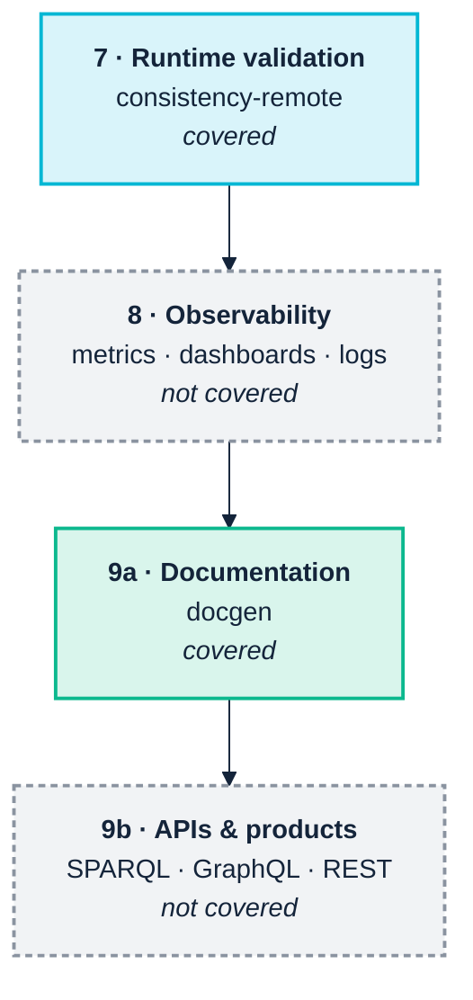

<p align="center">
  
</p>

# 13. Operate and consume

> **Annotated edition.** After each claim that has been checked, an *Evidence* line links to the commands, data and output behind it in [EVIDENCE.md](../../EVIDENCE.md#chapter-13), which links back here. The plain edition of this page is [here](../../../docs/13-operate-and-consume.md).

> *Part III — The practice · SemOps stages 7–9 · Operating-model layers 1 and 6*

> **Stories answered here**
> *As a platform owner, I want the same checks that guard the repository to run
> against what is actually in the triple store.*
> *As a data owner, I want to share a graph without sharing every predicate in
> it.*
> *As an application developer or an agent, I need documentation of what the
> terms mean and a guarantee they will not change under me.*

A scientific article comes with its metadata kept somewhere else: the category,
the authors and their institutions, the place and date of publication. For each
of those you lift the pen and go and look somewhere else. A knowledge graph
built on RDF with resolvable identifiers is not like that. The metadata is more
graph, and you can follow it without lifting the pen. Some years ago I called
this the Möbius-strip approach to information architecture, because metadata
and data end up on the same surface.

I mention it here because the last three pipeline stages are where that idea
either pays off or doesn't. Runtime validation, observability and consumption
are where a knowledge graph earns its keep or quietly becomes a cost centre. It
is also where this toolchain's coverage is thinnest, and this chapter is
explicit about which parts are real and which are grey.



One thing has moved since the last edition, and it does not fit neatly on that
diagram because it cuts across all three stages: **access policy enforced by the
store itself**, from HOLOS's `holosdb` package (§13.2). It is early, and it is
the most interesting addition to this part of the pipeline.

---

## 13.1 Runtime validation against a live store

Everything so far has run against files in a repository. The moment the org chart
moves from Git-tracked Turtle into a real store, a new question appears: **is
what is actually loaded still consistent with what we think we shipped?**

Repository checks cannot answer that. A store drifts through partial loads,
manual fixes, an update applied to one environment and not another, or a graph
someone forgot to reload.

```bash
# the store: HOLOS's server, from the HOLOS release
holos-server --listen 127.0.0.1:7878 --store ./var/acme

python -m ontology_suite consistency-remote \
  --query-endpoint http://127.0.0.1:7878/query \
  --manifest graphs.json \
  --out-dir out/consistency-remote --fail-on-misalignment
```

The store here is the toolchain's own, `holos-server`, but the command speaks the
plain SPARQL 1.1 Protocol, so any endpoint will do. `--auth-user` and
`--auth-password` are there for stores that want HTTP basic authentication.

> **`graphs.json` is not bundled with the fixture, and cannot be.** Unlike every
> other command in Part III, this one has no runnable file to point at, because
> a manifest binds *your* store's named-graph URIs, which nobody else can know.
> You write it once, as below.

### The manifest is the interesting part

A store holds triples, not project metadata. Nothing in it links a named graph
back to the transformation query that produced it, or a data graph to the
ontology graph it is supposed to conform to. The manifest is where a project
records that binding. It is a short JSON file:

```json
{
  "graphs": [
    {
      "graph_uri": "https://acme.example.org/graph/ontology/2.0.0",
      "role": "ontology"
    },
    {
      "graph_uri": "https://acme.example.org/graph/triplified/employees",
      "role": "triplified_data",
      "source_tarql": "queries/employees.rq",
      "ontology_graph_uri": "https://acme.example.org/graph/ontology/2.0.0",
      "notes": "nightly load from the HR extract"
    }
  ]
}
```

| Field | Applies to | Meaning |
|---|---|---|
| `graph_uri` | both | The named graph's URI **as the store knows it** |
| `role` | both | Exactly `"ontology"` or `"triplified_data"`; no other value means anything |
| `source_tarql` | data only | Local path to the query that produced this graph |
| `ontology_graph_uri` | data only | Which `"ontology"` graph this data must conform to |
| `notes` | both | Free text; ignored by the tooling, read by humans |

Or build it in Python, which is worth doing if the URIs come from somewhere
programmatic:

<a id="ev-c13-02"></a>*Evidence:* [C13.02 — The manifest, as JSON or built in Python; the flags](../../EVIDENCE.md#c13-02) (reproduced: PASS)

```python
from ontology_suite.remote.manifest import GraphManifest, GraphBinding

GraphManifest(bindings=[
    GraphBinding(graph_uri="https://acme.example.org/graph/ontology/2.0.0",
                 role="ontology"),
    GraphBinding(graph_uri="https://acme.example.org/graph/triplified/employees",
                 role="triplified_data",
                 source_tarql="queries/employees.rq",
                 ontology_graph_uri="https://acme.example.org/graph/ontology/2.0.0"),
]).save("graphs.json")
```

That structure enables a genuine **three-way check**: the live data graph, the
ontology graph it claims to conform to, and the local query file that produced
it, compared together. It catches the specific and common failure where the
repository is perfectly consistent and the store is a version behind: the
ontology renamed a class, the query was repaired, CI went green, and nobody
reloaded the data. The data graph then still uses the old class, which the
ontology graph no longer declares, and the template and the live data disagree
about it. `--fail-on-misalignment` makes that a non-zero exit.

<a id="ev-c13-03"></a>*Evidence:* [C13.03 — The store a version behind: --fail-on-misalignment exits 1](../../EVIDENCE.md#c13-03) (reproduced: PASS)

`--sample-limit` caps how many triples are pulled per named graph, which is what
makes this viable against a production-sized store. And remember
[Chapter 12](12-release-and-change.md)'s rule here too: if the ontology graph holds
only your own file and not the vocabularies it imports, terms such as `foaf:name`
will be reported as undeclared. Load the imports into a graph the manifest lists.

<a id="ev-c13-01"></a>*Evidence:* [C13.01 — consistency-remote against holos-server; the imports rule applies in the store](../../EVIDENCE.md#c13-01) (reproduced: PASS)

### Finding out what your graph URIs actually are

The manifest must use the store's own URIs, not what you think you loaded. Ask
the endpoint:

```sparql
SELECT ?g (COUNT(*) AS ?triples)
WHERE { GRAPH ?g { ?s ?p ?o } }
GROUP BY ?g ORDER BY DESC(?triples)
```

Run that first, every time, against a store you did not load yourself. A graph URI
that differs by a trailing slash is the commonest reason a three-way check
reports nothing at all.

> **`role` is not validated, and a typo costs you the whole check.** Re-verified at
> 0.22.0: a manifest saying `"triplified-data"` (a hyphen instead of an underscore)
> loads without complaint, contributes zero data bindings, and the run completes
> successfully having compared nothing. It exits 0 even with
> `--fail-on-misalignment`. It is the same silent-zero shape as the
> `--own-namespace` near-miss in [Chapter 9](09-continuous-integration.md) §9.4
> and the shapes-less `shacl` run in [Chapter 11](11-rules-and-inference.md)
> §11.1, and the same defence applies: point it at a graph you know is wrong,
> once, and watch it complain.

<a id="ev-c13-04"></a>*Evidence:* [C13.04 — A mistyped role compares nothing, successfully](../../EVIDENCE.md#c13-04) (reproduced: PASS)

### Named graphs are a decision you make once

[Chapter 3](03-across-the-boundary.md) argued that per-partner named graphs are
the highest-value cross-boundary decision, and this is where it pays off. The
manifest model assumes named graphs. A store where everything was merged into the
default graph cannot express these bindings at all, and cannot answer "which
supplier asserted this?" either. tarka's `--graph` option makes per-source graphs
the path of least resistance at load time, and they are effectively impossible to
retrofit.

> **But SHACL validation itself does not see them.** SHACL is defined over *one*
> data graph, and the engine behaves accordingly: quad syntaxes (TriG, N-Quads)
> parse fine, and every named graph plus the default graph is merged into a single
> graph before validation. So named graphs give you **provenance and lifecycle**
> (which partner sent what, which graph to reload, which to drop) and they do not
> give you **scoped validation**. If you need "validate supplier A's contribution
> against supplier A's contract", extract that graph and validate it as its own
> document. The manifest model above is built for exactly that: it binds each graph
> to the ontology it should conform to, and checks them one at a time rather than
> as a union.

<a id="ev-c13-05"></a>*Evidence:* [C13.05 — SHACL validation flattens named graphs](../../EVIDENCE.md#c13-05) (reproduced: PASS)

---

## 13.2 Access policy at the scan

The newest thing in this part of the toolchain is a store that answers a query
*as somebody*. HOLOS enforces access policy **at the index scan**: each quad is
decided as it comes off the index, before any SPARQL operator sees it. Not by
rewriting the query, and not by filtering the results afterwards.

The property that buys is easy to state and strong: **the answer to a query
equals the answer that query would have over the part of the store the principal
is allowed to see.** It holds for every query shape, without anyone enumerating
them, because no operator has any other way to reach the data.

Here it is through the `holosdb` package from PyPI, on HOLOS's small HR example,
run for this edition:

<a id="ev-c13-06"></a>*Evidence:* [C13.06 — Policy at the scan: rows without the column, unless you are in HR](../../EVIDENCE.md#c13-06) (reproduced: PASS)

```python
from holosdb import Store, Principal, Policy

store = Store()
store.load("hr.trig")

Q = """PREFIX ex: <http://example.com/>
SELECT ?name ?salary WHERE { GRAPH ?g { ?e ex:name ?name
                              OPTIONAL { ?e ex:salary ?salary } } }"""

policy = Policy().deny_predicate("http://example.com/salary", except_role="hr")

store.query(Q, principal=Principal("urn:user:alice"), policy=policy)
# Alice, Bob, Carol, each with no salary
store.query(Q, principal=Principal("urn:user:alice", roles=["hr"]), policy=policy)
# Alice 95000, Bob 88000, Carol 102000
```

The rows still come back; the column does not, unless you are in HR. (Note the
fluent API: each `Policy` method returns a new policy. Calling them as statements
and ignoring the result leaves you with no policy at all, which is a mistake I
made on the first attempt and would rather you didn't.) The places where a
query-rewriting design leaks do not leak:

<a id="ev-c13-07"></a>*Evidence:* [C13.07 — The fluent API mistake](../../EVIDENCE.md#c13-07) (reproduced: PASS)

| You ask | You get |
|---|---|
| `COUNT(*)` of salaries, without the role | `0`: the aggregate counts the visible store |
| Which named graphs exist, with a graph labelled at level 3 and no clearance | The labelled graph is missing from the list, and so is the fact that it exists |
| The same, with `Principal(..., clearance=3)` | All three graphs |
| The salary query with `.fail_closed()` on the policy | `HolosError: access denied by policy`, instead of a silent filter |

All verified at 0.21.0. HOLOS measures the cost at 8 ns per quad, about 1% of
decoding the quad. The `holos query` command from the release takes the same
policy as flags (`--deny-predicate … --except-role hr`, `--label-graph`,
`--fail-closed`) and gives the same answers.

<a id="ev-c13-08"></a><a id="ev-c13-09"></a>*Evidence:* [C13.08 — The holos command gives the same answers](../../EVIDENCE.md#c13-08) (reproduced: PASS) · [C13.09 — 8 ns per quad, by HOLOS's own measurement](../../EVIDENCE.md#c13-09) (cited)

`fail_closed` deserves a sentence of its own. Filtering is the default because the
filtered answer is the *correct* answer for that principal. But a compliance report
or a reconciliation total that is silently partial will be read as complete, and for
those the right behaviour is to fail. Choose per use, deliberately.

Three reasons this matters for SemOps, rather than only for security:

- **It moves an element off the grey list.** *Semantic Governance & Access
  Control* has been "partial: evidence yes, access control no" in every edition.
  Roles, attributes and classification levels now exist, enforced by the store you
  embed. Approval *workflow* still does not.
- **It answers the commercial-sensitivity problem** in
  [Chapter 3](03-across-the-boundary.md). A consortium member can share a graph
  without sharing the predicates that reveal their segmentation, and the policy
  holds for every query a partner could write.
- **It gives agents an identity.** An agent should be a principal with roles, not
  a service account that sees everything ([Chapter 5](05-genai-and-agents.md)).

`holosdb` also validates: `Store.validate("shapes.ttl")` returns a dictionary such
as `{'conforms': False, 'violations': 1, 'engine': 'adapted'}`. Its `native`
engine refuses a shapes graph that uses anything beyond SHACL Core (`sh:sparql`,
for instance) with a `HolosError` naming the construct, rather than dropping the
constraint and answering *conforms*. That refusal is the right one
([Chapter 11](11-rules-and-inference.md)).

Two things to know before you validate a store you care about. **Up to 0.21.0,
validation wrote the shapes into the store** and left them there, in a named
graph of their own (`urn:holos:python:shapes` from Python, `urn:holos:shapes` from
the command line with `--store`). Each further call added another copy, because a
shape's blank nodes are fresh every time, so two people missing a required name
gave 2 violations, then 4, then 6. On a persistent store the copies survived a
restart. Building this edition's evidence found it, and **0.21.1 fixed it the
same day**: the shapes are now read in a scope that is always rolled back, so the
store is exactly as it was afterwards. A shapes graph an earlier version left
behind is reported, with the `DROP GRAPH` that removes it, rather than read or
dropped on your behalf. If you validated a persistent store with 0.21.0, validate
it once with 0.21.1 and read the note.

<a id="ev-c13-10"></a>*Evidence:* [C13.10 — Validation and the store: written into it up to 0.21.0, untouched from 0.21.1](../../EVIDENCE.md#c13-10) (reproduced: PASS)

The other is smaller: the `holos validate` command defaults to the `native`
engine and the Python method to `adapted`, so the same words can run different
validators.

---

## 13.3 Documentation as a product: `docgen`

SemOps lists documentation as a first-class element (*"without it, semantic
systems become opaque"*), and it is the artefact
[Chapter 2](02-people-and-cognition.md) nominated as the answer to the
priesthood problem.

```bash
python -m ontology_suite docgen \
  --ontology examples/acme_robotics/acme-org-v1.ttl \
  --ref examples/acme_robotics/reference_vocab/org.ttl \
  --ref examples/acme_robotics/reference_vocab/foaf.rdf \
  --out-dir out/docgen
```

```
Wrote out/docgen/ontology_doc_data.json: prefix='acme', 4 classes,
  2 object properties, 3 datatype properties, 1 sections,
  5 external terms (3 resolved).
```

<a id="ev-c13-11"></a>*Evidence:* [C13.11 — docgen: 4 classes, 5 external terms, 3 resolved](../../EVIDENCE.md#c13-11) (reproduced: PASS)

You get a self-contained `ontology-documentation.html` (class and property
tables, diagrams, one concise-bounded-description diagram per class) plus
`ontology_doc_data.json`, the machine-readable version. That JSON is easy to
overlook and is the more strategically useful of the two: it is what you feed a
documentation portal, a catalogue, or an agent that needs to know what your terms
mean ([Chapter 5](05-genai-and-agents.md)). The `--ref` vocabularies are read, so
`foaf:Person` and `org:OrganizationalUnit` carry their upstream definitions into
the page; terms with no `--ref` are listed as external and unresolved, which is
the honest outcome.

### Still open: the page is reshuffled on every run

Re-checked at 0.22.0: three identical runs, three different files. The *content*
is canonical; the **order** of the class, property, import and section lists is
not. The cause is below `docgen`. rdflib holds triples in a `set`, and Python
randomises string hashing per process, so the parser hands the extractor its
triples in a different order each time ([Chapter 14](14-coverage-and-gaps.md)
§14.4 traces it). rdflib still does the parsing even though it no longer
evaluates anything, which is why the engine move left this alone.

<a id="ev-c13-12"></a>*Evidence:* [C13.12 — Three runs, three pages; pinned, one](../../EVIDENCE.md#c13-12) (reproduced: PASS)

That matters more for documentation than it would elsewhere. A reference page
exists partly to answer *"what changed this release?"*, which is unanswerable when
every run reshuffles it. And two colleagues generating the page from the same
commit are handed the vocabulary in a different reading order.

**If you generate the page in CI, set `PYTHONHASHSEED=0`.** Re-verified: two
runs, one hash. It is a workaround, not the fix (the fix is to sort on the way
out, ideally into document order), but it costs one environment variable. The same
variable turns out to decide whether the DL reasoner can load FOAF
([Chapter 14](14-coverage-and-gaps.md) §14.4), so set it for the whole job rather
than for this step alone.

### Make it automatic

The maturity model expects documentation *"auto-generated on every commit"* at
Level 3. That is one CI step:

```yaml
- name: Reference documentation
  env:
    PYTHONHASHSEED: "0"        # until docgen sorts its own output
  run: |
    uv run ontology-quality-suite docgen \
      --ontology ontology/acme-org.ttl --out-dir docs/reference
- uses: actions/upload-pages-artifact@v3
  with:
    path: docs/reference
```

Documentation that regenerates itself stays true. Documentation maintained by
hand was true once.

---

## 13.4 Observability: not covered

SemOps stage 8 wants graph size and growth metrics, query-performance dashboards,
SPARQL log analysis, data-quality KPIs, provenance tracking and anomaly
detection. **None of this is in the toolchain.** Prometheus, Grafana and Loki
remain the right answers, exactly as the pipeline blueprint says.

<a id="ev-c13-16"></a>*Evidence:* [C13.16 — Observability and APIs are not covered](../../EVIDENCE.md#c13-16) (argument)

There is one thing worth doing that costs almost nothing, and it is the bridge
between what you have and what you need:

> **Every check run writes `full_results.csv`. Retain them, timestamped.**

<a id="ev-c13-13"></a>*Evidence:* [C13.13 — Every row carries source_file and line](../../EVIDENCE.md#c13-13) (reproduced: PASS)

That file is a time series of your semantic quality. Findings by severity over
time, per check id, is a genuine data-quality KPI, and it comes free from
artefacts CI is already producing. Since 0.17.0 each row also carries
`source_file` and `line`, so the series can be cut by file: which module of the
ontology is accumulating findings. Most teams delete these with the build.

The signal to watch is not the absolute count but the **trend in Warnings**.
Violations get fixed because they fail the build. Warnings accumulate quietly,
and an accumulating Warning count is the observable signature of
[Chapter 1](01-the-business-case.md)'s decay, visible in your own CI artefacts a
year before anyone notices the model has drifted.

---

## 13.5 Knowledge products and APIs: not covered

SemOps stage 9 wants SPARQL endpoints, GraphQL and REST APIs, search indexes, and
data products. Nothing in the toolchain serves an API, and that is application
development rather than quality tooling.

The SemOps material's microservices guidance is the reference here, and its core
architectural point is sound: for low-latency semantic APIs, embed the engine
**in** the service rather than putting a service in front of a remote store. That
point has gained a candidate from inside the toolchain. `holosdb` (Python) and
`holos-wasm` / `holos-wasm-node` (JavaScript) are exactly such embeddable engines,
and they carry the access policy of §13.2 with them, so a service built on one
answers each caller with what that caller may see.

| Language | Engine | Best at |
|---|---|---|
| Rust | Oxigraph | Highest throughput, lowest latency, mature |
| Python · JS | HOLOS (`holosdb`, `holos-wasm`) | Policy at the scan, RDF 1.2, GeoSPARQL; early |
| Python | RDFLib | Analytics, AI/LLM integration |
| Node.js | Comunica | Streaming, web-native, federated |
| Prolog | SWI `semweb` | Rule-heavy, expert-system style |
| Java | Jena / Fuseki | Enterprise-standard, stable |

<a id="ev-c13-14"></a>*Evidence:* [C13.14 — HOLOS: embeddable, RDF 1.2, GeoSPARQL](../../EVIDENCE.md#c13-14) (reproduced: PASS)

HOLOS appears in the editor too: the VS Code extension's checks run on
`holos-wasm-node` ([Chapter 7](07-the-toolchain.md)). That is not a coincidence so
much as a signal: the same embeddable engine can serve the desk and the service.

<a id="ev-c13-15"></a>*Evidence:* [C13.15 — The editor's checks run on holos-wasm-node](../../EVIDENCE.md#c13-15) (cited)

### What consumption demands from everything upstream

Whether the consumer is a React application, a dashboard or an agent, it needs
four things, and all four are produced by earlier chapters, not by the API layer:

| Consumer needs | Produced by | Chapter |
|---|---|---|
| Stable IRIs that do not change meaning | Evidence-based semver, migration annotations | [12](12-release-and-change.md) |
| To know what a term means | `docgen`, `rdfs:label` coverage (`QUA-001`) | This chapter, [8](08-model-and-validate.md) |
| Confidence the data conforms | `data`, `consistency-remote` | [10](10-ingest-and-transform.md), this chapter |
| To know who asserted what, and what they may see | Named graphs; policy at the scan | [3](03-across-the-boundary.md), §13.2 |

An API built on a graph that lacks these will be wrong occasionally and
unpredictably, which is worse than being wrong reliably, because consumers can no
longer calibrate their trust.

---

## 13.6 Maturity checkpoint

`consistency-remote` against a live store, plus `docgen` on every commit, covers
part of Level 4's *"semantic APIs managed and monitored"*: the *managed* half. An
embeddable store that enforces access policy adds a piece of governance that was
missing, early as it is.

The *monitored* half needs an observability stack this toolchain does not provide,
and Level 4 also expects container deployment, automated environment promotion,
and continuous ingestion with retry logic. Those are real gaps, and
[Chapter 14](14-coverage-and-gaps.md) is where they are counted honestly rather
than glossed.

---

| ← [12. Release and change](12-release-and-change.md) | [14. Coverage and gaps →](14-coverage-and-gaps.md) |
|---|---|
